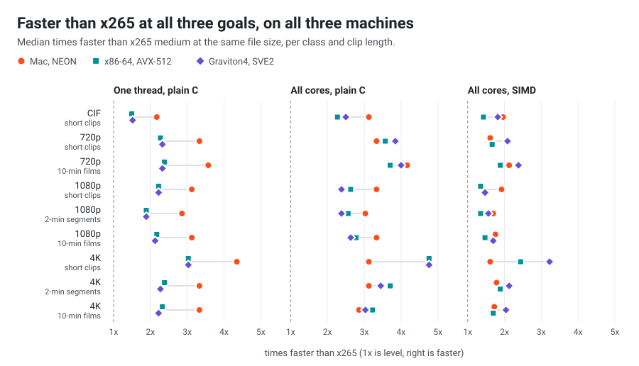
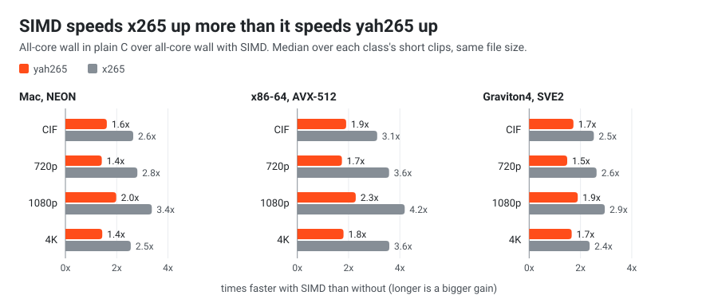
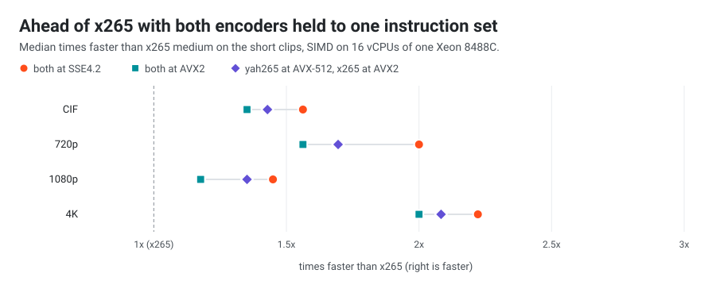

# Architectures

yah265 runs on arm64 and x86-64. This page covers which instruction sets it uses, how it chooses between them and what was tested on which machine.

On this page "2x faster" means half the wall time for a file of the same size.

## Where the speed comes from

An encoder's speed has three layers. The test set times each one.

The first layer is the algorithm, meaning how few candidates the encoder has to try. Because nothing gets help from the hardware at one thread in plain C, that run measures the algorithm alone. Threading is the second layer. The third is SIMD, short for single instruction, multiple data, where one instruction does the same arithmetic on many samples at once. The small hot functions that use it are called kernels. A typical one sums the differences between two blocks.

<figure class="chart wide">

<figcaption>Each side ran <code>medium</code>. The Mac used all 18 cores. On a cloud machine the two encoders were held to 16.</figcaption>
</figure>

yah265's lead is widest in plain C and narrowest with SIMD on. [What SIMD buys](#what-simd-buys) explains why. [Results](results.md#by-machine) has the table behind the chart.

## Supported today

| instruction set | where it ran | what was timed | correctness checks |
|---|---|---|---|
| NEON (arm64) | Apple M5 Max, Graviton4, Graviton3 | all-core SIMD speed on all three | checkasm, C-path comparison, conformance |
| SVE2, 128-bit (arm64) | Graviton4 | the whole test set | checkasm, streams identical to the Mac's |
| SVE, 256-bit (arm64) | Graviton3 | short clips only | timed streams identical to the Mac's |
| AVX-512 (x86-64) | Xeon 8488C | the whole test set | checkasm at all three x86 tiers |
| AVX2 (x86-64) | Xeon 8488C | short clips | checkasm, C-path comparison at 8 and 10 bits |
| SSE4.2 (x86-64) | Xeon 8488C, Rosetta, QEMU's Nehalem model | short clips | checkasm in all three places, C-path comparison, fast conformance |

The whole test set means every class and tier. For the AVX2 and SSE4.2 timings both encoders were capped at that tier. The AVX2 kernels ran both inside the AVX-512 encodes and capped alone. Both ways wrote the same streams. The SSE4.2 checks caught a deliberate break in each kernel family.

The rows follow the coverage table of the [all-architecture parity report](docs/parity/PARITY-REPORT-yah265-all-isa-2026-11-14.md). checkasm is the test program that holds each kernel to its C reference. The C-path comparison encodes the same clip with the kernels on and with them off, then compares the two streams byte for byte.

## Which kernels each tier has

Eight kernel families have NEON, AVX2 and SSE4.2 versions. A kernel ships at the AVX-512 or SVE tier only where it measured faster than the tier below.

| tier | kernel families |
|---|---|
| NEON, AVX2, SSE4.2 | the block-difference metrics, the transforms with the quantizer, intra prediction, coefficient costing, RDOQ, motion compensation, deblocking, SAO |
| AVX-512 | the block-difference metrics, the transforms |
| SVE | the block-difference metrics, one interpolation pass |

On an AVX-512 CPU the other families run their AVX2 kernels.

## How a kernel is picked

The binary holds every tier it was built with. At startup it asks the CPU and the operating system what they support. Each kernel call then goes to the highest tier present.

<figure class="diagram">
<svg class="d-wide" viewBox="0 0 720 304" role="img" aria-label="How a kernel is picked at run time">
<title>How a kernel is picked at run time</title>
<desc>Two ladders. On x86-64 the rungs from the bottom are plain C, SSE4.2, AVX2 and AVX-512. On arm64 they are plain C, NEON, NEON with the dot product extension, and SVE or SVE2. At startup the encoder reads what the CPU has, and each kernel runs on the highest rung it has a version for. The setting N265_CPU_MAX stops both ladders at a chosen rung, and N265_ASM_OFF=all sends every kernel back to plain C.</desc>
<text class="d-text" x="130" y="30" text-anchor="middle">x86-64</text>
<rect class="d-fill" x="40" y="206" width="180" height="42" rx="6"/>
<text class="d-label" x="130" y="224" text-anchor="middle">plain C</text>
<text class="d-label d-muted" x="130" y="240" text-anchor="middle">the reference, on every CPU</text>
<line class="d-arrow d-muted" x1="130" y1="206" x2="130" y2="197"/>
<rect class="d-box" x="40" y="154" width="180" height="42" rx="6"/>
<text class="d-label" x="130" y="172" text-anchor="middle">SSE4.2</text>
<text class="d-label d-muted" x="130" y="188" text-anchor="middle">128-bit</text>
<line class="d-arrow d-muted" x1="130" y1="154" x2="130" y2="145"/>
<rect class="d-box" x="40" y="102" width="180" height="42" rx="6"/>
<text class="d-label" x="130" y="120" text-anchor="middle">AVX2</text>
<text class="d-label d-muted" x="130" y="136" text-anchor="middle">256-bit</text>
<line class="d-arrow d-muted" x1="130" y1="102" x2="130" y2="93"/>
<rect class="d-box" x="40" y="50" width="180" height="42" rx="6"/>
<text class="d-label" x="130" y="68" text-anchor="middle">AVX-512</text>
<text class="d-label d-muted" x="130" y="84" text-anchor="middle">512-bit, some kernels</text>
<text class="d-text" x="590" y="30" text-anchor="middle">arm64</text>
<rect class="d-fill" x="500" y="206" width="180" height="42" rx="6"/>
<text class="d-label" x="590" y="224" text-anchor="middle">plain C</text>
<text class="d-label d-muted" x="590" y="240" text-anchor="middle">the reference, on every CPU</text>
<line class="d-arrow d-muted" x1="590" y1="206" x2="590" y2="197"/>
<rect class="d-box" x="500" y="154" width="180" height="42" rx="6"/>
<text class="d-label" x="590" y="172" text-anchor="middle">NEON</text>
<text class="d-label d-muted" x="590" y="188" text-anchor="middle">128-bit</text>
<line class="d-arrow d-muted" x1="590" y1="154" x2="590" y2="145"/>
<rect class="d-box" x="500" y="102" width="180" height="42" rx="6"/>
<text class="d-label" x="590" y="120" text-anchor="middle">NEON dot product</text>
<text class="d-label d-muted" x="590" y="136" text-anchor="middle">one kernel family</text>
<line class="d-arrow d-muted" x1="590" y1="102" x2="590" y2="93"/>
<rect class="d-box" x="500" y="50" width="180" height="42" rx="6"/>
<text class="d-label" x="590" y="68" text-anchor="middle">SVE or SVE2</text>
<text class="d-label d-muted" x="590" y="84" text-anchor="middle">Linux only, some kernels</text>
<text class="d-label" x="360" y="62" text-anchor="middle">At startup the encoder reads</text>
<text class="d-label" x="360" y="80" text-anchor="middle">what the CPU has. Each kernel</text>
<text class="d-label" x="360" y="98" text-anchor="middle">runs on the highest rung</text>
<text class="d-label" x="360" y="116" text-anchor="middle">it has a version for.</text>
<rect class="d-accent" x="280" y="148" width="160" height="40" rx="6"/>
<text class="d-mono" x="360" y="172.5" text-anchor="middle">N265_CPU_MAX</text>
<text class="d-label" x="360" y="206" text-anchor="middle">stops both ladders at a rung</text>
<line class="d-arrow d-accent" x1="280" y1="160" x2="224" y2="128"/>
<line class="d-arrow d-accent" x1="440" y1="160" x2="496" y2="128"/>
<rect class="d-accent" x="270" y="232" width="180" height="40" rx="6"/>
<text class="d-mono" x="360" y="256.5" text-anchor="middle">N265_ASM_OFF=all</text>
<text class="d-label" x="360" y="290" text-anchor="middle">sends every kernel back to C</text>
<line class="d-arrow d-accent" x1="270" y1="240" x2="224" y2="228"/>
<line class="d-arrow d-accent" x1="450" y1="240" x2="496" y2="228"/>
</svg>
<svg class="d-narrow" viewBox="0 0 360 522" role="img" aria-labelledby="arch-pick-n-t arch-pick-n-d">
<title id="arch-pick-n-t">How a kernel is picked at run time</title>
<desc id="arch-pick-n-d">Two ladders. On x86-64 the rungs from the bottom are plain C, SSE4.2, AVX2 and AVX-512. On arm64 they are plain C, NEON, NEON with the dot product extension, and SVE or SVE2. At startup the encoder reads what the CPU has, and each kernel runs on the highest rung it has a version for. The setting N265_CPU_MAX stops both ladders at a chosen rung, and N265_ASM_OFF=all sends every kernel back to plain C.</desc>
<text class="d-label" x="180" y="18" text-anchor="middle">At startup the encoder reads what the CPU has.</text>
<text class="d-label" x="180" y="36" text-anchor="middle">Each kernel runs on the highest rung</text>
<text class="d-label" x="180" y="54" text-anchor="middle">it has a version for.</text>
<text class="d-text" x="82" y="86" text-anchor="middle">x86-64</text>
<text class="d-text" x="278" y="86" text-anchor="middle">arm64</text>
<rect class="d-box" x="8" y="98" width="148" height="58" rx="6"/>
<text class="d-label" x="82" y="116" text-anchor="middle">AVX-512</text>
<text class="d-label d-muted" x="82" y="132" text-anchor="middle">512-bit,</text>
<text class="d-label d-muted" x="82" y="148" text-anchor="middle">some kernels</text>
<rect class="d-box" x="8" y="166" width="148" height="58" rx="6"/>
<text class="d-label" x="82" y="190" text-anchor="middle">AVX2</text>
<text class="d-label d-muted" x="82" y="208" text-anchor="middle">256-bit</text>
<line class="d-arrow d-muted" x1="82" y1="166" x2="82" y2="157"/>
<rect class="d-box" x="8" y="234" width="148" height="58" rx="6"/>
<text class="d-label" x="82" y="258" text-anchor="middle">SSE4.2</text>
<text class="d-label d-muted" x="82" y="276" text-anchor="middle">128-bit</text>
<line class="d-arrow d-muted" x1="82" y1="234" x2="82" y2="225"/>
<rect class="d-fill" x="8" y="302" width="148" height="58" rx="6"/>
<text class="d-label" x="82" y="320" text-anchor="middle">plain C</text>
<text class="d-label d-muted" x="82" y="336" text-anchor="middle">the reference,</text>
<text class="d-label d-muted" x="82" y="352" text-anchor="middle">on every CPU</text>
<line class="d-arrow d-muted" x1="82" y1="302" x2="82" y2="293"/>
<rect class="d-box" x="204" y="98" width="148" height="58" rx="6"/>
<text class="d-label" x="278" y="116" text-anchor="middle">SVE or SVE2</text>
<text class="d-label d-muted" x="278" y="132" text-anchor="middle">Linux only,</text>
<text class="d-label d-muted" x="278" y="148" text-anchor="middle">some kernels</text>
<rect class="d-box" x="204" y="166" width="148" height="58" rx="6"/>
<text class="d-label" x="278" y="190" text-anchor="middle">NEON dot product</text>
<text class="d-label d-muted" x="278" y="208" text-anchor="middle">one kernel family</text>
<line class="d-arrow d-muted" x1="278" y1="166" x2="278" y2="157"/>
<rect class="d-box" x="204" y="234" width="148" height="58" rx="6"/>
<text class="d-label" x="278" y="258" text-anchor="middle">NEON</text>
<text class="d-label d-muted" x="278" y="276" text-anchor="middle">128-bit</text>
<line class="d-arrow d-muted" x1="278" y1="234" x2="278" y2="225"/>
<rect class="d-fill" x="204" y="302" width="148" height="58" rx="6"/>
<text class="d-label" x="278" y="320" text-anchor="middle">plain C</text>
<text class="d-label d-muted" x="278" y="336" text-anchor="middle">the reference,</text>
<text class="d-label d-muted" x="278" y="352" text-anchor="middle">on every CPU</text>
<line class="d-arrow d-muted" x1="278" y1="302" x2="278" y2="293"/>
<rect class="d-accent" x="110" y="384" width="140" height="36" rx="6"/>
<text class="d-mono" x="180" y="406.5" text-anchor="middle">N265_CPU_MAX</text>
<path class="d-arrow d-accent" d="M172 384 V195 H158"/>
<path class="d-arrow d-accent" d="M188 384 V195 H202"/>
<text class="d-label" x="180" y="440" text-anchor="middle">stops both ladders at a rung</text>
<rect class="d-accent" x="100" y="456" width="160" height="36" rx="6"/>
<text class="d-mono" x="180" y="478.5" text-anchor="middle">N265_ASM_OFF=all</text>
<path class="d-arrow d-accent" d="M100 474 H40 V362"/>
<path class="d-arrow d-accent" d="M260 474 H320 V362"/>
<text class="d-label" x="180" y="512" text-anchor="middle">sends every kernel back to C</text>
</svg>
<figcaption>Because every rung writes the same bytes as plain C, the two settings change nothing but speed.</figcaption>
</figure>

Two environment settings override the choice without changing a bit of the output. `N265_CPU_MAX` caps the tier. `N265_ASM_OFF=all` turns every kernel off to run the plain C.

| architecture | values of `N265_CPU_MAX`, lowest first |
|---|---|
| x86-64 | `c`, `sse42`, `avx2`, `avx512` |
| arm64 | `c`, `neon`, `dotprod`, `i8mm`, `sve`, `sve2` |

The pure-C results on this site were timed with `N265_ASM_OFF=all`, on the shipping binary with no rebuild.

A tier can need more than its name says. The AVX2 tier needs FMA3 and BMI2 as well as AVX2. The SSE4.2 tier needs SSSE3 and SSE4.1. SVE is detected on Linux only. No Apple CPU has it.

## What SIMD buys

The chart shows how much faster each encoder gets when its kernels are switched on, with all cores busy in both cases.

<figure class="chart wide">

<figcaption>Short clips at the same file size.</figcaption>
</figure>

<!--gen:simd-table-->
| class | Mac: yah265 / x265 | Xeon: yah265 / x265 | Graviton4: yah265 / x265 | clips |
|---|--:|--:|--:|--:|
| CIF | 1.61x / 2.64x | 1.90x / 3.12x | 1.73x / 2.52x | 3 |
| 720p | 1.42x / 2.81x | 1.74x / 3.58x | 1.48x / 2.63x | 4 |
| 1080p | 1.98x / 3.37x | 2.28x / 4.19x | 1.89x / 2.95x | 3 |
| 4K | 1.44x / 2.55x | 1.80x / 3.59x | 1.66x / 2.36x | 1 |
<!--/gen:simd-table-->

SIMD speeds x265 up more than it speeds yah265 up, on every machine at every size. Although yah265 starts further ahead in plain C, its lead is smaller once the kernels are on. I'd expect part of the reason to be work that has no kernels. The driver's per-frame analysis is scalar C in yah265 ([The lookahead and the driver](threading.md#the-lookahead-and-the-driver)).

The higher tiers add little on top of the base ones at encode level. The [SVE notes](docs/sve.md) have the kernel-by-kernel timings on arm64.

## Capped tiers on x86

The x86 results above come from a CPU with AVX-512. Many x86 machines stop at AVX2 and older ones at SSE4.2. To see how the comparison holds there, I held the two encoders to the same tier on the same Xeon. yah265 was capped through `N265_CPU_MAX` and x265 through its `--asm` option.

<figure class="chart wide">

<figcaption>One Xeon 8488C with SIMD on 16 vCPUs, at <code>medium</code> on each side.</figcaption>
</figure>

Each cell is the median over a size's short clips, then the slowest clip.

<!--gen:capped-table-->
| class | both at SSE4.2 | both at AVX2 | clips |
|---|--:|--:|--:|
| CIF | 1.56x / 1.33x | 1.35x / 1.14x | 3 |
| 720p | 2.00x / 1.54x | 1.56x / 1.25x | 4 |
| 1080p | 1.45x / 1.30x | 1.18x / 1.09x | 3 |
| 4K | 2.22x / 2.22x | 2.00x / 2.00x | 1 |
<!--/gen:capped-table-->

yah265 stays ahead at both caps. AVX2 against AVX2 is the closest pairing, because x265 gains more from AVX2 than yah265 does. yah265 wrote the same stream at all three tiers on every clip.

A capped Xeon isn't an AVX2-only CPU. Its cores, caches and clock speeds are its own. A machine that really stops at AVX2 will read different wall times. What this run settles is the ratio when both encoders use one instruction set.

## How ARM and x86 differ

The arm64 machines write the same streams as each other. A Graviton writes the Mac's stream byte for byte, apart from one title whose source frames were decoded differently on the cloud machine.

x86 writes a different stream from arm64 at `medium`. On arm64 the compiler fuses a floating-point multiply and add into one instruction, because that instruction is always present there. Baseline x86-64 can't assume it. The streams differ because some of the encoder's floating-point results then differ. I chose to leave that as it is. Quality on x86 was checked by encoding four rate curves again there. [By machine](results.md#by-machine) has the comparison. Within x86, every tier writes the same stream.

The register widths differ too. NEON is always 128 bits wide. Each of the three x86 tiers has a fixed width of its own. SVE's width belongs to the CPU. Because Graviton4 and Graviton3 differ in it, the SVE kernels are written to work at any width.

The last difference is where each tier can be tested. The Mac runs NEON natively. It runs the SSE4.2 and AVX2 builds under emulation, where their correctness checks can run. AVX-512 and SVE need real hardware. Those tiers were built, checked and timed on rented cloud machines.

## Why intrinsics

The kernels are written with compiler intrinsics. An intrinsic is a C function that stands for one SIMD instruction. There are no assembly files.

That choice gives this project three things. Because a kernel is C, the address and undefined-behavior sanitizers run on it like on any other code. One source file serves both bit depths, because the 10-bit library compiles the same file again with wider samples. A kernel also takes the same arguments on every architecture. One test can then hold every tier to the same C reference.

Each tier's files are compiled with that tier's instruction set switched on. Everything else is compiled for the baseline CPU. A kernel can then only be reached through the run-time check.

## Checking a kernel yourself

checkasm feeds each kernel and its C reference the same random and worst-case inputs. The outputs have to match. It also puts guard bytes around every buffer to catch a kernel that reads or writes past its block.

```sh
make build
build/tests/checkasm            # every family, every tier this CPU has
build/tests/checkasm satd       # one family
build/tests/checkasm --bench    # time each kernel against its C reference
make checkasm-asan              # the same checks under the sanitizers
```

The families are `transform`, `satd`, `mc`, `rdoq`, `cost`, `intra`, `deblock` and `sao`.

The second check is on whole encodes. Encode a clip once with the kernels on and once with them off, then compare the two files.

```sh
N265_ASM_OFF=all build/y265 clip.y4m --threads 1 -o c.hevc
build/y265 clip.y4m --threads 1 -o simd.hevc
cmp c.hevc simd.hevc
```

`cmp` prints nothing when the two streams match. On x86, add a run with `N265_CPU_MAX=avx2` or `N265_CPU_MAX=sse42` to check the lower tiers the same way.
