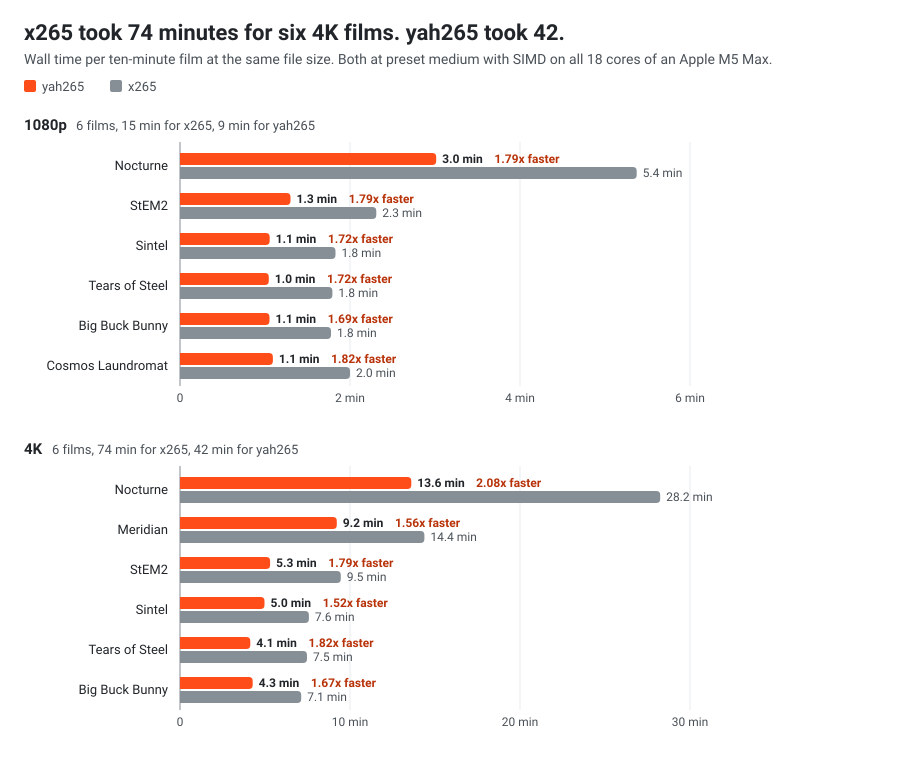

# Introducing yah265

<!--gen:headline-->yah265 encodes video 1.77x faster than x265 at the same file size, median over every timed cell (CRF, capped VBR and content types), with +1.18 VMAF v1 points.<!--/gen:headline-->

It's an H.265/HEVC encoder I wrote from scratch. Speed is the reason to try it. The chart shows what the difference looks like on real films. I gave both encoders the same ten-minute films on my Mac at `--preset medium` and had each write files of the same size. yah265 finished every film first. Its picture also scored higher on VMAF v1 every time.

<figure class="chart"><figcaption>Data: the Mac parity report. The films table below has the same readings.</figcaption></figure>

On this page "2x faster" means half the wall time.

## One word changes in your ffmpeg command

You run it the way you run x264 or x265.

```sh
ffmpeg -i in.mp4 -c:v libx265  -preset medium -crf 25 out.mp4
ffmpeg -i in.mp4 -c:v libyah265 -preset medium -crf 25 out.mp4
```

The project's own ffmpeg build includes `libyah265`. One command makes that build: `scripts/build-ffmpeg.sh`. [Build and first encode](start.md) walks through it. The same CRF number won't give the same file size as x265, because yah265 has its own CRF scale.

## Faster on every cell I timed

A cell is one clip at one resolution in one rate mode. Each dot below is one cell timed on the Mac.

<figure class="chart"><figcaption>Data: the Mac parity report and the content-type rows of the parity data. The first table below lists each row's median.</figcaption></figure>

The rows are the three kinds of test behind the headline. CRF cells run from ten-second clips to ten-minute films, and in each one yah265 is solved onto x265's file size. Capped VBR cells give both encoders the same target bitrate on real titles. Content types are film grain, sports and screen capture. No dot sits left of the x265 line.

## Three goals and a quality bar

yah265 is the second of three sibling encoders. [yah264](https://terranvigil.github.io/yah264/) reached the same goals against x264 first. The code is clean-room from the ITU-T H.265 specification. Every stream it writes has to decode correctly in two independent decoders before a number from it counts.

I set three speed goals against x265 at `--preset medium`. Each one compares files of the same size.

| goal | yah265 | x265 |
|---|---|---|
| G1 | plain C on one thread | `--no-asm` on one thread |
| G2 | plain C on all cores | `--no-asm` on all cores |
| G3 | SIMD on all cores | its own assembly on all cores |

G3 is the one a user sees. A goal passes in a group of clips when the median is at least even and the slowest clip is no more than 15% slower. Quality has its own bar. On every rate ladder of a real film, yah265 may need at most 1.0% more bits than x265 for the same VMAF v1.

## The same lead on three machines

The Mac isn't the only machine I timed. Both encoders also ran on an Intel Xeon with AVX-512 and on an AWS Graviton4 with SVE2, held to the same 16 cores on each cloud box.

<figure class="chart"><figcaption>Data: the three per-machine parity reports. The G3 table below has each marker's value.</figcaption></figure>

yah265 leads in every group on all three machines and passes all three goals on each. Because plenty of x86 machines have no AVX-512, I also held both encoders to AVX2 and then to SSE4.2 on the Xeon and timed the short clips again. The lead held at both.

## Smaller files for the same picture

Speed would mean little if the files got bigger. Every real film has a five-rung rate ladder at CRF and another at capped VBR, scored on VMAF v1 at display size.

<figure class="chart"><figcaption>Data: the BD section of the Mac parity report.</figcaption></figure>

Over all the ladders yah265 needs a median <!--gen:bd-median-->10.9%<!--/gen:bd-median--> fewer bits for the same score. Every ladder is inside the bar.

<figure class="chart"><figcaption>Data: the rate ladder file.</figcaption></figure>

Here are three of those ladders as curves. On Tears of Steel and Meridian the yah265 curve sits above x265's the whole way. Chimera is the hardest title in the set for us, and at 4K the two curves nearly touch.

## The same result through ffmpeg

Most people meet an encoder through ffmpeg. An outside tester would run it that way too. So I ran both encoders from one ffmpeg build with `-preset medium` and default threads. yah265 ran at a fixed CRF. x265's CRF was then searched until its file came within <!--gen:ff-tol-->2%<!--/gen:ff-tol--> of ours. VMAF v1 scored every frame of both.

<!--gen:ffmpeg-table-->
| clip | encoder | crf | size | encode time | VMAF v1 |
|---|---|--:|--:|--:|--:|
| Meridian 1080p, 60 s | libyah265 | 25 | 3.08 MB | **9.0 s** | 84.25 |
|  | libx265 | 26.7 | 3.10 MB | 23.7 s | 82.22 |
| Tears of Steel 1080p, 60 s | libyah265 | 25 | 8.09 MB | **5.7 s** | 90.62 |
|  | libx265 | 25.8 | 7.96 MB | 10.5 s | 89.77 |
<!--/gen:ffmpeg-table-->

Both clips came out the way the films did, with less time and a higher score. These are the commands for the first clip. The last one runs the same encode through yah265's own command line.

<!--gen:ff-cmd-->
```sh
ffmpeg -ss 30 -i Meridian_UHD4k5994_HDR_P3PQ.mp4 -frames:v 3596 -an -vf scale=1920:1080:flags=bicubic,format=yuv420p \
  -c:v libyah265 -preset medium -crf 25 -tag:v hvc1 out.yah265.mp4
ffmpeg -ss 30 -i Meridian_UHD4k5994_HDR_P3PQ.mp4 -frames:v 3596 -an -vf scale=1920:1080:flags=bicubic,format=yuv420p \
  -c:v libx265 -preset medium -crf 26.7 -tag:v hvc1 out.x265.mp4

# the same yah265 encode through its own command line
ffmpeg -ss 30 -i Meridian_UHD4k5994_HDR_P3PQ.mp4 -frames:v 3596 -an -vf scale=1920:1080:flags=bicubic,format=yuv420p -f yuv4mpegpipe - | \
  build-rel/y265 - -o out.hevc --preset medium --crf 25
```
<!--/gen:ff-cmd-->

## How we got there

<figure class="chart"><figcaption>Data: the timed board's history file.</figcaption></figure>

The chart is the timed board. It read every milestone commit on the same short clips until the shared test set took over in October. yah265 started out slow. The first reading with SIMD on every core took <!--gen:hist-g3-first-->15.2x<!--/gen:hist-g3-first--> x265's time.

### Correct first, then quality, then speed

The first commits built the bitstream layer and a conformance gate before any encoding decision. Every stream has to decode to the encoder's own reconstruction through both ffmpeg and libde265, and one-thread output has to be byte-identical from run to run. Neither rule ever relaxed.

Quality came before speed on purpose. A board read at matched file size moves whenever quality moves, so speed work done before quality settles has to be done again.

### Threads and NEON

By default x265 runs at most four frame threads, which left about half of my 18 cores idle at 720p. yah265 runs one shared worker pool whose unit of work is a row of coding tree units, and rows from several frames are in flight at once. A row starts once its reference frames have finished the rows its motion search can reach. Geometry alone sets that wait. Output across thread counts is checked at every gate, though the only identity I promise is one thread from run to run.

NEON kernels shipped in rounds the same week. This was the hard goal, because x265's arm64 assembly makes it about three times as fast as its own C. Each of our kernels is bit-exact with its C reference, so turning SIMD off changes the speed and nothing else. On the chart the SIMD line climbs to under 2x slower within two days.

### Picking what medium means

By mid-September yah265 had a large quality lead and was still slower with SIMD on. We redefined `medium` as the goal preset and spent part of the lead on speed. That's where the SIMD line crosses even.

### Real films disagreed with the short clips

The short clips had us ahead everywhere. Two-minute segments of real titles didn't agree, because Meridian needed more bits than x265 and Sol Levante took longer to encode.

Meridian's problem was block size. Because our 32x32 coding blocks spent their bits on syntax at low rates, a 64x64 tree with a skip gate went in at HD and 4K. Sol Levante's time went to intra search inside P and B frames. We ranked the intra modes once, stopped trying 4x4 intra there and stopped recursing under intra blocks that almost never split. Both changes also gained quality.

A task trace showed that the bigger tree then cost wall time on all cores because too few frames were in flight. Once a scheduling simulator matched the measured walls within 1%, it pointed at twelve frames in flight with reference frames scheduled first. The check across thread counts still read byte-identical afterward.

### VBR started out behind

When VBR was first measured we trailed x265 on cells where CRF was level or ahead. VBR was also slower than x265 on all cores. Only one picture was ever in flight, because VBR waited for every frame to finish before it planned the next one. Planning from frames up to eight back gave the parallelism back.

That change wrote HRD underflows on very shallow buffers. Those buffers now code with no lag, because a stream that underflows its own signaled buffer isn't conformant. Capped VBR then moved onto the CRF path with a slow level. It also stopped spending surplus bits on frames that already looked perfect.

### A dev set that reads in ten minutes

A full-table read took a night. In October we switched to a dev set of eight short windows and one two-minute segment, which reads in about ten minutes. Thirteen changes merged in two days. Every one was read on the whole dev set before it shipped.

The biggest find there was motion search on fine texture. Our runs of B-frames were twice as long as x265's, and at that distance the diamond search got stuck. A hexagon search fixed it, along with a stronger motion term in the rule that ends a run.

### VMAF v1

In late October I moved all three encoders from VMAF-NEG to VMAF v1, which reads chroma, banding and motion. Chimera fell over the bar at once because of chroma. Inter chroma now rounds less aggressively. Both chroma quantizers run finer than luma's. Scoring at display size exposed the same loss at CIF, where the chroma setting now reaches too.

Then v1's banding feature found dark grain coded to flat steps on StEM2 and Nocturne. Raising the psychovisual strength on dark, smooth blocks fixed both.

### The input read

One title still failed the speed bar with SIMD on. Meridian at 720p was slower than x265 even though our instruction count was the lowest of any film. The time went to the input, because the command line read each frame between calls into the encoder and a slow disk added its time to every frame. Reading on its own thread fixed it.

### Off the Mac

Parity on the Mac wasn't the finish line, because a parity claim has to hold on every instruction set the encoder ships. The x86-64 kernels gained an AVX-512 tier for the transforms and the block-difference sums. The arm64 kernels gained an SVE tier. Every tier is bit-exact with C, as NEON is. Both cloud tables then ran on EC2 spot instances, with both encoders built on each box from the same source. yah265 passed every goal in every group on both machines the first time they were timed.

## The tables behind the charts

Every table here is filled by the script that draws the charts.

### Every timed cell

<!--gen:headline-table-->
| timed cells | count | median | slowest cell |
|---|--:|--:|---|
| CRF | 35 | 1.79x faster | Sintel 4K, 10 min, 1.52x faster |
| capped VBR | 26 | 1.64x faster | Meridian 1080p, 10 min, 1.18x faster |
| content types | 9 | 1.92x faster | Lash of the Whip 1080p, 1.85x faster |
| **all** | **70** | **1.77x faster** | Meridian 1080p, 10 min, 1.18x faster |
<!--/gen:headline-table-->

All of these ran on the Mac with SIMD on all cores. The VMAF v1 lead in the headline is the median over the CRF and content-type cells, where the two files are the same size. yah265 scores higher on <!--gen:dv-cells-->39 of the 44<!--/gen:dv-cells--> of them.

### Each ten-minute film

<!--gen:films-table-->
| class | film | x265 | yah265 | faster | VMAF v1 ahead |
|---|---|--:|--:|--:|--:|
| 1080p | Nocturne | 5.4 min | 3.0 min | 1.79x | +1.21 |
| 1080p | StEM2 | 2.3 min | 1.3 min | 1.79x | +1.85 |
| 1080p | Cosmos Laundromat | 2.0 min | 1.1 min | 1.82x | +1.07 |
| 1080p | Sintel | 1.8 min | 1.1 min | 1.72x | +0.76 |
| 1080p | Tears of Steel | 1.8 min | 1.0 min | 1.72x | +1.08 |
| 1080p | Big Buck Bunny | 1.8 min | 1.1 min | 1.69x | +0.70 |
| 1080p | Meridian | not timed | not timed | - | - |
| 1080p | **all 6 timed** | **15 min** | **9 min** | **1.76x** | |
| 4K | Nocturne | 28.2 min | 13.6 min | 2.08x | +0.70 |
| 4K | Meridian | 14.4 min | 9.2 min | 1.56x | +1.18 |
| 4K | StEM2 | 9.5 min | 5.3 min | 1.79x | +1.24 |
| 4K | Sintel | 7.6 min | 5.0 min | 1.52x | +1.36 |
| 4K | Tears of Steel | 7.5 min | 4.1 min | 1.82x | +1.18 |
| 4K | Big Buck Bunny | 7.1 min | 4.3 min | 1.67x | +0.44 |
| 4K | **all 6 timed** | **74 min** | **42 min** | **1.79x** | |
<!--/gen:films-table-->

Meridian has no 1080p time because its source decoder couldn't feed frames fast enough for a valid timing.

### The three goals on each machine

Each range runs from the slowest group's median to the fastest's. A group is one resolution in one tier: short clips, two-minute segments or ten-minute films.

<!--gen:goal-table-->
| goal | Apple M5 Max (NEON) | Xeon 8488C (AVX-512) | Graviton4 (SVE2) |
|---|--:|--:|--:|
| G1: C on one thread | 2.17x to 4.35x | 1.49x to 3.03x | 1.52x to 3.03x |
| G2: C on all cores | 2.86x to 4.17x | 2.27x to 4.76x | 2.38x to 4.76x |
| G3: SIMD on all cores | 1.61x to 2.13x | 1.35x to 2.44x | 1.47x to 3.23x |
<!--/gen:goal-table-->

<!--gen:combos-line-->That's 81 of 81 combinations of machine, group and goal inside the bar. Bus at CIF on the Xeon is the slowest single clip at G3 on any machine. It still runs 1.22x faster.<!--/gen:combos-line-->

### G3 by resolution and length

The last column is how many VMAF v1 points yah265 scores above x265 when both files are the same size. It's the median over the group, read on the Mac.

<!--gen:arch-table-->
| class | tier | Mac, NEON | x86-64, AVX-512 | Graviton4, SVE2 | VMAF v1 ahead at the same size |
|---|---|--:|--:|--:|--:|
| CIF | short clips | 1.96x | 1.43x | 1.82x | +2.33 |
| 720p | short clips | 1.61x | 1.67x | 2.08x | +2.39 |
| 720p | 10-min films | 2.13x | 1.89x | 2.38x | +1.67 |
| 1080p | short clips | 1.92x | 1.35x | 1.47x | +0.61 |
| 1080p | 2-min segments | 1.69x | 1.35x | 1.56x | +1.96 |
| 1080p | 10-min films | 1.75x | 1.47x | 1.69x | +1.08 |
| 4K | short clips | 1.61x | 2.44x | 3.23x | +1.86 |
| 4K | 2-min segments | 1.79x | 1.89x | 2.13x | +1.40 |
| 4K | 10-min films | 1.72x | 1.69x | 2.04x | +1.18 |
<!--/gen:arch-table-->

### x86 without AVX-512

Both encoders were held to the same instruction set on the Xeon. Each cell is the median over the short clips of that class.

<!--gen:capped-table-->
| class | both held to SSE4.2 | both held to AVX2 |
|---|--:|--:|
| CIF | 1.56x | 1.35x |
| 720p | 2.00x | 1.59x |
| 1080p | 1.45x | 1.18x |
| 4K | 2.33x | 2.22x |
<!--/gen:capped-table-->

### Bits saved at the same VMAF v1

<!--gen:quality-table-->
| rate mode | ladders | median bits saved | ahead of x265 | inside the bar | thinnest margin |
|---|--:|--:|--:|--:|---|
| CRF | 26 | 12.1% | 26 | 26 | Chimera 4K, 2 min, -0.29% |
| capped VBR | 26 | 9.4% | 25 | 26 | Chimera 4K, 2 min, +0.70% |
| both | 52 | 10.9% | 51 | 52 | Chimera 4K, 2 min, +0.70% |
<!--/gen:quality-table-->

The three curves in the chart are these ladders at CRF.

<!--gen:curves-table-->
| panel | bits saved at the same VMAF v1 |
|---|--:|
| Tears of Steel 1080p, 10 min | 12.6% |
| Meridian 1080p, 2 min | 28.7% |
| Chimera 4K, 2 min | 0.3% |
<!--/gen:curves-table-->

### Quality off the Mac

The ladders ran on the Mac. Graviton4's quality is the Mac's, because it writes the Mac's streams byte for byte in nearly every timed encode. The encodes that differ had a different input or a re-solved CRF. On x86-64 the compiler rounds some floating-point math differently and the streams move a little. I ran some ladders again there to see how far.

<!--gen:offmac-table-->
| machine | check | result |
|---|---|---|
| Graviton4 | timed encodes that are the Mac's streams byte for byte | 108 of 114 |
| x86-64 | ladders run again, largest difference from the Mac's BD-rate | 4 ladders, 0.07 points |
<!--/gen:offmac-table-->

### The timed board's first and last readings

<!--gen:board-table-->
| board median | first timed board | last timed board |
|---|--:|--:|
| C on one thread | 2.7x x265's time (2026-09-07) | 3.23x faster (2026-10-03) |
| SIMD on all cores | 15.2x x265's time (2026-09-10) | 1.31x faster (2026-10-03) |
<!--/gen:board-table-->

## How it was measured

On the Mac both encoders ran on one Apple M5 Max with 18 cores, where the reference is the Homebrew build of x265 4.3 with its arm64 assembly. The cloud boxes built x265 4.3 from its release tarball with clang. On every machine both encoders ran at `medium` and read the same frames from one feeder on standard input.

For a timed CRF reading, yah265 is solved onto x265's file size within 1%. The capped VBR cells are timed at one shared target bitrate and aren't solved to match, though their files come out close in size. They count toward the headline's speed and have no VMAF figure in it. x265 ran its default lookahead of 20 frames. yah265 ran its own `medium` default: 20 frames from 720p up and 12 at CIF.

Quality is VMAF v1, scored at display size on every frame of the two-minute segments and every third frame of the films. The ten-minute films skip their black openings and stop before the end credits. Cloud wall times are reported apart from the Mac's and never pooled with them. The headline is the Mac's.

The [results page](results.md) has every table. The [methodology](methodology.md) has the rules that make a number valid. The figures on this page come from <!--gen:report-link-->[the all-architecture parity report of 2026-11-14](docs/parity/PARITY-REPORT-yah265-all-isa-2026-11-14.md)<!--/gen:report-link--> and the per-machine reports beside it. One [script](scripts/blog_charts.py) draws every chart and fills in every figure. You can [check it yourself](check-it-yourself.md).

## Docs

- [Build and first encode](start.md)
- [Encoding guide](guide.md)
- [Options](options.md)
- [HDR](hdr.md)
- [The HEVC standard](hevc.md)
- [Design](design.md)
- [Threading](threading.md)
- [Architectures](architectures.md)
- [Results](results.md)
- [Check it yourself](check-it-yourself.md)
- Source: [github.com/terranvigil/yah265](https://github.com/terranvigil/yah265)
