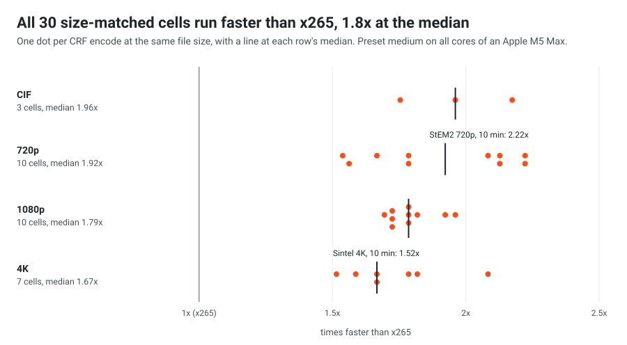
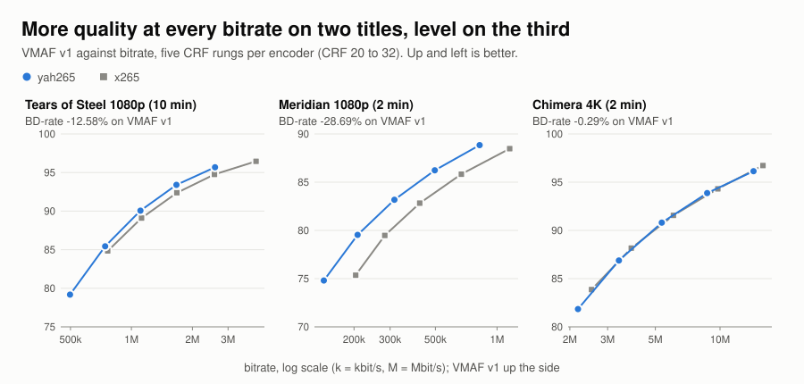
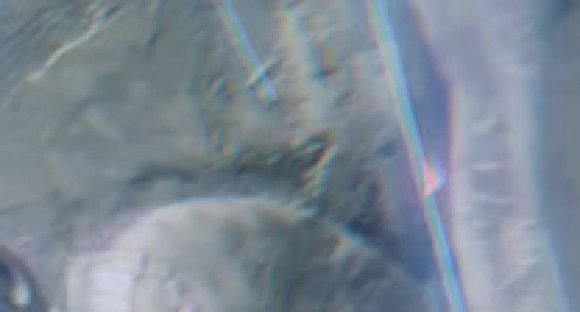
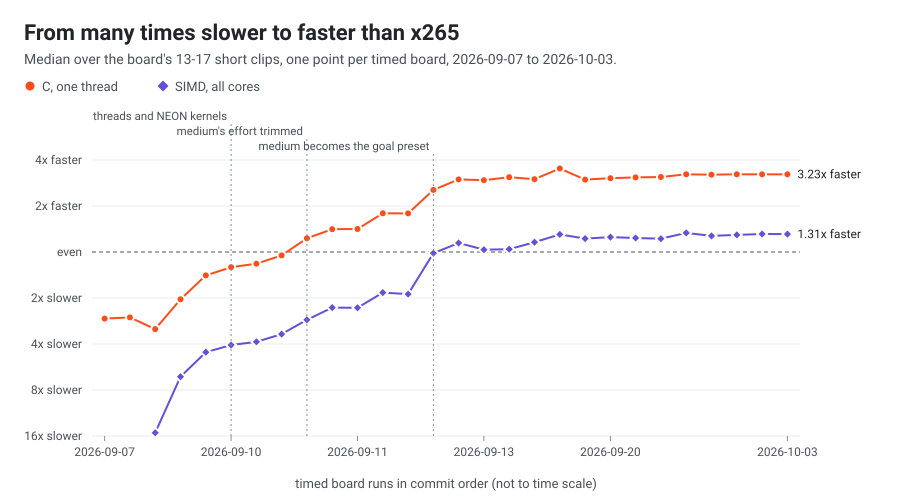

# Introducing yah265

<!--gen:headline-->On an Apple M5 Max, yah265 encodes a median 1.8x faster than x265 at the same file size. Its VMAF v1 score is a median 1.23 points higher. Those medians cover the 30 CRF encodes of the test set where the two files match in size within 1%, from short clips to ten-minute films at CIF to 4K. Both encoders ran at preset medium with SIMD on all cores.<!--/gen:headline-->

It's a new HEVC encoder I wrote in C. Speed is the reason to try it. The chart shows what the difference looks like on real films. Both encoders wrote files of the same size from the same ten-minute films on my Mac at `--preset medium`. yah265 finished all of them first. Each of its files also scored higher on VMAF v1.

<figure class="chart"><figcaption>The films table below has the same readings.</figcaption></figure>

On this page "2x faster" means half the wall time.

## One word changes in your ffmpeg command

You run it the way you run x264 or x265.

```sh
ffmpeg -i in.mp4 -c:v libx265  -preset medium -crf 25 out.mp4
ffmpeg -i in.mp4 -c:v libyah265 -preset medium -crf 25 out.mp4
```

The project's own ffmpeg build includes `libyah265`. One command makes that build: `scripts/build-ffmpeg.sh`. [Build and first encode](start.md) walks through it. The same CRF number won't give the same file size as x265, because yah265 has its own CRF scale.

## Faster on every cell I timed

A cell is one clip at one resolution. Each dot below is one cell timed on the Mac, where yah265's file is within 1% of x265's size.

<figure class="chart"><figcaption>The first table below lists each row's median.</figcaption></figure>

These are the cells behind the headline, from ten-second clips to ten-minute films. In each one yah265's CRF is solved onto x265's file size. No dot is left of the x265 line. Capped VBR and the content-type clips were timed too, although the [results page](results.md#vbr) reports them apart because their files aren't matched in size the same way.

## Three goals and a quality bar

yah265 is the second of three sibling encoders. [yah264](https://terranvigil.github.io/yah264/) reached the same goals against x264 first. I wrote the encoder from the ITU-T H.265 specification. Every stream it writes has to decode correctly in two independent decoders before a number from it counts.

I set three speed goals against x265 at `--preset medium`. Each one compares files of the same size.

| goal | yah265 | x265 |
|---|---|---|
| G3 | SIMD on all cores | its own assembly on all cores |
| G1 | plain C on one thread | `--no-asm` on one thread |
| G2 | plain C on all cores | `--no-asm` on all cores |

G3 is the one a user sees. G1 and G2 compare the algorithms with the hand-written SIMD off on both sides. I read those two as engineering checks, because x265 isn't meant to run without its assembly. A goal passes in a group of clips when the median is at least even and the slowest clip is no more than 15% slower. The quality bar is that on any rate ladder of a real film, yah265 may need at most 1.0% more bits than x265 for the same VMAF v1.

## The same lead on three machines

I also timed both encoders on an Intel Xeon with AVX-512 and on an AWS Graviton4 with SVE2. Each cloud box held them to the same 16 vCPUs.

<figure class="chart"><figcaption>The G3 table below has each marker's value.</figcaption></figure>

yah265 leads in each group on all three machines and passes all three goals on each. Because plenty of x86 machines have no AVX-512, I timed the short clips again on the Xeon with both encoders held to AVX2 and then to SSE4.2. The lead held at both.

## Smaller files for the same VMAF score

Speed would mean little if the files got bigger. Each real film has a five-rung rate ladder at CRF and another at capped VBR. Both are scored on VMAF v1 at display size.

<figure class="chart"></figure>

Over all the ladders yah265 needs a median <!--gen:bd-median-->10.2%<!--/gen:bd-median--> fewer bits for the same score. None is outside the bar.

<figure class="chart"></figure>

Here are three of those ladders as curves. So that I couldn't pick them by eye, I took the CRF ladders with the largest saving, the median one and the smallest. In the last panel the two curves nearly touch.

Here is the hardest moment of one clip, from two files of the same size.

<!--gen:fig-frames-->
<figure class="compare">
<div class="cmp">
<div class="cmp-head"><p class="cmp-title">0:29 into the clip<span>VMAF v1 on this frame: yah265 88.3, x265 84.4. The crop is shown at 4x.</span></p><div class="cmp-where"><i style="left:80.00%;top:5.59%;width:10.83%;height:13.05%"></i></div></div>
<div class="cmp-pane" data-name="Reference"><span class="cmp-tag">Reference · 4x zoom</span></div>
<div class="cmp-pane" data-name="yah265" data-first><span class="cmp-tag ours"><b>yah265</b> · VMAF v1 88.3 on this frame · 15.95 MB file · 4x zoom</span></div>
<div class="cmp-pane" data-name="x265"><span class="cmp-tag"><b>x265</b> · VMAF v1 84.4 on this frame · 15.88 MB file · 4x zoom</span></div>
</div>
<figcaption>A complex frame of Tears of Steel clip at 1080p, where both encoders score lowest. The crop shows where the two differ most. yah265 keeps more of the texture. Both files are the same size within 0.5%. <a href="results.html#side-by-side-at-the-same-size">Results</a> has more. Tears of Steel: (CC) Blender Foundation, <a href="https://mango.blender.org">mango.blender.org</a>, CC-BY 3.0.</figcaption>
</figure>
<!--/gen:fig-frames-->

A still frame only goes so far. The [comparison players](https://terranvigil.github.io/yah265-compare/) play both encodes in motion at the same file size. You can switch between them and jump to the hardest moments yourself.

An average can hide a bad stretch. Here is that clip frame by frame, from both files.

<!--trust:fig-trace-->
<figure class="chart"></figure>
<!--/trust:fig-trace-->

yah265's lead is wider on the clip's worst frames than on its average. [Results](results.md#the-worst-frames) has the figures.

## The same result through ffmpeg

Most people meet an encoder through ffmpeg, as an outside tester would. I ran both encoders from one ffmpeg build with `-preset medium` and default threads. Once yah265 had run at a fixed CRF, x265's CRF was searched until its file came within <!--gen:ff-tol-->2%<!--/gen:ff-tol--> of yah265's. VMAF v1 scored all the frames of both.

<!--gen:ffmpeg-table-->
| clip | encoder | crf | size | encode time | VMAF v1 |
|---|---|--:|--:|--:|--:|
| Tears of Steel 1080p, 60 s | libyah265 | 25 | 8.09 MB | **5.7 s** | 90.62 |
|  | libx265 | 25.8 | 7.96 MB | 10.5 s | 89.77 |
<!--/gen:ffmpeg-table-->

yah265 took less time on this clip and its file scored higher. Take it as an example, since it's one run of each encoder. Of the commands below, the last one runs the same encode through yah265's own command line.

<!-- recipe: skip encodes a minute of 1080p three times; the y265 line is checked in start.md -->
<!--gen:ff-cmd-->
```sh
ffmpeg -ss 60 -i tearsofsteel_4k.mov -frames:v 1440 -an -vf scale=1920:858:flags=bicubic,format=yuv420p \
  -c:v libyah265 -preset medium -crf 25 -tag:v hvc1 out.yah265.mp4
ffmpeg -ss 60 -i tearsofsteel_4k.mov -frames:v 1440 -an -vf scale=1920:858:flags=bicubic,format=yuv420p \
  -c:v libx265 -preset medium -crf 25.8 -tag:v hvc1 out.x265.mp4

# the same yah265 encode through its own command line
ffmpeg -ss 60 -i tearsofsteel_4k.mov -frames:v 1440 -an -vf scale=1920:858:flags=bicubic,format=yuv420p -f yuv4mpegpipe - | \
  build-rel/y265 - -o out.hevc --preset medium --crf 25
```
<!--/gen:ff-cmd-->

## How I got there

<figure class="chart"></figure>

The chart is the timed board. It read each milestone commit on the same short clips until the shared test set took over in October. yah265 started out slow. The first reading with SIMD on all cores took <!--gen:hist-g3-first-->15.2x<!--/gen:hist-g3-first--> x265's time.

### Correct first, then quality, then speed

The first commits built the bitstream layer and a conformance gate before any encoding decision. A stream has to decode to the encoder's own reconstruction through both ffmpeg and libde265. One-thread output has to be byte-identical from run to run. Neither rule ever relaxed.

Quality came before speed on purpose. Because a board read at matched file size moves whenever quality moves, speed work done before quality settles has to be done again.

### Threads and NEON

On my 18-core Mac, x265's auto-detection chose four frame threads. About half the cores sat idle at 720p. yah265 runs one shared worker pool whose unit of work is a row of coding tree units. Rows from several frames are in flight at once. A row starts once its reference frames have finished the rows its motion search can reach. Geometry alone sets that wait. Output across thread counts is checked at each gate, though the only identity I promise is one thread from run to run.

NEON kernels shipped in rounds the same week. This was the hard goal, because on these clips x265's arm64 assembly makes it about three times as fast as its plain C. Because each of yah265's kernels is bit-exact with its C reference, turning SIMD off changes nothing but the speed. On the chart the SIMD line climbs to under 2x slower within two days.

### Picking what medium means

By mid-September yah265 had a large quality lead, although it was still slower with SIMD on. Redefining `medium` as the goal preset spent part of the lead on speed. That's where the SIMD line crosses even.

### Real films disagreed with the short clips

The short clips had yah265 ahead everywhere. Two-minute segments of real titles didn't agree, because one needed more bits than x265 and Sol Levante took longer to encode.

The first problem was block size. Because yah265's 32x32 coding blocks spent their bits on syntax at low rates, a 64x64 tree with a skip gate went in at HD and 4K. Sol Levante's time went to intra search inside P and B frames. I ranked the intra modes once. Trying 4x4 intra there stopped, as did recursing under intra blocks that almost never split. Both changes also gained quality.

A task trace showed that the bigger tree then cost wall time on all cores because too few frames were in flight. Once a scheduling simulator matched the measured walls within 1%, it pointed at twelve frames in flight with reference frames scheduled first. The check across thread counts still read byte-identical afterward.

### VBR started out behind

When VBR was first measured yah265 trailed x265 on cells where CRF was level or ahead. VBR was also slower than x265 on all cores. Only one picture was ever in flight, because VBR waited for each frame to finish before it planned the next one. Planning from frames up to eight back gave the parallelism back.

That change wrote HRD underflows on very shallow buffers. Those buffers now code with no lag, because a stream that underflows its own signaled buffer isn't conformant. Capped VBR then moved onto the CRF path with a slow level. It also stopped spending surplus bits on frames that already looked perfect.

### A dev set that reads in ten minutes

Because a full-table read took a night, in October I switched to a dev set of eight short windows and one two-minute segment that reads in about ten minutes. Thirteen changes merged in two days. Each was read on the whole dev set before it shipped.

The biggest find there was motion search on fine texture. yah265's runs of B-frames were twice as long as x265's. At that distance the diamond search got stuck. A hexagon search fixed it, along with a stronger motion term in the rule that ends a run.

### VMAF v1

In late October I moved all three encoders from VMAF-NEG to VMAF v1. VMAF v1 reads chroma, banding and motion. One title fell over the bar at once because of chroma. Inter chroma now rounds less aggressively and both chroma quantizers run finer than luma's. Scoring at display size exposed the same loss at CIF, where the chroma setting now reaches too.

Then v1's banding feature found dark grain coded to flat steps on StEM2 and Nocturne. Raising the psychovisual strength on dark, smooth blocks fixed both.

### The input read

One film still failed the speed bar with SIMD on. At 720p it was slower than x265 even though yah265's instruction count was the lowest of any film. The time went to the input. Because the command line read each frame between calls into the encoder, a slow disk added its time to each one. Reading on its own thread fixed it.

### Off the Mac

Parity on the Mac wasn't the finish line, because a parity claim has to hold on all the instruction sets the encoder ships. The x86-64 kernels gained an AVX-512 tier for the transforms and the block-difference sums. The arm64 kernels gained an SVE tier. Each tier is bit-exact with C, as NEON is. Both cloud tables then ran on EC2 spot instances. Each box built both encoders from the same source. yah265 passed all three goals in each group on both machines the first time they were timed.

## The tables behind the charts

### The cells behind the headline

<!--gen:headline-table-->
| size-matched cells on the Mac | count | median | slowest cell |
|---|--:|--:|---|
| CIF | 3 | 1.96x faster | Bus CIF, 1.75x faster |
| 720p | 10 | 1.92x faster | Shields 720p, 1.54x faster |
| 1080p | 10 | 1.79x faster | Big Buck Bunny 1080p, 10 min, 1.69x faster |
| 4K | 7 | 1.67x faster | Sintel 4K, 10 min, 1.52x faster |
| **all** | **30** | **1.8x faster** | Sintel 4K, 10 min, 1.52x faster |
<!--/gen:headline-table-->

All of these ran on the Mac at CRF with SIMD on all cores. In each one the two files are the same size within 1%. The VMAF v1 lead in the headline is the median over the same cells. yah265 scores higher on <!--gen:dv-cells-->29 of the 30<!--/gen:dv-cells--> of them.

### Each ten-minute film

<!--gen:films-table-->
| class | film | x265 | yah265 | faster | VMAF v1 ahead |
|---|---|--:|--:|--:|--:|
| 1080p | Nocturne | 5.4 min | 3.0 min | 1.79x | +1.21 |
| 1080p | StEM2 | 2.3 min | 1.3 min | 1.79x | +1.85 |
| 1080p | Cosmos Laundromat | 2.0 min | 1.1 min | 1.82x | +1.07 |
| 1080p | Sintel | 1.8 min | 1.1 min | 1.72x | +0.76 |
| 1080p | Tears of Steel | 1.8 min | 1.0 min | 1.72x | +1.08 |
| 1080p | Big Buck Bunny | 1.8 min | 1.1 min | 1.69x | +0.70 |
| 1080p | **all 6 timed** | **15 min** | **9 min** | **1.76x** | |
| 4K | Nocturne | 28.2 min | 13.6 min | 2.08x | +0.70 |
| 4K | StEM2 | 9.5 min | 5.3 min | 1.79x | +1.24 |
| 4K | Sintel | 7.6 min | 5.0 min | 1.52x | +1.36 |
| 4K | Tears of Steel | 7.5 min | 4.1 min | 1.82x | +1.18 |
| 4K | Big Buck Bunny | 7.1 min | 4.3 min | 1.67x | +0.44 |
| 4K | **all 5 timed** | **60 min** | **32 min** | **1.85x** | |
<!--/gen:films-table-->

### The three goals on each machine

Each range runs from the slowest group's median to the fastest's. A group is one resolution in one tier: short clips, two-minute segments or ten-minute films.

<!--gen:goal-table-->
| goal | Apple M5 Max (NEON) | Xeon 8488C (AVX-512) | Graviton4 (SVE2) |
|---|--:|--:|--:|
| G3: as shipped, SIMD on all cores | 1.59x to 2.13x | 1.25x to 2.33x | 1.39x to 3.03x |
| G1: algorithm only, plain C on one thread | 2.17x to 4.00x | 1.49x to 2.94x | 1.52x to 2.94x |
| G2: algorithm only, plain C on all cores | 2.56x to 4.35x | 2.22x to 4.76x | 2.08x to 4.35x |
<!--/gen:goal-table-->

<!--gen:combos-line-->That's 81 of 81 combinations of machine, group and goal inside the bar. Bus at CIF on the Xeon is the slowest single clip at G3 on any machine and still runs 1.22x faster.<!--/gen:combos-line-->

### G3 by resolution and length

The last column is how many VMAF v1 points yah265 scores above x265 when both files are the same size. It's the median over the group, read on the Mac.

<!--gen:arch-table-->
| class | tier | Mac, NEON | x86-64, AVX-512 | Graviton4, SVE2 | VMAF v1 ahead at the same size |
|---|---|--:|--:|--:|--:|
| CIF | short clips | 1.96x | 1.43x | 1.82x | +2.33 |
| 720p | short clips | 1.61x | 1.67x | 2.08x | +2.39 |
| 720p | 10-min films | 2.13x | 1.89x | 2.33x | +1.54 |
| 1080p | short clips | 1.92x | 1.35x | 1.47x | +0.61 |
| 1080p | 2-min segments | 1.72x | 1.25x | 1.39x | +1.96 |
| 1080p | 10-min films | 1.75x | 1.45x | 1.67x | +1.08 |
| 4K | short clips | 1.59x | 2.33x | 3.03x | +1.22 |
| 4K | 2-min segments | 1.67x | 1.49x | 1.59x | +1.72 |
| 4K | 10-min films | 1.79x | 1.67x | 2.04x | +1.18 |
<!--/gen:arch-table-->

### x86 without AVX-512

Both encoders were held to the same instruction set on the Xeon. Each cell is the median over the short clips of that class.

<!--gen:capped-table-->
| class | both held to SSE4.2 | both held to AVX2 |
|---|--:|--:|
| CIF | 1.56x | 1.35x |
| 720p | 2.00x | 1.56x |
| 1080p | 1.45x | 1.18x |
| 4K | 2.22x | 2.00x |
<!--/gen:capped-table-->

### Bits saved at the same VMAF v1

<!--gen:quality-table-->
| rate mode | ladders | median bits saved | ahead of x265 | inside the bar | thinnest margin |
|---|--:|--:|--:|--:|---|
| CRF | 19 | 12.0% | 19 | 19 | Big Buck Bunny 4K, 10 min, -4.94% |
| capped VBR | 19 | 9.1% | 19 | 19 | Nocturne 720p, 10 min, -0.41% |
| both | 38 | 10.2% | 38 | 38 | Nocturne 720p, 10 min, -0.41% |
<!--/gen:quality-table-->

The three curves in the chart are these ladders at CRF.

<!--gen:curves-table-->
| panel | bits saved at the same VMAF v1 |
|---|--:|
| StEM2 1080p, 10 min | 18.0% |
| Sintel 720p, 10 min | 12.0% |
| Big Buck Bunny 4K, 10 min | 4.9% |
<!--/gen:curves-table-->

### Quality off the Mac

The ladders ran on the Mac. Graviton4's quality is the Mac's, because it writes the Mac's streams byte for byte in nearly all the timed encodes. The encodes that differ had a different input or a re-solved CRF. On x86-64 the streams move a little because the compiler rounds some floating-point math differently. I ran some ladders again there to see how far.

<!--gen:offmac-table-->
| machine | check | result |
|---|---|---|
| Graviton4 | timed encodes that are the Mac's streams byte for byte | 84 of 90 |
| x86-64 | ladders run again, largest difference from the Mac's BD-rate | 3 ladders, 0.03 points |
<!--/gen:offmac-table-->

### The timed board's first and last readings

<!--gen:board-table-->
| board median | first timed board | last timed board |
|---|--:|--:|
| C on one thread | 2.7x x265's time (2026-09-07) | 3.23x faster (2026-10-03) |
| SIMD on all cores | 15.2x x265's time (2026-09-10) | 1.31x faster (2026-10-03) |
<!--/gen:board-table-->

## How it was measured

On the Mac both encoders ran on one Apple M5 Max with 18 cores, where the reference is the Homebrew build of x265 4.3 with its arm64 assembly. The cloud boxes built x265 4.3 from its release tarball with clang. On all three machines both encoders ran at `medium`. They read the same frames from one feeder on standard input.

For a timed CRF reading, yah265 is solved onto x265's file size within 1%. The headline covers only those cells. I didn't include the capped VBR cells, because they're timed at one shared target bitrate without being solved to match. x265 ran its default lookahead of 20 frames. yah265 ran its own `medium` default: 20 frames from 720p up and 12 at CIF.

Quality is VMAF v1: Netflix's `vmaf_v1.0.16` models on libvmaf 3.x. It's scored at display size. A picture under 1080p is scaled up to fit 1920x1080 first, CIF included. The ladders score all frames of the two-minute segments and one frame in three of the films. Each ten-minute film runs from the end of its black opening to the start of its end credits. Because cloud wall times are reported apart from the Mac's, the headline is the Mac's alone.

The [results page](results.md) has the tables. The [methodology](methodology.md) has the rules that make a number valid. The figures on this page come from <!--gen:report-link-->[the all-architecture parity report of 2026-11-14](docs/parity/PARITY-REPORT-yah265-all-isa-2026-11-14.md)<!--/gen:report-link--> and the per-machine reports beside it. The charts and figures come from one [script](scripts/blog_charts.py). You can [check it yourself](check-it-yourself.md).

## Docs

- [Build and first encode](start.md)
- [Encoding guide](guide.md)
- [Options](options.md)
- [HDR](hdr.md)
- [The HEVC standard](hevc.md)
- [Design](design.md)
- [Threading](threading.md)
- [Architectures](architectures.md)
- [Results](results.md)
- [Check it yourself](check-it-yourself.md)
- Source: [github.com/terranvigil/yah265](https://github.com/terranvigil/yah265)
