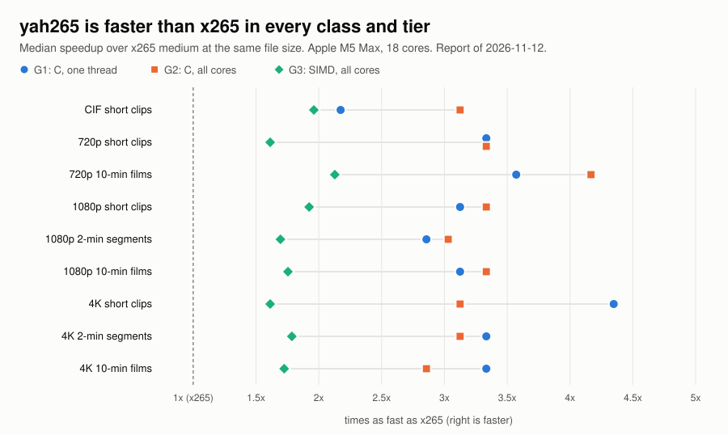

# Introducing yah265

yah265 is an H.265/HEVC encoder written from scratch. At `--preset medium` it runs <!--gen:g3-range-->1.61x to 2.13x<!--/gen:g3-range--> as fast as x265 with both encoders' SIMD on and every core busy. For the same VMAF v1 quality it needs a median <!--gen:bd-median-->10.9%<!--/gen:bd-median--> fewer bits.

It's the second of three sibling encoders. [yah264](https://terranvigil.github.io/yah264/) reached the same goals against x264 first. yah265 follows the same rules. The code is clean-room from the ITU-T H.265 specification, and two independent decoders check every stream it writes.

## Highlights

Each speed figure is the median over a group of clips, at the same file size as x265. A range runs from the slowest group to the fastest:

| build | times as fast as x265 |
|---|--:|
| plain C, one thread (x265 `--no-asm`, one thread) | <!--gen:g1-range-->2.17x to 4.35x<!--/gen:g1-range--> |
| plain C, all cores (x265 `--no-asm`) | <!--gen:g2-range-->2.86x to 4.17x<!--/gen:g2-range--> |
| SIMD, all cores (yah265 NEON against x265's own assembly) | <!--gen:g3-range-->1.61x to 2.13x<!--/gen:g3-range--> |

- Faster than x265 on every goal in every class from CIF to 4K, and on clips from ten seconds to ten minutes. That's <!--gen:combos-->27 of 27<!--/gen:combos--> combinations of class, length and goal.
- Ahead of x265 on <!--gen:ladders-ahead-->51<!--/gen:ladders-ahead--> of <!--gen:ladders-->52<!--/gen:ladders--> rate ladders on real films, at CRF and at capped VBR. All <!--gen:ladders-in-bar-->52<!--/gen:ladders-in-bar--> are inside the +1.0% bar.
- Main, Main10, 4:2:2 and 4:4:4 from one binary.
- CRF, fixed QP, ABR, VBR and CBR with a VBV, capped CRF and two-pass.
- HDR10, HDR10+, HLG and Dolby Vision profile 8 signaling.
- Four presets in x265's names, and x265's option names wherever the two share a feature.

<figure class="chart"></figure>

The closest group is <!--gen:closest-group-->720p short clips on G3<!--/gen:closest-group-->. The slowest single clip anywhere is <!--gen:slowest-cell-->Sintel at 4K on G3<!--/gen:slowest-cell-->, which still runs <!--gen:slowest-x-->1.52x<!--/gen:slowest-x--> as fast as x265.

<!--gen:speed-table-->
| class | tier | G1, C on one thread | G2, C on all cores | G3, SIMD on all cores | VMAF v1 at the same size |
|---|---|--:|--:|--:|--:|
| CIF | short clips | 2.17x | 3.12x | 1.96x | +2.33 |
| 720p | short clips | 3.33x | 3.33x | 1.61x | +2.39 |
| 720p | 10-min films | 3.57x | 4.17x | 2.13x | +1.67 |
| 1080p | short clips | 3.12x | 3.33x | 1.92x | +0.61 |
| 1080p | 2-min segments | 2.86x | 3.03x | 1.69x | +1.96 |
| 1080p | 10-min films | 3.12x | 3.33x | 1.75x | +1.08 |
| 4K | short clips | 4.35x | 3.12x | 1.61x | +1.86 |
| 4K | 2-min segments | 3.33x | 3.12x | 1.79x | +1.40 |
| 4K | 10-min films | 3.33x | 2.86x | 1.72x | +1.18 |
<!--/gen:speed-table-->

The last column is VMAF v1 points ahead of x265 at the same file size, median over the group.

<figure class="chart"></figure>

Over the whole rate range the saving is a median <!--gen:bd-crf-->12.1%<!--/gen:bd-crf--> at CRF and <!--gen:bd-vbr-->9.4%<!--/gen:bd-vbr--> at capped VBR. The bar for parity is +1.0% on every ladder. The thinnest margin is <!--gen:bd-tightest-->Chimera 4K (2 min) VBR<!--/gen:bd-tightest--> at <!--gen:bd-tightest-v-->+0.70%<!--/gen:bd-tightest-v-->.

## How it was measured

Both encoders ran `--preset medium` on one Apple M5 Max with 18 cores. The reference is the Homebrew build of x265 4.3, with its arm64 assembly. For a speed reading, yah265 is solved onto x265's file size within 1%. Both encoders read the same frames from one feeder on standard input. Quality is VMAF v1, scored at display size on every frame of the two-minute segments and every third frame of the films. The ten-minute films skip their black openings and stop before the end credits.

The [results page](results.md) has every table. The [methodology](methodology.md) has the rules that make a number valid. The current figures on this page come from <!--gen:report-link-->[the parity report of 2026-11-12](docs/parity/PARITY-REPORT-yah265-2026-11-12.md)<!--/gen:report-link-->. The history chart comes from the board's own data file. One [script](scripts/blog_charts.py) draws every chart and fills in every figure from those two sources. You can [check it yourself](check-it-yourself.md).

## How we got there

<figure class="chart"></figure>

The chart is the timed board. It read every milestone commit on the same corpus of short clips until the shared parity spec took over in October. On the first full board yah265 took <!--gen:hist-g1-first-->2.7x<!--/gen:hist-g1-first--> x265's time on one thread in plain C. The first reading with SIMD on every core was worse. It took <!--gen:hist-g3-first-->15.2x<!--/gen:hist-g3-first--> x265's time.

### Correct first, then quality, then speed

The first commits built the bitstream layer and a conformance gate before any encoding decision. Every stream has to decode to the encoder's own reconstruction through both ffmpeg and libde265. One-thread output has to be byte-identical from run to run. Neither rule ever relaxed.

Quality came before speed on purpose. yah264 had learned that a speed round run before quality settles has to be redone. A board read at matched file size moves whenever quality moves.

### Threads and NEON

x265 runs at most four frame threads by default. On an 18-core machine at 720p it leaves about half the cores idle. yah265 runs one shared worker pool whose unit of work is a row of coding tree units. Rows from several frames are in flight at once. A row starts once its reference frames have finished the rows its motion search can reach. Because each wait depends only on geometry, the threaded encoder makes the same decisions as the one-thread encoder.

NEON kernels shipped in rounds the same week. This was the hard goal, because x265's arm64 assembly makes it about three times as fast as its own C. Each of our kernels is bit-exact with its C reference. Turning SIMD off changes the speed and nothing else. The SIMD line on the chart drops from far below even to under 2x slower within two days.

### Picking what medium means

By mid-September yah265 had a large quality lead and was still slower with SIMD on. We redefined `medium` as the goal preset and spent part of the lead on speed. Its tools and effort were placed so that it passes the goals on every clip. That's where the SIMD line crosses even.

### Real films exposed what the short clips missed

The short corpus had us ahead everywhere. Two-minute segments of real titles at 720p to 4K didn't agree. Meridian at 1080p needed 11.7% more bits than x265 for the same quality. Sol Levante at 1080p took 1.28x x265's time.

Meridian's gap was the block size. At low rates our 32x32 coding blocks spent their bits on syntax. A 64x64 tree with a skip gate went in at HD and 4K. Sol Levante's time went to intra search inside P and B frames. We ranked the intra modes once, stopped trying 4x4 intra there and stopped recursing under intra blocks that almost never split. Both changes also gained quality.

On all cores the 64x64 tree then cost wall time. A task trace showed why: too few frames were in flight. We built a scheduling simulator that matched the measured walls within 1%. It pointed at twelve frames in flight with reference frames scheduled first. The output stayed byte-identical across thread counts.

### VBR started out behind

When VBR was first measured, we trailed x265 by 8% to 35% on cells where CRF was level or ahead. It was also slower than x265 at all cores. VBR waited for every frame to finish before it planned the next one. Only one picture was ever in flight. Planning from frames up to eight back gave the parallelism back.

That change wrote HRD underflows on very shallow buffers. A stream that underflows its own signaled buffer isn't conformant. Those buffers now code with no lag. Capped VBR then moved onto the CRF path with a slow level. It also stopped spending surplus bits on frames that already looked perfect. Together those took the Chimera segment's VBR gap from 19% to under 1% behind.

### A short dev set

A full-table read took a night. In October we switched to a dev set of eight short windows and one two-minute segment. It reads in about ten minutes. Thirteen changes merged in two days. Every one was read on the whole dev set before it shipped.

The biggest find there was motion search on fine texture. Our runs of B-frames were twice as long as x265's. At that distance the diamond search got stuck. A hexagon search fixed it, along with a stronger motion term in the rule that ends a run. Sunflower at 1080p went from 18.7% behind to slightly ahead.

### VMAF v1

In late October I moved all three encoders from VMAF-NEG to VMAF v1, which reads chroma, banding and motion. Chimera fell over the bar at once. The loss was chroma. Inter chroma now rounds less aggressively. Both chroma quantizers run finer than luma's.

Scoring at display size exposed the same chroma loss at CIF. The chroma setting now reaches down to CIF too. Then v1's banding feature found dark grain coded to flat steps on StEM2 and Nocturne. Raising the psychovisual strength on dark, smooth blocks fixed both.

### The input read

One title still failed the speed bar with SIMD on. Meridian at 720p took 1.22x x265's time even though our instruction count was the lowest of any film. The time went to the input. The command line read each frame between calls into the encoder. A slow disk added its time to every frame. Reading on its own thread made Meridian 1.6x faster at six threads.

### Parity

yah265 declared full parity in early November. <!--gen:parity-line-->[The parity report of 2026-11-12](docs/parity/PARITY-REPORT-yah265-2026-11-12.md) has every speed combination passing. Every ladder is inside the bar.<!--/gen:parity-line-->

## Still open

- The content types tier (film grain, sports and screen) hasn't been timed. Its speed doesn't count toward parity.
- End credits are reported apart from the films. <!--gen:credits-->On 1 of 5 titles yah265 needs more bytes than x265 there. The other 2 are still pending.<!--/gen:credits-->
- Every result here is from the Mac. Parity on x86-64 (SSE4.2, AVX2 and AVX-512) and on arm64 SVE is in progress.

## Docs

- [Getting started](start.md)
- [Design](design.md)
- [HDR](hdr.md)
- [Results](results.md)
- [Check it yourself](check-it-yourself.md)
- Source: [github.com/terranvigil/yah265](https://github.com/terranvigil/yah265)
