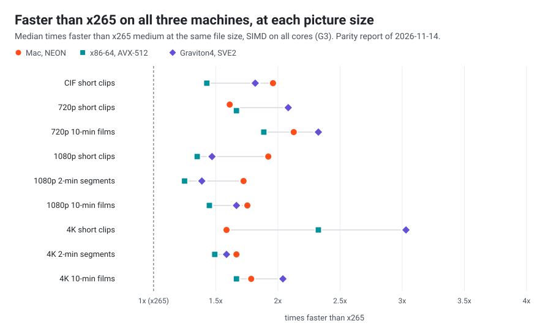
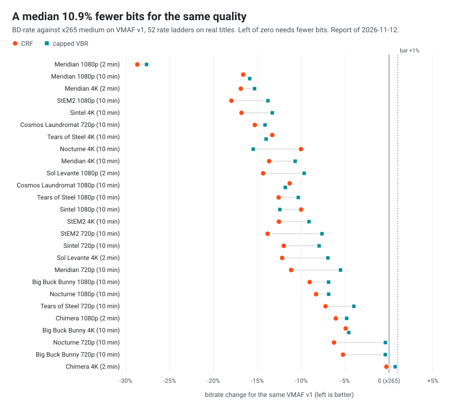

# Introducing yah265

yah265 is an H.265/HEVC encoder written from scratch. What sets it apart from x265 is speed. I gave both encoders the same six ten-minute films at 4K on my Mac and had each write files of the same size at `--preset medium`. x265 took <!--gen:films-uhd-ref-->74 minutes<!--/gen:films-uhd-ref--> to encode them. yah265 took <!--gen:films-uhd-ours-->42 minutes<!--/gen:films-uhd-ours-->. Its pictures also scored higher on VMAF v1 on <!--gen:films-uhd-better-->all 6<!--/gen:films-uhd-better--> of those films.

<figure class="chart"></figure>

The longest film, <!--gen:longest-title-->Nocturne<!--/gen:longest-title-->, took x265 <!--gen:longest-ref-->28.2 minutes<!--/gen:longest-ref--> at 4K and yah265 <!--gen:longest-ours-->13.6 minutes<!--/gen:longest-ours-->. At 1080p the films took <!--gen:films-hd-ref-->15 minutes<!--/gen:films-hd-ref--> against <!--gen:films-hd-ours-->9 minutes<!--/gen:films-hd-ours-->. <!--gen:films-void-->Meridian<!--/gen:films-void--> is missing from the 1080p panel because its source decoder couldn't feed frames fast enough for a valid timing.

On this page "2x faster" means half the wall time.

## The goals

yah265 is the second of three sibling encoders. [yah264](https://terranvigil.github.io/yah264/) reached the same goals against x264 first. The code is clean-room from the ITU-T H.265 specification. Every stream it writes is checked against two independent decoders.

I set three speed goals against x265 at `--preset medium`. Each one compares files of the same size:

| goal | yah265 | x265 |
|---|---|---|
| G1 | plain C on one thread | `--no-asm` on one thread |
| G2 | plain C on all cores | `--no-asm` on all cores |
| G3 | SIMD on all cores | its own assembly on all cores |

G3 is the one a user sees. A goal passes in a group of clips when the median is at least even and the slowest clip is no more than 15% slower. Quality has its own bar. On every rate ladder of a real film, yah265 may need at most 1.0% more bits than x265 for the same VMAF v1. The test set runs from CIF to 4K and from ten-second clips to ten-minute films.

## The same lead on three machines

The Mac isn't the only machine I timed. Both encoders also ran on an Intel Xeon with AVX-512 and on an AWS Graviton4 with SVE2. Each cloud box held both encoders to the same 16 cores. With SIMD on all cores yah265 ran <!--gen:g3-all-->1.35x to 3.23x<!--/gen:g3-all--> faster than x265 across every group on the three machines.

<figure class="chart"></figure>

Each range below runs from the slowest group's median to the fastest's. A group is one resolution in one tier: short clips, two-minute segments or ten-minute films.

<!--gen:goal-table-->
| goal | Apple M5 Max (NEON) | Xeon 8488C (AVX-512) | Graviton4 (SVE2) |
|---|--:|--:|--:|
| G1: C on one thread | 2.17x to 4.35x | 1.49x to 3.03x | 1.52x to 3.03x |
| G2: C on all cores | 2.86x to 4.17x | 2.27x to 4.76x | 2.38x to 4.76x |
| G3: SIMD on all cores | 1.61x to 2.13x | 1.35x to 2.44x | 1.47x to 3.23x |
<!--/gen:goal-table-->

That's <!--gen:combos-->81 of 81<!--/gen:combos--> combinations of machine, group and goal inside the bar. The slowest single clip anywhere is <!--gen:slowest-cell-->Bus at CIF on the Xeon<!--/gen:slowest-cell-->, which still runs <!--gen:slowest-x-->1.22x<!--/gen:slowest-x--> faster.

Plenty of x86 machines have no AVX-512. So I also capped both encoders at AVX2 on the Xeon and timed the short clips again. yah265 ran <!--gen:avx2-range-->1.18x to 2.22x<!--/gen:avx2-range--> faster than x265. Capped at SSE4.2 it ran <!--gen:sse42-range-->1.45x to 2.33x<!--/gen:sse42-range--> faster.

The G3 medians per group, with the quality lead at the same file size:

<!--gen:arch-table-->
| class | tier | Mac, NEON | x86-64, AVX-512 | Graviton4, SVE2 | VMAF v1 ahead at the same size |
|---|---|--:|--:|--:|--:|
| CIF | short clips | 1.96x | 1.43x | 1.82x | +2.33 |
| 720p | short clips | 1.61x | 1.67x | 2.08x | +2.39 |
| 720p | 10-min films | 2.13x | 1.89x | 2.38x | +1.67 |
| 1080p | short clips | 1.92x | 1.35x | 1.47x | +0.61 |
| 1080p | 2-min segments | 1.69x | 1.35x | 1.56x | +1.96 |
| 1080p | 10-min films | 1.75x | 1.47x | 1.69x | +1.08 |
| 4K | short clips | 1.61x | 2.44x | 3.23x | +1.86 |
| 4K | 2-min segments | 1.79x | 1.89x | 2.13x | +1.40 |
| 4K | 10-min films | 1.72x | 1.69x | 2.08x | +1.18 |
<!--/gen:arch-table-->

The last column is how many VMAF v1 points yah265 scores above x265 when both files are the same size, median over the group, read on the Mac.

## Fewer bits for the same picture

Speed would mean little if the files got bigger. Every real film has a five-rung rate ladder at CRF and another at capped VBR, scored on VMAF v1 at display size.

<figure class="chart"></figure>

The yah265 curve sits above x265's the whole way on <!--gen:curve1-->the ten-minute film of Tears of Steel at 1080p<!--/gen:curve1-->. Over the shared range it needs <!--gen:curve1-bd-->12.6%<!--/gen:curve1-bd--> fewer bits for the same score. On <!--gen:curve2-->the two-minute segment of Meridian at 1080p<!--/gen:curve2--> it needs <!--gen:curve2-bd-->28.7%<!--/gen:curve2-bd--> fewer. Chimera is the hardest title in the set for us. On <!--gen:curve3-->the two-minute segment of Chimera at 4K<!--/gen:curve3--> the two curves nearly touch, <!--gen:curve3-bd-->0.3%<!--/gen:curve3-bd--> apart.

<figure class="chart"></figure>

Over all <!--gen:ladders-->52<!--/gen:ladders--> ladders yah265 needs a median <!--gen:bd-median-->10.9%<!--/gen:bd-median--> fewer bits. That's <!--gen:bd-crf-->12.1%<!--/gen:bd-crf--> at CRF and <!--gen:bd-vbr-->9.4%<!--/gen:bd-vbr--> at capped VBR. It comes out ahead on <!--gen:ladders-ahead-->51<!--/gen:ladders-ahead--> ladders. All <!--gen:ladders-in-bar-->52<!--/gen:ladders-in-bar--> are inside the bar. The thinnest margin is <!--gen:bd-tightest-->the two-minute segment of Chimera at 4K under VBR<!--/gen:bd-tightest--> at <!--gen:bd-tightest-v-->+0.70%<!--/gen:bd-tightest-v-->.

The ladders ran on the Mac. Graviton4 writes the Mac's streams byte for byte in <!--gen:g4-same-->108 of 114<!--/gen:g4-same--> timed encodes. The others had a different input or a re-solved crf. So Graviton4's quality is the Mac's. On x86-64 the compiler rounds some floating-point math differently, which moves the streams a little. I re-ran <!--gen:x86-repro-n-->4<!--/gen:x86-repro-n--> ladders there. Each came within <!--gen:x86-repro-max-->0.07<!--/gen:x86-repro-max--> BD points of the Mac's.

## Through ffmpeg

Most people meet an encoder through ffmpeg. An outside tester would run it that way too. So I ran both encoders from one ffmpeg build with `-preset medium` and default threads. yah265 ran at a fixed CRF. x265's CRF was then searched until its file came within <!--gen:ff-tol-->2%<!--/gen:ff-tol--> of ours. VMAF v1 scored every frame of both.

<!--gen:ffmpeg-table-->
| clip | encoder | crf | size | encode time | VMAF v1 |
|---|---|--:|--:|--:|--:|
| Meridian 1080p, 60 s | libyah265 | 25 | 3.08 MB | **9.0 s** | 84.25 |
|  | libx265 | 26.7 | 3.10 MB | 23.7 s | 82.22 |
| Tears of Steel 1080p, 60 s | libyah265 | 25 | 8.09 MB | **5.7 s** | 90.62 |
|  | libx265 | 25.8 | 7.96 MB | 10.5 s | 89.77 |
<!--/gen:ffmpeg-table-->

On <!--gen:ff-best-->Meridian at 1080p<!--/gen:ff-best--> yah265 finished in <!--gen:ff-best-ours-->9.0 s<!--/gen:ff-best-ours--> where x265 took <!--gen:ff-best-ref-->23.7 s<!--/gen:ff-best-ref-->. The ffmpeg wrapper for yah265 isn't in upstream ffmpeg yet. Until it is, the last command below runs the same encode through yah265's own command line.

<!--gen:ff-cmd-->
```sh
ffmpeg -ss 30 -i Meridian_UHD4k5994_HDR_P3PQ.mp4 -frames:v 3596 -an -vf scale=1920:1080:flags=bicubic,format=yuv420p \
  -c:v libyah265 -preset medium -crf 25 -tag:v hvc1 out.yah265.mp4
ffmpeg -ss 30 -i Meridian_UHD4k5994_HDR_P3PQ.mp4 -frames:v 3596 -an -vf scale=1920:1080:flags=bicubic,format=yuv420p \
  -c:v libx265 -preset medium -crf 26.7 -tag:v hvc1 out.x265.mp4

# the same yah265 encode through its own command line
ffmpeg -ss 30 -i Meridian_UHD4k5994_HDR_P3PQ.mp4 -frames:v 3596 -an -vf scale=1920:1080:flags=bicubic,format=yuv420p -f yuv4mpegpipe - | \
  build-rel/n265 - -o out.hevc --preset medium --crf 25
```
<!--/gen:ff-cmd-->

## How it was measured

On the Mac both encoders ran on one Apple M5 Max with 18 cores. The reference there is the Homebrew build of x265 4.3 with its arm64 assembly. On the cloud boxes x265 4.3 was built from its release tarball with clang. For a timed reading, yah265 is solved onto x265's file size within 1%. Both encoders read the same frames from one feeder on standard input. Quality is VMAF v1, scored at display size on every frame of the two-minute segments and every third frame of the films. The ten-minute films skip their black openings and stop before the end credits. Cloud wall times are reported apart from the Mac's and never pooled with them.

The [results page](results.md) has the Mac's tables. The [methodology](methodology.md) has the rules that make a number valid. The figures on this page come from <!--gen:report-link-->[the all-architecture parity report of 2026-11-14](docs/parity/PARITY-REPORT-yah265-all-isa-2026-11-14.md)<!--/gen:report-link--> and the per-machine reports beside it. The history chart comes from the board's own data file. The ffmpeg runs come from a small data file copied out of each run. One [script](scripts/blog_charts.py) draws every chart and fills in every figure. You can [check it yourself](check-it-yourself.md).

## How we got there

<figure class="chart"></figure>

The chart is the timed board. It read every milestone commit on the same corpus of short clips until the shared parity spec took over in October. On the first full board yah265 took <!--gen:hist-g1-first-->2.7x<!--/gen:hist-g1-first--> x265's time on one thread in plain C. The first reading with SIMD on every core was worse. It took <!--gen:hist-g3-first-->15.2x<!--/gen:hist-g3-first--> x265's time.

### Correct first, then quality, then speed

The first commits built the bitstream layer and a conformance gate before any encoding decision. Every stream has to decode to the encoder's own reconstruction through both ffmpeg and libde265. One-thread output has to be byte-identical from run to run. Neither rule ever relaxed.

Quality came before speed on purpose. yah264 had learned that a speed round run before quality settles has to be redone. A board read at matched file size moves whenever quality moves.

### Threads and NEON

x265 runs at most four frame threads by default. On an 18-core machine at 720p it leaves about half the cores idle. yah265 runs one shared worker pool whose unit of work is a row of coding tree units. Rows from several frames are in flight at once. A row starts once its reference frames have finished the rows its motion search can reach. Because each wait depends only on geometry, the threaded encoder makes the same decisions as the one-thread encoder.

NEON kernels shipped in rounds the same week. This was the hard goal, because x265's arm64 assembly makes it about three times as fast as its own C. Each of our kernels is bit-exact with its C reference. Turning SIMD off changes the speed and nothing else. The SIMD line on the chart drops from far below even to under 2x slower within two days.

### Picking what medium means

By mid-September yah265 had a large quality lead and was still slower with SIMD on. We redefined `medium` as the goal preset and spent part of the lead on speed. Its tools and effort were placed so that it passes the goals on every clip. That's where the SIMD line crosses even.

### Real films exposed what the short clips missed

The short corpus had us ahead everywhere. Two-minute segments of real titles at 720p to 4K didn't agree. Meridian at 1080p needed 11.7% more bits than x265 for the same quality. Sol Levante at 1080p took 1.28x x265's time.

Meridian's gap was the block size. At low rates our 32x32 coding blocks spent their bits on syntax. A 64x64 tree with a skip gate went in at HD and 4K. Sol Levante's time went to intra search inside P and B frames. We ranked the intra modes once, stopped trying 4x4 intra there and stopped recursing under intra blocks that almost never split. Both changes also gained quality.

On all cores the 64x64 tree then cost wall time. A task trace showed why: too few frames were in flight. We built a scheduling simulator that matched the measured walls within 1%. It pointed at twelve frames in flight with reference frames scheduled first. The output stayed byte-identical across thread counts.

### VBR started out behind

When VBR was first measured, we trailed x265 by 8% to 35% on cells where CRF was level or ahead. It was also slower than x265 at all cores. VBR waited for every frame to finish before it planned the next one. Only one picture was ever in flight. Planning from frames up to eight back gave the parallelism back.

That change wrote HRD underflows on very shallow buffers. A stream that underflows its own signaled buffer isn't conformant. Those buffers now code with no lag. Capped VBR then moved onto the CRF path with a slow level. It also stopped spending surplus bits on frames that already looked perfect. Together those took the Chimera segment's VBR gap from 19% to under 1% behind.

### A short dev set

A full-table read took a night. In October we switched to a dev set of eight short windows and one two-minute segment. It reads in about ten minutes. Thirteen changes merged in two days. Every one was read on the whole dev set before it shipped.

The biggest find there was motion search on fine texture. Our runs of B-frames were twice as long as x265's. At that distance the diamond search got stuck. A hexagon search fixed it, along with a stronger motion term in the rule that ends a run. Sunflower at 1080p went from 18.7% behind to slightly ahead.

### VMAF v1

In late October I moved all three encoders from VMAF-NEG to VMAF v1, which reads chroma, banding and motion. Chimera fell over the bar at once. The loss was chroma. Inter chroma now rounds less aggressively. Both chroma quantizers run finer than luma's.

Scoring at display size exposed the same chroma loss at CIF. The chroma setting now reaches down to CIF too. Then v1's banding feature found dark grain coded to flat steps on StEM2 and Nocturne. Raising the psychovisual strength on dark, smooth blocks fixed both.

### The input read

One title still failed the speed bar with SIMD on. Meridian at 720p took 1.22x x265's time even though our instruction count was the lowest of any film. The time went to the input. The command line read each frame between calls into the encoder. A slow disk added its time to every frame. Reading on its own thread made Meridian 1.6x faster at six threads.

### Off the Mac

Parity on the Mac wasn't the finish line, because a parity claim has to hold on every instruction set the encoder ships. The x86-64 kernels gained an AVX-512 tier for the transforms and the block-difference sums. The arm64 kernels gained an SVE tier. Every tier is bit-exact with C, as NEON is. Both cloud tables then ran on EC2 spot instances, with both encoders built on each box from the same source. yah265 passed every goal in every group on both machines the first time they were timed.

## Still open

- The content tier (film grain, sports and screen capture) was timed only at G3 and only on the Mac. Its speed doesn't count toward parity.
- End credits are reported apart from the films. <!--gen:credits-->On 1 of 5 titles yah265 needs more bytes than x265 there. The other 2 are still pending.<!--/gen:credits-->
- SSE4.2 and AVX2 were timed on short clips with both encoders held to that tier on a Xeon. No CPU that stops at AVX2 or SSE4.2 in silicon was timed. Neither was any AMD x86 CPU.
- Graviton3 runs SVE at 256 bits. It was timed on short clips at G3 only.
- The ffmpeg runs above are on the Mac only, at 1080p. A 4K run was started and cancelled.

## Docs

- [Getting started](start.md)
- [Design](design.md)
- [HDR](hdr.md)
- [Results](results.md)
- [Check it yourself](check-it-yourself.md)
- Source: [github.com/terranvigil/yah265](https://github.com/terranvigil/yah265)
