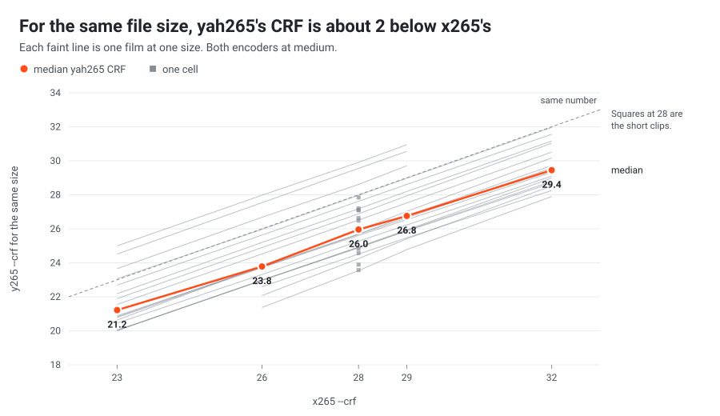

# Coming from x265

This page is for someone who has an x265 command line and wants the `y265` one. Most options keep their name and meaning. A few are spelled differently and some aren't accepted. `y265` stops with an error on an option it doesn't know. It never ignores one silently.

## Options that keep their name

<!--map:accepted-->
| area | options |
|---|---|
| rate | `--crf`, `--qp`, `--bitrate`, `--vbv-maxrate`, `--vbv-bufsize`, `--vbv-init`, `--crf-min`, `--crf-max`, `--qpmin`, `--qpmax`, `--strict-cbr`, `--pass`, `--stats`, `--zones`, `--qpfile`, `--max-ausize-factor` |
| preset and tune | `--preset` with `fast`, `medium`, `slow` or `slower`, and `--tune zerolatency` |
| GOP | `--keyint`, `--open-gop`, `--radl`, `--bframes`, `--ref`, `--rc-lookahead`, `--weightp`, `--weightb`, `--temporal-layers` |
| coding | `--ctu`, `--tu-intra-depth`, `--tu-inter-depth`, `--rdoq-level`, `--cbqpoffs`, `--crqpoffs`, `--lossless` |
| input | `--input-res`, `--input-csp`, `--input-depth`, `--output-depth`, `--fps`, `--frames`, `--seek`, `--dither` |
| stream | `--repeat-headers`, `--aud`, `--eos`, `--eob`, `--hash`, `--high-tier`, `--info`, `--idr-recovery-sei`, `--pic-struct`, `--hrd-concat` |
| filters | `--nr-intra`, `--nr-inter`, `--mcstf` |
| color and HDR | `--colorprim`, `--transfer`, `--colormatrix`, `--range`, `--videoformat`, `--chromaloc`, `--overscan`, `--sar`, `--display-window`, `--video-signal-type-preset`, `--master-display`, `--max-cll`, `--hdr10`, `--atc-sei`, `--dolby-vision-rpu`, `--dolby-vision-profile` |
| reports | `--ssim`, `--csv`, `--csv-log-level` |
<!--/map:accepted-->

The same name doesn't promise the same default. [Options](options.md) lists every default, and `--show-config` prints what a command resolves to without encoding.

## Options with a different spelling

<!--map:renamed-->
| x265 | `y265` | note |
|---|---|---|
| `--input`, `--y4m` | the first bare argument | a file name, or `-` for a pipe. A Y4M header is recognized by itself |
| `--output` | `-o` | |
| `--pools`, `--frame-threads` | `--threads` | one count. The default, 0, is one worker per CPU |
| `--aq-mode` | `--aq` | 1 or 0. The preset sets the strength |
| `--cutree`, `--no-cutree` | `--cutree` | takes 1 or 0 |
| `--level-idc` | `--level` | written `4.1` or `41` |
| `--vui-timing-info` | `--vui-timing` | on by default |
| `--recon` | `--dump-recon` | raw YUV |
| `--log-level` | `--verbose` | prints the resolved configuration |
| `--hdr10-opt` | `--hdr-opt` | either name works. It turns on yah265's own HDR tuning, which works differently |
| `--b-adapt` | `--b-adapt` | 0 and 1 mean the same. 2 isn't offered |
| `--dup-threshold` | `--dup-threshold` | the unit is different. Start from 0, the default |
| `--film-grain` | `--film-grain` | x265 takes a file of grain parameters. `y265` estimates the grain itself and takes a strength |
| `--profile` | none | the input and `--output-depth` pick the profile |
<!--/map:renamed-->

## Options y265 doesn't accept

<!--map:refused-->
| x265 | why | use instead |
|---|---|---|
| `--preset` with `ultrafast`, `superfast`, `veryfast`, `faster`, `veryslow` or `placebo` | four were built and measured against the x265 preset of the same name. None earned it. The fastest two aren't built | the error names the nearest of the four presets |
| `--tune psnr`, `--tune ssim` | each fits the encoder to a metric the project doesn't decide on | `--ssim` reports the number without changing the encode |
| `--tune grain` | x265's set of rate-control and psychovisual changes for grain hasn't been built here | `--film-grain` is a different tool that the [guide](guide.md#film-grain-denoising-and-filters) describes |
| `--tune fastdecode` | only part of it could be delivered | `--no-weightp` and `--no-weightb` |
| `--tune animation` | not built | `medium` as it is |
| `--psy-rd`, `--psy-rdoq` | yah265's perceptual weighting works differently, so x265's numbers wouldn't mean the same thing | the preset sets it |
| `--aq-strength` | the preset sets the strength frame by frame | `--aq 0` turns AQ off |
| `--rd`, `--me`, `--subme`, `--merange`, `--rect`, `--amp`, `--limit-refs`, `--rskip`, `--early-skip`, `--max-merge` | how hard the encoder searches is the preset's job here | a preset. The [environment knobs](guide.md#environment-knobs) are there for experiments |
| `--signhide`, `--tskip`, `--strong-intra-smoothing`, `--temporal-mvp` | single coding tools have no switch | a preset |
| `--sao`, `--no-sao`, `--deblock`, `--no-deblock` | the in-loop filters have no switch | none |
| `--scenecut`, `--no-scenecut`, `--min-keyint` | the encoder always looks for scene changes | `--keyint` |
| `--b-pyramid` | B-frames are always arranged as a pyramid | `--bframes` |
| `--wpp`, `--slices`, `--lookahead-slices`, `--lookahead-threads` | yah265 sets up its threads by itself | `--threads` |
| `--asm`, `--no-asm` | the SIMD tier is picked at run time | `N265_ASM_OFF=all` in the environment, for testing |
| `--ipratio`, `--pbratio`, `--qcomp` | rate control isn't steered through these ratios | the guide's [rate modes](guide.md#rate-modes) |
| `--intra-refresh` | refused by name. A refresh only helps if nothing in the refreshed area predicts from outside it. The encoder can't promise that | none |
| `--scaling-list` | refused by name. Every quantizer path would have to apply the matrices | none |
| `--interlace`, `--field` | interlaced coding isn't built | none |
| `--analysis-save`, `--analysis-load` | they serve a multi-stage pipeline that nothing here uses | none |
<!--/map:refused-->

The guide's [list of what's left out](guide.md#left-out-on-purpose) has the longer reasons.

## Translating a CRF

The CRF scale is yah265's own. For the same file size, yah265's number is usually about two below x265's.

<!--trust:fig-crf-->
<figure class="chart"></figure>
<!--/trust:fig-crf-->

<!--trust:crf-table-->
| x265 `--crf` | `y265 --crf`, median | range over the cells | cells |
|--:|--:|--:|--:|
| 23 | 21.2 | 20.0 to 25.0 | 16 |
| 26 | 23.8 | 21.4 to 28.0 | 19 |
| 28 | 26.0 | 23.5 to 29.9 | 30 |
| 29 | 26.8 | 24.8 to 30.9 | 19 |
| 32 | 29.4 | 27.9 to 32.0 | 16 |
<!--/trust:crf-table-->

Use the table as a starting point and check the size on your own content, because the range is wide. The films don't agree with each other. Sintel needs a higher number than x265's and Big Buck Bunny about the same one, while most of the others need one two to four lower.

The row for 28 is the matched point of every size-matched cell on the Mac, where yah265's CRF was solved onto x265's file. The other rows place x265's size at that CRF on yah265's five-rung ladder for each film. A film is left out of a row when the answer falls outside its ladder. The 23 and 32 rows have fewer cells for that reason.
