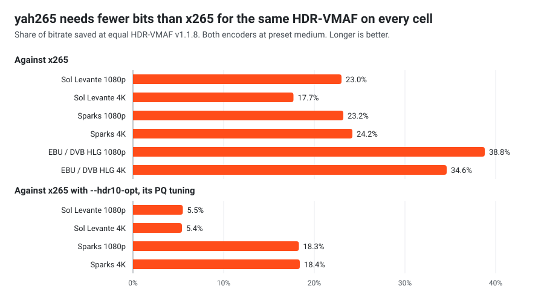

# HDR

yah265 writes HDR10, HDR10+, HLG and Dolby Vision profile 8 as Main 10 HEVC. Each one is a 10-bit stream with color flags that say how to read the samples. Most add metadata that tells a display how the pictures were graded. At `--preset medium` the transfer function also changes how the pictures are coded, as [Tuning for HDR](#tuning-for-hdr) describes.

## What each format is made of

| format | base stream | added to it |
|---|---|---|
| HDR10 | PQ transfer, BT.2020 primaries and matrix | mastering display (ST 2086), MaxCLL and MaxFALL |
| HDR10+ | HDR10 | an ST 2094-40 message per picture |
| HLG | HLG transfer, BT.2020 primaries and matrix | nothing |
| Dolby Vision 8.1 | HDR10 | an RPU per picture |
| Dolby Vision 8.2 | SDR BT.709, coded 10-bit | an RPU per picture |
| Dolby Vision 8.4 | HLG | an RPU per picture |

<figure class="diagram">
<svg class="d-wide" viewBox="0 0 720 240" role="img" aria-labelledby="hdr-lay-t hdr-lay-d">
<title id="hdr-lay-t">Which HDR format is built on which base stream</title>
<desc id="hdr-lay-d">The three base streams are HDR10, HLG and SDR BT.709, drawn in a row. HDR10+ and Dolby Vision 8.1 each add per-picture metadata to HDR10. Dolby Vision 8.4 adds it to HLG. Dolby Vision 8.2 adds it to SDR BT.709.</desc>
<text class="d-label" x="20" y="22">Per-picture metadata</text>
<rect class="d-box" x="20" y="36" width="140" height="52" rx="6"/>
<text class="d-text" x="90" y="58" text-anchor="middle">HDR10+</text>
<text class="d-label" x="90" y="77" text-anchor="middle">ST 2094-40</text>
<rect class="d-box" x="180" y="36" width="140" height="52" rx="6"/>
<text class="d-text" x="250" y="58" text-anchor="middle">Dolby Vision 8.1</text>
<text class="d-label" x="250" y="77" text-anchor="middle">RPU</text>
<rect class="d-box" x="350" y="36" width="160" height="52" rx="6"/>
<text class="d-text" x="430" y="58" text-anchor="middle">Dolby Vision 8.4</text>
<text class="d-label" x="430" y="77" text-anchor="middle">RPU</text>
<rect class="d-box" x="540" y="36" width="160" height="52" rx="6"/>
<text class="d-text" x="620" y="58" text-anchor="middle">Dolby Vision 8.2</text>
<text class="d-label" x="620" y="77" text-anchor="middle">RPU</text>
<line class="d-arrow" x1="90" y1="90" x2="90" y2="140"/>
<line class="d-arrow" x1="250" y1="90" x2="250" y2="140"/>
<line class="d-arrow" x1="430" y1="90" x2="430" y2="140"/>
<line class="d-arrow" x1="620" y1="90" x2="620" y2="140"/>
<rect class="d-fill" x="20" y="142" width="300" height="56" rx="6"/>
<text class="d-text" x="170" y="166" text-anchor="middle">HDR10</text>
<text class="d-label" x="170" y="186" text-anchor="middle">PQ, BT.2020, static metadata</text>
<rect class="d-fill" x="350" y="142" width="160" height="56" rx="6"/>
<text class="d-text" x="430" y="166" text-anchor="middle">HLG</text>
<text class="d-label" x="430" y="186" text-anchor="middle">HLG, BT.2020</text>
<rect class="d-fill" x="540" y="142" width="160" height="56" rx="6"/>
<text class="d-text" x="620" y="166" text-anchor="middle">SDR</text>
<text class="d-label" x="620" y="186" text-anchor="middle">BT.709</text>
<text class="d-label" x="20" y="226">Base streams</text>
</svg>
<svg class="d-narrow" viewBox="0 0 360 452" role="img" aria-labelledby="hdr-lay-t-n hdr-lay-d-n">
<title id="hdr-lay-t-n">Which HDR format is built on which base stream</title>
<desc id="hdr-lay-d-n">The three base streams are HDR10, HLG and SDR BT.709, drawn one under another. HDR10+ and Dolby Vision 8.1 each add per-picture metadata to HDR10. Dolby Vision 8.4 adds it to HLG. Dolby Vision 8.2 adds it to SDR BT.709.</desc>
<rect class="d-box" x="10" y="8" width="164" height="46" rx="6"/>
<text class="d-text" x="92" y="28" text-anchor="middle">HDR10+</text>
<text class="d-label" x="92" y="45" text-anchor="middle">ST 2094-40</text>
<rect class="d-box" x="186" y="8" width="164" height="46" rx="6"/>
<text class="d-text" x="268" y="28" text-anchor="middle">Dolby Vision 8.1</text>
<text class="d-label" x="268" y="45" text-anchor="middle">RPU</text>
<line class="d-arrow" x1="92" y1="56" x2="92" y2="80"/>
<line class="d-arrow" x1="268" y1="56" x2="268" y2="80"/>
<rect class="d-fill" x="10" y="82" width="340" height="46" rx="6"/>
<text class="d-text" x="180" y="102" text-anchor="middle">HDR10</text>
<text class="d-label" x="180" y="119" text-anchor="middle">PQ, BT.2020, static metadata</text>
<rect class="d-box" x="10" y="160" width="340" height="46" rx="6"/>
<text class="d-text" x="180" y="180" text-anchor="middle">Dolby Vision 8.4</text>
<text class="d-label" x="180" y="197" text-anchor="middle">RPU</text>
<line class="d-arrow" x1="180" y1="208" x2="180" y2="232"/>
<rect class="d-fill" x="10" y="234" width="340" height="46" rx="6"/>
<text class="d-text" x="180" y="254" text-anchor="middle">HLG</text>
<text class="d-label" x="180" y="271" text-anchor="middle">HLG, BT.2020</text>
<rect class="d-box" x="10" y="312" width="340" height="46" rx="6"/>
<text class="d-text" x="180" y="332" text-anchor="middle">Dolby Vision 8.2</text>
<text class="d-label" x="180" y="349" text-anchor="middle">RPU</text>
<line class="d-arrow" x1="180" y1="360" x2="180" y2="384"/>
<rect class="d-fill" x="10" y="386" width="340" height="46" rx="6"/>
<text class="d-text" x="180" y="406" text-anchor="middle">SDR</text>
<text class="d-label" x="180" y="423" text-anchor="middle">BT.709</text>
</svg>
<figcaption>A player that doesn't know the per-picture metadata plays the base stream under it.</figcaption>
</figure>

Dolby Vision profile 5 isn't offered. Its base layer is in Dolby's IPTPQc2 color space. Nothing in this toolchain can produce or check that.

## Encoding HDR10

`y265` reads the master through a pipe from ffmpeg:

```sh
ffmpeg -i master.mov -pix_fmt yuv420p10le -strict -1 -f yuv4mpegpipe - |
  y265 - -o out.hevc --crf 22 \
    --colorprim bt2020 --transfer smpte2084 --colormatrix bt2020nc \
    --master-display 'G(13250,34500)B(7500,3000)R(34000,16000)WP(15635,16450)L(10000000,1)' \
    --max-cll 1000,400
```

Because the two metadata values describe the grade, they come from the master. [Reading the values off a source](#reading-the-values-off-a-source) shows how to get them. The string above is a P3 D65 mastering display.

| in the command | what it is | unit |
|---|---|---|
| `G(x,y)B(x,y)R(x,y)` | the display's green, blue and red primaries | 0.00002 |
| `WP(x,y)` | its white point | 0.00002 |
| `L(max,min)` | its peak and black luminance | 0.0001 cd/m² |
| `--max-cll <c,f>` | MaxCLL, then MaxFALL | cd/m² |

### One name for the color flags

`--video-signal-type-preset` sets the color flags from one name. A mastering display can follow the name after a colon.

| name | what it sets |
|---|---|
| `BT2100_PQ_YCC` | PQ, BT.2020 primaries and matrix, chroma location 2 |
| `BT2100_PQ_YCC:P3D65x1000n0005` | the same, plus a P3 D65 mastering display from 0.0005 to 1000 cd/m² |
| `BT2100_PQ_YCC:P3D65x4000n005` | the same, plus a P3 D65 mastering display from 0.005 to 4000 cd/m² |
| `BT2100_HLG_YCC` | HLG, BT.2020 primaries and matrix, chroma location 2 |

A color flag given beside the name wins over it. Because the name sets no light level, `--max-cll` still goes beside it.

### HDR10 from ffmpeg

```sh
ffmpeg -i master.mov -pix_fmt yuv420p10le \
  -vf setparams=color_primaries=bt2020:color_trc=smpte2084:colorspace=bt2020nc \
  -c:v libyah265 -preset medium -crf 22 \
  -yah265-params 'master-display=G(13250,34500)B(7500,3000)R(34000,16000)WP(15635,16450)L(10000000,1):max-cll=1000,400' \
  -tag:v hvc1 out.mp4
```

`libyah265` writes the color flags from the tags on the frames ffmpeg hands it. A master that is already tagged PQ and BT.2020 needs no `setparams`. The filter is there for a source with missing tags. ffmpeg's `-color_primaries` and `-color_trc` flags didn't reach the encoder in the ffmpeg 8 build I tested.

The mastering display and the light level reach the stream only through `-yah265-params`. Without it, ffmpeg writes those values to the MP4 container only, not to the stream.

HDR10+ and Dolby Vision read metadata files. The parameter list refuses those two options. Encode HDR10+ and Dolby Vision with `y265`.

## Encoding HLG

Because HLG has no static metadata, the two ways to signal it differ only in their color flags.

| signaling | options |
|---|---|
| HLG in the color flags | `--transfer arib-std-b67 --colorprim bt2020 --colormatrix bt2020nc` |
| BT.2020 SDR in the color flags, HLG in an alternative transfer SEI | `--transfer bt2020-10 --colorprim bt2020 --colormatrix bt2020nc --atc-sei arib-std-b67` |

The second form is the backward-compatible signaling that broadcast uses. An older receiver reads only the color flags and shows the picture as BT.2020 SDR. A receiver that knows the SEI treats the stream as HLG.

```sh
ffmpeg -i master.mov -pix_fmt yuv420p10le -strict -1 -f yuv4mpegpipe - |
  y265 - -o out.hevc --crf 22 \
    --transfer bt2020-10 --colorprim bt2020 --colormatrix bt2020nc \
    --atc-sei arib-std-b67
```

## Encoding HDR10+ and Dolby Vision 8.1

The command is HDR10's with a metadata file for each format. Either one works alone.

<!-- recipe: skip needs an HDR10+ JSON and a Dolby Vision RPU file -->
```sh
ffmpeg -i master.mov -pix_fmt yuv420p10le -strict -1 -f yuv4mpegpipe - |
  y265 - -o out.hevc --crf 22 \
    --colorprim bt2020 --transfer smpte2084 --colormatrix bt2020nc \
    --master-display 'G(13250,34500)B(7500,3000)R(34000,16000)WP(15635,16450)L(10000000,1)' \
    --max-cll 1000,400 \
    --dhdr10-info meta.json \
    --dolby-vision-rpu RPU.bin --dolby-vision-profile 8.1
```

The other two Dolby Vision profiles take the same pair of options over a different base stream. All three want a 10-bit 4:2:0 encode at limited range.

| `--dolby-vision-profile` | color flags of the base stream |
|---|---|
| `8.1` | HDR10's |
| `8.2` | `--transfer bt709 --colorprim bt709 --colormatrix bt709` |
| `8.4` | either HLG form from the table above |

A raw HEVC stream has nowhere to say "this is Dolby Vision" except the RPUs themselves. A player needs the container to tell it. In MP4 that's the Dolby Vision configuration box, named `dvvC` for profile 8. Matroska has an equivalent. ffmpeg's stream copy from a raw `.hevc` doesn't write that box. A Dolby Vision-aware muxer such as MP4Box or mkvmerge does.

## Reading the values off a source

ffprobe prints the color flags and the static metadata of a file's first frame:

```sh
ffprobe -v error -select_streams v:0 -read_intervals '%+#1' -show_frames \
  -show_entries stream=profile,pix_fmt:frame=color_primaries,color_transfer,color_space,chroma_location:frame_side_data \
  -of default=nw=1 master.mov
```

On an HDR10 master the side data has a mastering display block and a light level block. ffprobe prints each value as a fraction. Use the numerators as they are when the denominators are 50000 (chromaticities) and 10000 (luminances).

| ffprobe field | goes in |
|---|---|
| `green_x`, `green_y` | `G(x,y)` |
| `blue_x`, `blue_y` | `B(x,y)` |
| `red_x`, `red_y` | `R(x,y)` |
| `white_point_x`, `white_point_y` | `WP(x,y)` |
| `max_luminance`, `min_luminance` | `L(max,min)` |
| `max_content`, `max_average` | `--max-cll <c,f>` |

## Checking the output

The same ffprobe command on `out.hevc` shows what a player will read. These are the values a correct stream gives:

| field | HDR10 | HLG |
|---|---|---|
| `profile` | `Main 10` | `Main 10` |
| `pix_fmt` | `yuv420p10le` | `yuv420p10le` |
| `color_primaries` | `bt2020` | `bt2020` |
| `color_transfer` | `smpte2084` | `arib-std-b67` |
| `color_space` | `bt2020nc` | `bt2020nc` |
| HDR side data | mastering display, content light level | none |

Because ffprobe applies the alternative transfer SEI, it reports `arib-std-b67` for both HLG forms. MediaInfo tells them apart. On HDR10 it also names the format on its "HDR format" line and prints the mastering display and light levels in cd/m².

For the dynamic formats, `hdr10plus_tool extract` and `dovi_tool extract-rpu` read the metadata back out of the encode.

## Mistakes to avoid

### 8-bit input

`y265` codes at the depth of its input. HDR10 or HLG flags on an 8-bit input therefore give an 8-bit Main stream labeled HDR. Convert in ffmpeg with `-pix_fmt yuv420p10le`, as the commands above do. HDR10+ and Dolby Vision refuse an 8-bit encode outright.

### Chroma location

BT.2020 and BT.2100 site 4:2:0 chroma top-left. That's `--chromaloc 2`. Set it only when the master's chroma really sits there, because the flag relabels the samples without moving them. The `--video-signal-type-preset` names set it for you.

### Flags that contradict the format

A command line that would mislabel a dynamic format is refused before it writes anything.

| command line | result |
|---|---|
| HDR10+ without a 10-bit HDR10 encode under it | refused |
| a Dolby Vision profile whose color flags don't match | refused |
| Dolby Vision on an 8-bit, full-range or non-4:2:0 encode | refused |
| an RPU file without a profile, or a profile without a file | refused |
| a profile other than 8.1, 8.2 or 8.4 | refused |
| Dolby Vision without a VBV | warning |
| Dolby Vision 8.1 without `--master-display` | warning |

The two warnings still encode.

## Where the signaling goes in the stream

<figure class="diagram">
<svg class="d-wide" viewBox="0 0 720 250" role="img" aria-labelledby="hdr-fig-t hdr-fig-d">
<title id="hdr-fig-t">Where each piece of HDR signaling goes in the stream</title>
<desc id="hdr-fig-d">A stream drawn as a row of pictures. The color flags are in the sequence parameter set at the start. The mastering display and light level messages come at each key frame. An HDR10+ message and a Dolby Vision RPU come with each picture.</desc>
<rect class="d-accent" x="10" y="100" width="90" height="56" rx="6"/>
<text class="d-text" x="55" y="124" text-anchor="middle">SPS</text>
<text class="d-label" x="55" y="144" text-anchor="middle">VUI</text>
<rect class="d-fill" x="120" y="100" width="110" height="56" rx="6"/>
<text class="d-text" x="175" y="133" text-anchor="middle">key frame</text>
<rect class="d-box" x="250" y="100" width="90" height="56" rx="6"/>
<text class="d-text" x="295" y="133" text-anchor="middle">picture</text>
<rect class="d-box" x="360" y="100" width="90" height="56" rx="6"/>
<text class="d-text" x="405" y="133" text-anchor="middle">picture</text>
<rect class="d-fill" x="470" y="100" width="110" height="56" rx="6"/>
<text class="d-text" x="525" y="133" text-anchor="middle">key frame</text>
<rect class="d-box" x="600" y="100" width="90" height="56" rx="6"/>
<text class="d-text" x="645" y="133" text-anchor="middle">picture</text>
<text class="d-label" x="10" y="24">Once per stream</text>
<text class="d-label" x="10" y="44">transfer, primaries, matrix</text>
<line class="d-arrow" x1="55" y1="54" x2="55" y2="98"/>
<text class="d-label" x="200" y="24">At each key frame</text>
<text class="d-label" x="200" y="44">mastering display, light level</text>
<line class="d-arrow" x1="210" y1="54" x2="180" y2="98"/>
<line class="d-arrow" x1="380" y1="54" x2="520" y2="98"/>
<text class="d-label" x="360" y="222" text-anchor="middle">With each picture: an HDR10+ message and a Dolby Vision RPU</text>
<line class="d-line" x1="175" y1="190" x2="645" y2="190"/>
<line class="d-arrow" x1="175" y1="190" x2="175" y2="158"/>
<line class="d-arrow" x1="295" y1="190" x2="295" y2="158"/>
<line class="d-arrow" x1="405" y1="190" x2="405" y2="158"/>
<line class="d-arrow" x1="525" y1="190" x2="525" y2="158"/>
<line class="d-arrow" x1="645" y1="190" x2="645" y2="158"/>
</svg>
<svg class="d-narrow" viewBox="0 0 360 360" role="img" aria-labelledby="hdr-fig-t-n hdr-fig-d-n">
<title id="hdr-fig-t-n">Where each piece of HDR signaling goes in the stream</title>
<desc id="hdr-fig-d-n">A stream drawn as a column of pictures. The color flags are in the sequence parameter set at the start. The mastering display and light level messages come at each key frame. An HDR10+ message and a Dolby Vision RPU come with each picture.</desc>
<rect class="d-accent" x="40" y="8" width="110" height="52" rx="6"/>
<text class="d-text" x="95" y="32" text-anchor="middle">SPS</text>
<text class="d-label" x="95" y="51" text-anchor="middle">VUI</text>
<rect class="d-fill" x="40" y="74" width="110" height="36" rx="6"/>
<text class="d-text" x="95" y="97" text-anchor="middle">key frame</text>
<rect class="d-box" x="40" y="120" width="110" height="36" rx="6"/>
<text class="d-text" x="95" y="143" text-anchor="middle">picture</text>
<rect class="d-box" x="40" y="166" width="110" height="36" rx="6"/>
<text class="d-text" x="95" y="189" text-anchor="middle">picture</text>
<rect class="d-fill" x="40" y="212" width="110" height="36" rx="6"/>
<text class="d-text" x="95" y="235" text-anchor="middle">key frame</text>
<rect class="d-box" x="40" y="258" width="110" height="36" rx="6"/>
<text class="d-text" x="95" y="281" text-anchor="middle">picture</text>
<text class="d-label" x="196" y="22">Once per stream</text>
<text class="d-label" x="196" y="40">transfer, primaries,</text>
<text class="d-label" x="196" y="56">matrix</text>
<line class="d-arrow" x1="190" y1="34" x2="152" y2="34"/>
<text class="d-label" x="196" y="146">At each key frame</text>
<text class="d-label" x="196" y="164">mastering display,</text>
<text class="d-label" x="196" y="180">light level</text>
<line class="d-arrow" x1="190" y1="148" x2="152" y2="94"/>
<line class="d-arrow" x1="190" y1="166" x2="152" y2="228"/>
<line class="d-line" x1="20" y1="92" x2="20" y2="318"/>
<line class="d-arrow" x1="20" y1="92" x2="38" y2="92"/>
<line class="d-arrow" x1="20" y1="138" x2="38" y2="138"/>
<line class="d-arrow" x1="20" y1="184" x2="38" y2="184"/>
<line class="d-arrow" x1="20" y1="230" x2="38" y2="230"/>
<line class="d-arrow" x1="20" y1="276" x2="38" y2="276"/>
<text class="d-label" x="8" y="336">With each picture: an HDR10+ message</text>
<text class="d-label" x="8" y="352">and a Dolby Vision RPU</text>
</svg>
<figcaption>Static HDR10 metadata repeats at key frames so a player can join mid-stream. Dynamic metadata travels with each picture.</figcaption>
</figure>

## Dynamic metadata comes from a file

HDR10+ and Dolby Vision describe the content scene by scene. yah265 doesn't measure that. The metadata comes from the grade, in the files the two common tools write:

- `--dhdr10-info` reads the JSON that [hdr10plus_tool](https://github.com/quietvoid/hdr10plus_tool) writes. `hdr10plus_tool extract master.hevc -o meta.json` makes one. Profile A and profile B with a Bézier tone curve both work. Each takes one window per picture.
- `--dolby-vision-rpu` reads the RPU file that [dovi_tool](https://github.com/quietvoid/dovi_tool) writes. That's `dovi_tool extract-rpu` from an existing Dolby Vision stream, or `dovi_tool generate` from a colorist's Dolby Vision XML.

Entry *i* of either file goes with frame *i* of the input. `--seek` skips entries along with frames. If a file runs out before the input does, the encode exits with an error. A file with entries left over gets a warning.

Both readers check what they read. HDR10+ values must fall inside the HDR10+ profiles' ranges. An RPU's header must say profile 8. Either file can come from a pipe.

## Tuning for HDR

`medium` codes a stream differently once its transfer flag or its alternative transfer SEI names PQ or HLG. The other presets code HDR like SDR.

| picture size | what `medium` does on HDR |
|---|---|
| any size | codes chroma six quantizer steps finer than luma, and drops the extra psy weight it gives dark blocks on SDR |
| 720p and up | keeps the full intra mode search that SDR gives up for speed |
| 4K | keeps the intra transform split too |

Chroma gets the finer steps because HDR chroma loses far more than SDR chroma at the same quantizer.

A switch forces the tuning on for any stream, or off for an HDR one. Chroma offsets you set yourself still win.

<p class="optchips"><span>Options</span> <a href="options.md#opt-hdr-opt"><code>--hdr-opt</code></a> <a href="options.md#opt-hdr10-opt"><code>--hdr10-opt</code></a> <a href="options.md#opt-no-hdr-opt"><code>--no-hdr-opt</code></a> <a href="options.md#opt-cbqpoffs"><code>--cbqpoffs</code></a> <a href="options.md#opt-crqpoffs"><code>--crqpoffs</code></a></p>

## Quality on HDR content

<figure class="chart"></figure>

I scored both encoders with Netflix's HDR-VMAF v1.1.8. The table gives yah265's BD-rate against x265, where a negative number is the share of bitrate yah265 saves at equal quality.

<!--gen:hdr-table-->
| title | transfer | size | against x265 | against x265 `--hdr10-opt` |
|---|---|---|--:|--:|
| Sol Levante | PQ | 1080p | -23.0% | -5.5% |
| Sol Levante | PQ | 4K | -17.7% | -5.4% |
| Sparks | PQ | 1080p | -23.2% | -18.3% |
| Sparks | PQ | 4K | -24.2% | -18.4% |
| EBU / DVB HLG | HLG | 1080p | -38.8% | PQ only |
| EBU / DVB HLG | HLG | 4K | -34.6% | PQ only |
<!--/gen:hdr-table-->

yah265 is ahead on every cell. The margin is thinnest on Sol Levante against x265 with its `--hdr10-opt` option on.

Don't read the HLG clip's lead as a lead on all HLG. The clip is easy material: two near-static shots. The next table shows what the tuning alone is worth on it.

<!--gen:hdr-tuning-table-->
| HLG clip | tuned, against x265 | untuned, against x265 | tuned against untuned |
|---|--:|--:|--:|
| 1080p | -38.8% | -29.1% | -14.1% |
| 4K | -34.6% | -23.4% | -15.0% |
<!--/gen:hdr-tuning-table-->

### How the HDR measurements were run

The PQ titles are from Netflix Open Content: Sol Levante is 24p animation, Sparks 60p live action. The HLG clip is the EBU / DVB 8K HLG test clip, published by DVB under CC BY 4.0 (credit EBU / DVB). Frames 600 to 899 of its 37 Mbit/s rendition, around the clip's one cut, were scaled down with HLG and BT.2020 kept.

Both encoders ran `medium` with the same signaling. Scores use HDR-VMAF's 3H model at 1080p and its 1.5H model at 4K, in the high frame rate variant at 50 fps and above. HDR-VMAF has no HLG mode, so the HLG clip is converted to PQ before scoring.

Each encoder ran its own CRF ladder, because the two scales don't line up on this material:

<!--gen:hdr-ladder-table-->
| title | excerpt | yah265 `--crf` | x265 `--crf` |
|---|---|---|---|
| Sol Levante | 10 seconds, 24 fps | 11 to 26 in steps of 3 | 20 to 32 in steps of 3 |
| Sparks | 5 seconds, 60 fps | 17 to 32 in steps of 3 | 20 to 32 in steps of 3 |
| EBU / DVB HLG | 6 seconds, 50 fps | 20 to 35 in steps of 3 | 20 to 32 in steps of 3 |
<!--/gen:hdr-ladder-table-->

yah265's six rungs cover 95% or more of x265's HDR-VMAF range in each cell. The [HDR ladder script](scripts/hdr_bd.py) runs the ladders and the BD measurement.

### Banding

Banding was read with HDR-VMAF's PQ CAMBI. Sol Levante's flat gradients band on both encoders at the lower rates. There yah265's worst frames band less than x265's at the same bitrate. On average yah265 bands slightly more on all three titles. Both encoders stay far below the level where banding shows. The [HDR notes](docs/hdr.md) have the CAMBI figures.

## How it was checked

- A CRF encode with `--dhdr10-info` and `--dolby-vision-rpu` matches what `hdr10plus_tool inject` and `dovi_tool inject-rpu` produce from the same encode without them.
- `dovi_tool extract-rpu` and `hdr10plus_tool extract` on an encode give back the input metadata exactly. That holds with B-frames reordering the pictures, with `--seek`, and across `--gop-parallel` segments.
- The ST 2094-40 writer reproduces a profile B message from a real HDR10+ stream byte for byte. A unit test holds it to that.
- ffmpeg parses the HDR10+ message and the Dolby Vision RPU of each frame. It decodes the streams with errors fatal.
- The Dolby Vision test uses Netflix's own grade for Sol Levante. That's the Dolby Vision XML published with it under CC BY 4.0, turned into profile 8.1 RPUs by `dovi_tool`.
- The metadata doesn't change the pictures of a CRF encode. Under a bitrate target its bytes count toward the target.
