# yah265

Welcome to the home of yah265, an HEVC encoder that went through months of optimization and benchmarking until it significantly outperformed x265 and others. We chose targets for quality, compression and encoding speed and were able to surpass them. I will go into more details as to how I was able to do this later in these docs.

<p class="standfirst"><!--gen:headline-->On an Apple M5 Max, yah265 encodes a median 1.79x faster than x265 at the same file size. Its VMAF v1 score is a median 1.23 points higher. Those medians cover the 30 CRF encodes of the test set where the two files match in size within 1%, from short clips to ten-minute films at CIF to 4K. Both encoders ran at preset medium with SIMD on all cores.<!--/gen:headline--></p>

yah265 is an H.265/HEVC encoder written from scratch in C. It runs inside ffmpeg under the options you already use.

<figure class="chart hero"></figure>

## Try it

```sh
ffmpeg -i in.mp4 -c:v libx265   -preset medium -crf 25 out.mp4   # what you run today
ffmpeg -i in.mp4 -c:v libyah265 -preset medium -crf 25 out.mp4   # swap one word
```

Simple command builds that ffmpeg from a clone of the repository:

```sh
git clone https://github.com/terranvigil/yah265 && cd yah265
scripts/build-ffmpeg.sh
```

The new ffmpeg is at `build-ffmpeg/ffmpeg/ffmpeg`. [Build and first encode](start.md) has the details and the `y265` command line.

## Speed on three machines

<figure class="chart"></figure>

On this site "faster" compares wall time for files of the same size. Both encoders run `--preset medium` with SIMD on every core. Right is faster on every speed chart.

## Side by side at the same size

The two encodes below are the same size. Switch between the reference and each of them. This is the one frame of three where yah265's lead is clearest. [Results](results.md#side-by-side-at-the-same-size) shows all three.

<!--gen:fig-frames-->
<figure class="compare">
<div class="cmp">
<div class="cmp-head"><p class="cmp-title">0:29 into the clip<span>VMAF v1 on this frame: yah265 88.3, x265 84.4. The crop is shown at 4x.</span></p><div class="cmp-where"><i style="left:80.00%;top:5.59%;width:10.83%;height:13.05%"></i></div></div>
<div class="cmp-pane" data-name="Reference"><span class="cmp-tag">Reference · 4x zoom</span></div>
<div class="cmp-pane" data-name="yah265" data-first><span class="cmp-tag ours"><b>yah265</b> · VMAF v1 88.3 on this frame · 15.95 MB file · 4x zoom</span></div>
<div class="cmp-pane" data-name="x265"><span class="cmp-tag"><b>x265</b> · VMAF v1 84.4 on this frame · 15.88 MB file · 4x zoom</span></div>
</div>
<figcaption>A complex frame of Tears of Steel clip at 1080p, where both encoders score lowest. The crop shows where the two differ most. yah265 keeps more of the texture. Both files are the same size within 0.5%. <a href="results.html#side-by-side-at-the-same-size">Results</a> has more. Tears of Steel: (CC) Blender Foundation, <a href="https://mango.blender.org">mango.blender.org</a>, CC-BY 3.0.</figcaption>
</figure>
<!--/gen:fig-frames-->

## What it does

- Encodes through ffmpeg as `libyah265`, or from a pipe with [its own command line](start.md#build-y265-on-its-own).
- CRF, capped CRF, VBR, CBR, ABR and two-pass. The [encoding guide](guide.md#pick-a-rate-mode) says when to pick each.
- Main, Main10, 4:4:4 and 4:2:2 [profiles](guide.md#set-the-bit-depth-and-profile) from one binary.
- [HDR10, HDR10+, HLG and Dolby Vision profile 8](hdr.md).
- SIMD on arm64 and x86-64. [Architectures](architectures.md) lists what runs where.
- x265's option names for shared features. [Options](options.md) lists every one.

## Results in brief

The headline covers the cells in the first table. Each is one clip at one picture size, coded at CRF on an 18-core Apple M5 Max, where yah265's file is within 1% of x265's size.

<!--gen:pooled-table-->
| size-matched cells on the Mac | count | median | slowest cell |
|---|--:|--:|---|
| CIF | 3 | 1.96x faster | Bus CIF, 1.75x faster |
| 720p | 10 | 1.92x faster | Shields 720p, 1.54x faster |
| 1080p | 10 | 1.79x faster | Big Buck Bunny 1080p, 10 min, 1.69x faster |
| 4K | 7 | 1.67x faster | Sintel 4K, 10 min, 1.52x faster |
| **all** | **30** | **1.79x faster** | Sintel 4K, 10 min, 1.52x faster |
<!--/gen:pooled-table-->

<!--gen:quality-table-->
| quality on the Mac | cells | median |
|---|--:|--:|
| VMAF v1 lead at the same file size, the cells above | 30 | +1.23 points |
| bits saved at equal VMAF v1, rate ladders at CRF and capped VBR | 38 | 10.2% |
<!--/gen:quality-table-->

The project has three speed goals. G3 times both encoders as shipped. It's the speed a user sees. G1 and G2 switch the hand-written SIMD off on both sides to compare the algorithms alone. Read those two rows as engineering checks, because x265 isn't meant to run without its assembly. Each cell is the range of group medians on that machine.

<!--gen:goal-table-->
| goal | Apple M5 Max (NEON) | Xeon 8488C (AVX-512) | Graviton4 (SVE2) |
|---|--:|--:|--:|
| G3: as shipped, SIMD on all cores | 1.59x to 2.13x | 1.25x to 2.33x | 1.39x to 3.03x |
| G1: algorithm only, plain C on one thread | 2.17x to 4.00x | 1.49x to 2.94x | 1.52x to 2.94x |
| G2: algorithm only, plain C on all cores | 2.56x to 4.35x | 2.22x to 4.76x | 2.08x to 4.35x |
<!--/gen:goal-table-->

[Results](results.md) has every table and chart. [A skeptic's questions](faq.md) answers the objections I'd raise myself.

## Why I built it

I've worked in video ingestion, encoding, packaging and delivery for nearly 20 years. The primary goal is always the same: Optimize for cost in terms of compute, storage and bandwidth while achieving the highest quality possible. This is the HEVC codec I would have dreamed of 10 years ago. I've gone after every dimension I cared about.

## A family

I wrote yah265 from the ITU-T H.265 specification to see whether a new encoder could pass x265 at its default preset on speed and on VMAF v1 together. Two independent decoders decode every stream it writes. Their output is compared with the encoder's own reconstruction. The [launch post](blog.md) tells the full story.

yah265 is the second of three sibling encoders. [yah264](https://terranvigil.github.io/yah264/) met the same goals against x264 first. yaav1 is coming soon!

## License

yah265 is dual-licensed: GPL-2.0-or-later, or a commercial license. Write to terranvigil@gmail.com for commercial terms.
