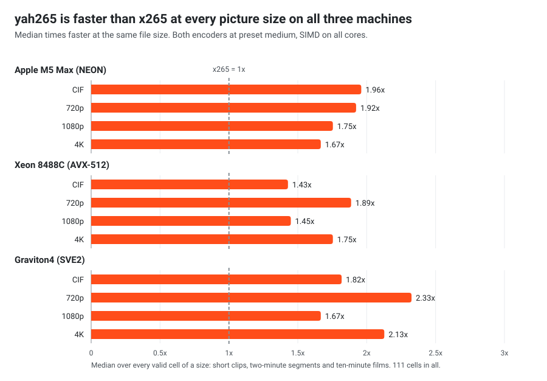
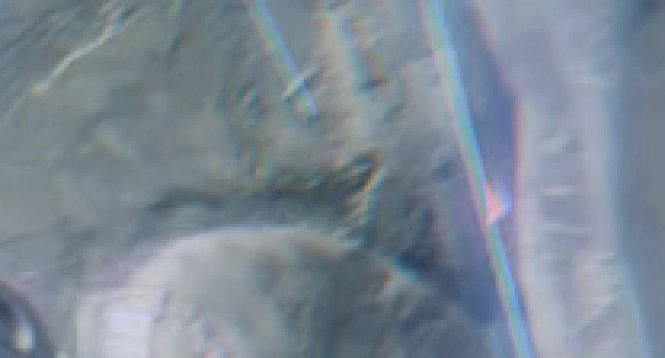

# yah265

<p class="standfirst"><!--gen:headline-->yah265 encodes video 1.77x faster than x265 at the same file size, median over every timed cell (CRF, capped VBR and content types), with +1.18 VMAF v1 points.<!--/gen:headline--></p>

yah265 is an H.265/HEVC encoder written from scratch in C. It runs inside ffmpeg under the options you already use.

<figure class="chart hero"><figcaption>Data: every cell timed on the Mac, from the parity report in the repository.</figcaption></figure>

## Try it

```sh
ffmpeg -i in.mp4 -c:v libx265   -preset medium -crf 25 out.mp4   # what you run today
ffmpeg -i in.mp4 -c:v libyah265 -preset medium -crf 25 out.mp4   # swap one word
```

One command builds that ffmpeg from a clone of the repository:

```sh
git clone https://github.com/terranvigil/yah265 && cd yah265
scripts/build-ffmpeg.sh
```

The new ffmpeg is at `build-ffmpeg/ffmpeg/ffmpeg`. [Build and first encode](start.md) has the details and the `y265` command line.

## Speed on three machines

<figure class="chart"><figcaption>Data: the Mac, Xeon and Graviton4 parity reports in the repository.</figcaption></figure>

On this site "faster" compares wall time for files of the same size, so 2x faster is half the time. Both encoders run `--preset medium` with SIMD on every core. The capped VBR cells share a target bitrate where the others share a size.

## Same size, side by side

The two encodes below are the same size. Switch between the reference and each of them.

<!--gen:fig-frames-->
<figure class="compare">
<div class="cmp">
<div class="cmp-head"><p class="cmp-title">The hardest moment, 0:29 into the clip<span>VMAF v1 on this frame: yah265 88.3, x265 84.4. The crop is shown at 4x.</span></p><div class="cmp-where"><i style="left:80.00%;top:5.59%;width:10.83%;height:13.05%"></i></div></div>
<div class="cmp-pane" data-name="Reference"><span class="cmp-tag">Reference · 4x zoom</span></div>
<div class="cmp-pane" data-name="yah265" data-first><span class="cmp-tag ours"><b>yah265</b> · VMAF v1 88.3 on this frame · 15.95 MB file · 4x zoom</span></div>
<div class="cmp-pane" data-name="x265"><span class="cmp-tag"><b>x265</b> · VMAF v1 84.4 on this frame · 15.88 MB file · 4x zoom</span></div>
</div>
<figcaption>The hardest moment of a 90-second Tears of Steel clip at 1080p: the lowest-scoring frame, by the two encoders' mean VMAF v1, cropped to the region where the two encodes lose detail most differently. Both files are the same size to within 0.5%. <a href="results.html#same-size-side-by-side">Results</a> has the next two hardest moments, one of them a crop where x265 holds up better. Tears of Steel: (CC) Blender Foundation, <a href="https://mango.blender.org">mango.blender.org</a>, CC-BY 3.0.</figcaption>
</figure>
<!--/gen:fig-frames-->

<!--gen:frames-player-->Scrub the whole clip yourself in the <a href="compare/tears/">comparison player</a>.<!--/gen:frames-player-->

## What it does

- Encodes through ffmpeg as `libyah265`, or from a pipe with [its own command line](start.md#build-y265-on-its-own).
- CRF, capped CRF, VBR, CBR, ABR and two-pass. The [encoding guide](guide.md#rate-modes) says when to pick each.
- Main, Main10, 4:4:4 and 4:2:2 [profiles](guide.md#profiles-depth-and-chroma) from one binary.
- [HDR10, HDR10+, HLG and Dolby Vision profile 8](hdr.md).
- SIMD on arm64 and x86-64. [Architectures](architectures.md) lists what runs where.
- x265's option names for shared features. [Options](options.md) lists every one.

## Results in brief

Every cell behind the headline was timed on an 18-core Apple M5 Max:

<!--gen:pooled-table-->
| timed cells | count | median | slowest cell |
|---|--:|--:|---|
| CRF | 35 | 1.79x faster | Sintel 4K, 10 min, 1.52x faster |
| capped VBR | 26 | 1.64x faster | Meridian 1080p, 10 min, 1.18x faster |
| content types | 9 | 1.92x faster | Lash of the Whip 1080p, 1.85x faster |
| **all** | **70** | **1.77x faster** | Meridian 1080p, 10 min, 1.18x faster |
<!--/gen:pooled-table-->

<!--gen:quality-table-->
| quality on the Mac | cells | median |
|---|--:|--:|
| VMAF v1 lead at the same file size, CRF and content types | 44 | +1.18 points |
| bits saved at equal VMAF v1, rate ladders at CRF and capped VBR | 52 | 10.9% |
<!--/gen:quality-table-->

The three goals, as the range of group medians on each machine:

<!--gen:goal-table-->
| goal | Apple M5 Max (NEON) | Xeon 8488C (AVX-512) | Graviton4 (SVE2) |
|---|--:|--:|--:|
| G1: C on one thread | 2.17x to 4.35x | 1.49x to 3.03x | 1.52x to 3.03x |
| G2: C on all cores | 2.86x to 4.17x | 2.27x to 4.76x | 2.38x to 4.76x |
| G3: SIMD on all cores | 1.61x to 2.13x | 1.35x to 2.44x | 1.47x to 3.23x |
<!--/gen:goal-table-->

[Results](results.md) has every table and chart.

## Why I built it

<!-- OWNER: this section is a draft from facts already published. Approve or replace it. -->

yah265 is the second of three sibling encoders. [yah264](https://terranvigil.github.io/yah264/) met the same goals against x264 first, and the [launch post](blog.md) tells this one's story. I wrote yah265 from the ITU-T H.265 specification to see whether a new encoder could pass x265 at its own default preset on speed and on quality together. Every stream it writes is decoded by two independent decoders and compared with the encoder's own reconstruction.

## License

yah265 is GPL-2.0-or-later. A commercial license is also available, the same arrangement x264 and x265 use. Write to terranvigil@gmail.com for commercial terms.
