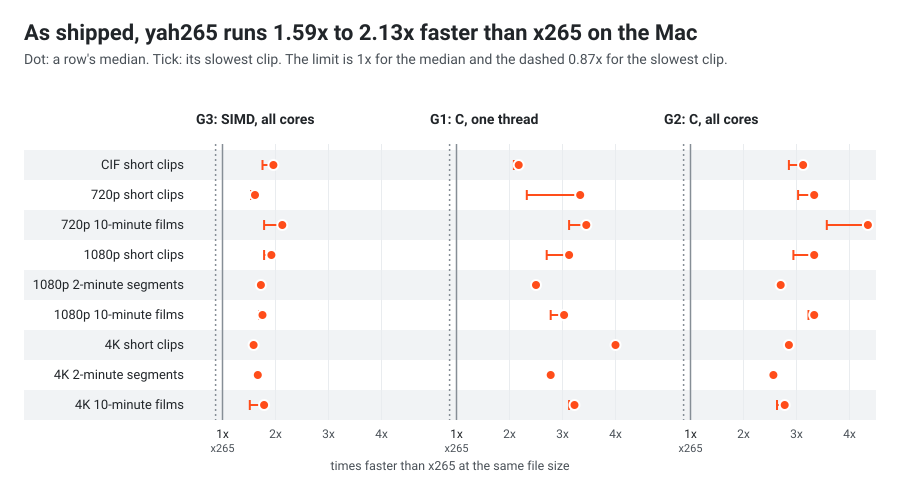
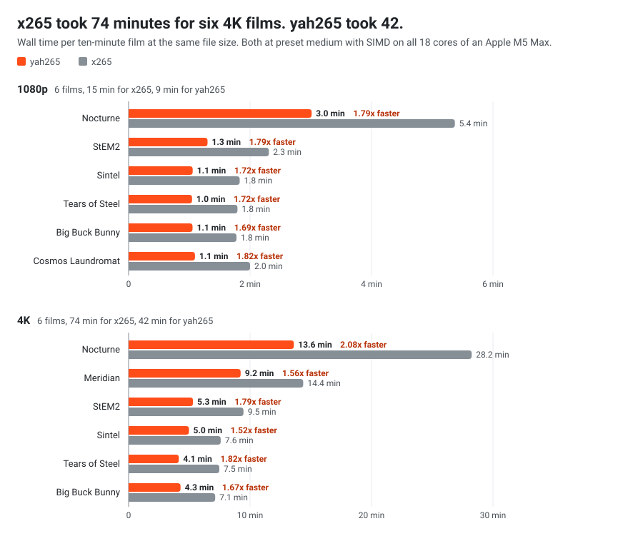
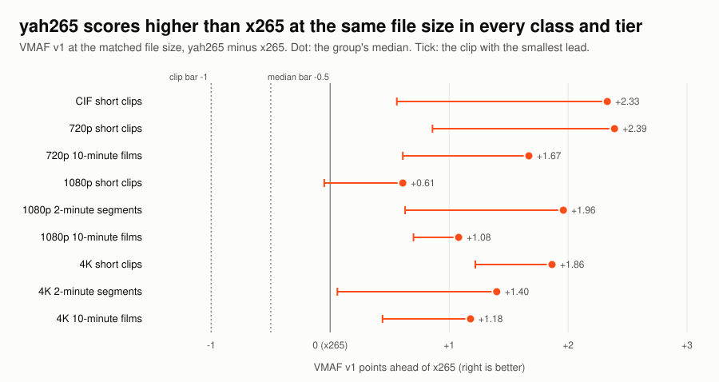
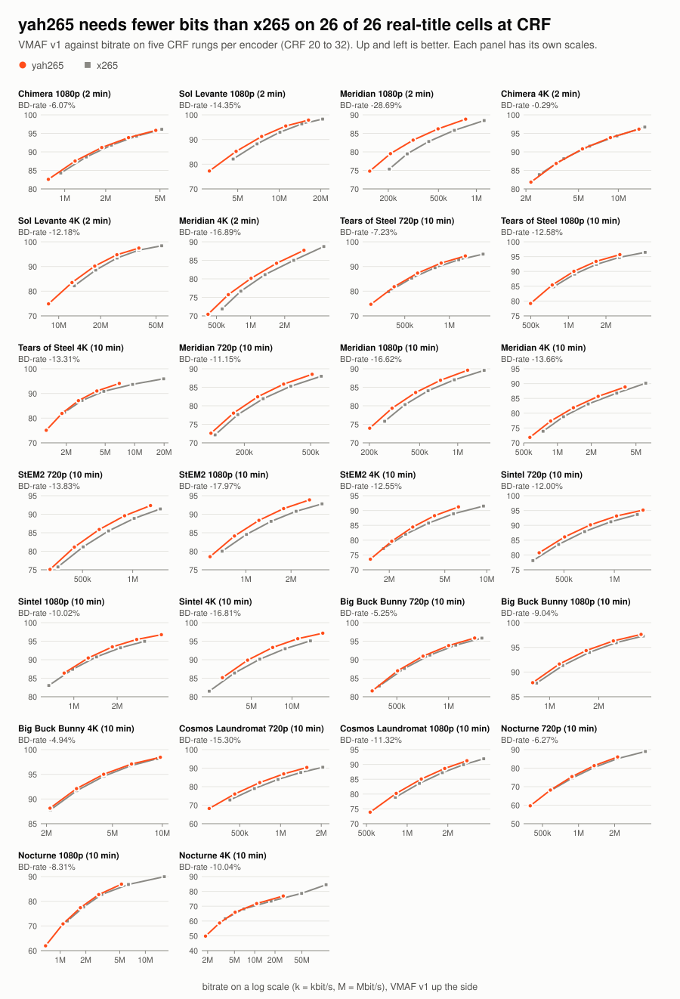

# Results

Every reading on this page compares yah265 with x265 4.3 when both run at `--preset medium`. A script builds the tables and charts from the recorded runs. Its check fails when the page and the data disagree.

<!--gen:verdict-->
| what was measured | result |
|---|--:|
| speed: combinations of class, tier and goal inside the bar, over three machines | 81 of 81 |
| VBR encode time: real-title cells faster than x265, over three machines | 78 of 78 |
| rate ladders at or under the +1.0% BD-rate bar | 52 of 52 |
| median bits saved at equal VMAF v1 over those ladders | 10.9% |
| VBR rungs within ±10% of their target | 130 of 130 |
| content-type clips passing on quality | 9 of 9 |
<!--/gen:verdict-->

"The bar" is the pass mark a reading has to meet. [The methodology](methodology.md) sets out each bar and the rules that make a number valid. [Check it yourself](check-it-yourself.md) shows how to take the same readings on your own machine.

## How to read this page

A cell is one clip at one picture size. A class is a picture size and a tier is a clip length. Cells are grouped by both.

Speed is a ratio. It's yah265's encode time divided by x265's when both write a file of the same size, so anything under 1.00 means yah265 finished first. A ratio of 0.50 is what this site calls 2x faster.

A speed cell in a table holds two ratios: the median over the group's clips, then the slowest clip. A group passes when its median is at or under 1.00 and its slowest clip is at or under 1.15, as long as its quality holds too.

Speed is read three ways. I call them goals.

<!--gen:goal-defs-->
| goal | yah265 | x265 | threads |
|---|---|---|---|
| G1 | plain C (`N265_ASM_OFF=all`) | plain C (`--no-asm`) | one. x265 gets it from `--pools none --frame-threads 1` |
| G2 | plain C | plain C | each encoder's default |
| G3 | as shipped, with SIMD | as shipped, with its assembly | each encoder's default |
<!--/gen:goal-defs-->

Plain C is the same binary on both sides with its hand-written SIMD switched off.

Three machines were timed:

- **Mac**: an Apple M5 Max with 18 cores and NEON. The reference there is the Homebrew build of x265 4.3+1-e9b8812.
- **x86-64**: an Intel Xeon Platinum 8488C with AVX-512, rented in the cloud.
- **Graviton4**: an AWS arm64 machine with SVE2.

On the two cloud machines both encoders were held to 16 vCPUs. x265 was built there from its 4.3 release. A cloud time is only ever compared with x265 on the same machine.

Each encoder looks ahead by its own `medium` default. That's 20 frames for x265. For yah265 it's 20 frames at 720p and up and 12 at CIF.

## The test set

<!--gen:test-set-->
| tier | cells | what's in it | how it's cut |
|---|---|---|---|
| S, short clips | 3 at CIF, 4 at 720p, 3 at 1080p, 2 at 4K | Big Buck Bunny, Ducks take off, Meridian, Park joy, bus, foreman, fourpeople, pedestrian, riverbed, shields, stefan, sunflower | each clip whole |
| M, 2-minute segments | 3 at 1080p, 3 at 4K | Chimera, Meridian, Sol Levante | from the first non-black frame |
| L, 10-minute films | 7 at 720p, 7 at 1080p, 6 at 4K | Big Buck Bunny, Cosmos Laundromat, Meridian, Nocturne, Sintel, StEM2, Tears of Steel | 600 seconds past the opening card, stopped before the end credits |
| C, content types | 1 at 720p, 7 at 1080p, 1 at 4K | 2 film grain, 4 sports, 3 screen | seven short clips and one ten-minute film scan at two sizes |
<!--/gen:test-set-->

Tiers S, M and L decide the speed verdict. Tier C adds film grain, sports and screen recordings. Its quality counts toward the verdict. Its speed is shown and doesn't count.

Both encoders read the same 8-bit 4:2:0 frames on standard input from one feeder.

## Speed

<!--gen:fig-speed-->
<figure class="chart"><figcaption>Data: <a href="docs/parity/PARITY-REPORT-yah265-2026-11-12.csv">the Mac report's rows</a>.</figcaption></figure>
<!--/gen:fig-speed-->

The table has the Mac's numbers as median / slowest clip.

<!--gen:speed-mac-->
| class | tier | G1 | G2 | G3 | G3 as times faster |
|---|---|--:|--:|--:|--:|
| CIF | short clips | 0.46 / 0.48 | 0.32 / 0.35 | 0.51 / 0.57 | 1.96x |
| 720p | short clips | 0.30 / 0.43 | 0.30 / 0.33 | 0.62 / 0.65 | 1.61x |
| 720p | 10-minute films | 0.28 / 0.32 | 0.24 / 0.31 | 0.47 / 0.56 | 2.13x |
| 1080p | short clips | 0.32 / 0.37 | 0.30 / 0.34 | 0.52 / 0.56 | 1.92x |
| 1080p | 2-minute segments | 0.35 / 0.40 | 0.33 / 0.37 | 0.59 / 0.66 | 1.69x |
| 1080p | 10-minute films | 0.32 / 0.36 | 0.30 / 0.31 | 0.57 / 0.59 | 1.75x |
| 4K | short clips | 0.23 / 0.25 | 0.32 / 0.35 | 0.62 / 0.63 | 1.61x |
| 4K | 2-minute segments | 0.30 / 0.36 | 0.32 / 0.39 | 0.56 / 0.60 | 1.79x |
| 4K | 10-minute films | 0.30 / 0.32 | 0.35 / 0.38 | 0.58 / 0.66 | 1.72x |
<!--/gen:speed-mac-->

G3 is the closest of the three goals because x265's assembly gains more over its own C than yah265's SIMD does over ours.

Four Meridian cells on the Mac are left out of the medians. The rules void a ratio when the feeder can't deliver frames 1.5 times as fast as the faster encoder runs. That happened on these four. All four were timed on the cloud machines, where the feeder kept up.

On the 2-minute and 10-minute cells, G1 and G2 are timed on 30-second windows. A window starts every three minutes and is coded as its own stream. A goal is void for a cell if the summed window bytes of the two encoders differ by more than 5%.

## Each ten-minute film

<figure class="chart"></figure>

Each film runs from its start frame to its last story frame, before the end credits. The table has the Mac's ratio for each film at each goal. "void" marks a cell the feeder couldn't keep up with.

<!--gen:films-->
| film | last story frame | G1 | G2 | G3 |
|---|--:|--:|--:|--:|
| Tears of Steel 720p | 12671 | 0.28 | 0.23 | 0.47 |
| Tears of Steel 1080p | 12671 | 0.33 | 0.30 | 0.58 |
| Tears of Steel 4K | 12671 | 0.30 | 0.34 | 0.55 |
| Meridian 720p | 32886 | 0.18 | 0.31 | void |
| Meridian 1080p | 32886 | 0.19 | void | void |
| Meridian 4K | 32886 | 0.19 | 0.32 | 0.64 |
| StEM2 720p | 12939 | 0.28 | 0.22 | 0.45 |
| StEM2 1080p | 12939 | 0.32 | 0.29 | 0.56 |
| StEM2 4K | 12939 | 0.32 | 0.36 | 0.56 |
| Sintel 720p | 13177 | 0.29 | 0.24 | 0.47 |
| Sintel 1080p | 13177 | 0.31 | 0.31 | 0.58 |
| Sintel 4K | 13177 | 0.32 | 0.38 | 0.66 |
| Big Buck Bunny 720p | 13928 | 0.29 | 0.28 | 0.56 |
| Big Buck Bunny 1080p | 13928 | 0.33 | 0.31 | 0.59 |
| Big Buck Bunny 4K | 13928 | 0.31 | 0.37 | 0.60 |
| Cosmos Laundromat 720p | 13723 | 0.32 | 0.22 | 0.48 |
| Cosmos Laundromat 1080p | 13723 | 0.36 | 0.30 | 0.55 |
| Nocturne 720p | 34319 | 0.23 | 0.27 | 0.56 |
| Nocturne 1080p | 34319 | 0.28 | 0.29 | 0.56 |
| Nocturne 4K | 34319 | 0.28 | 0.29 | 0.48 |
<!--/gen:films-->

## By machine

<!--gen:fig-machines-->
<figure class="chart"><figcaption>Data: <a href="docs/parity/PARITY-REPORT-yah265-2026-11-12.csv">the Mac rows</a>, <a href="docs/parity/PARITY-REPORT-yah265-x86-2026-11-13.csv">the Xeon rows</a>, <a href="docs/parity/PARITY-REPORT-yah265-graviton-2026-11-13.csv">the Graviton4 rows</a>.</figcaption></figure>
<!--/gen:fig-machines-->

The same medians as times faster than x265, from each machine's slowest group to its fastest:

<!--gen:goal-table-->
| goal | Apple M5 Max (NEON) | Xeon 8488C (AVX-512) | Graviton4 (SVE2) |
|---|--:|--:|--:|
| G1: C on one thread | 2.17x to 4.35x | 1.49x to 3.03x | 1.52x to 3.03x |
| G2: C on all cores | 2.86x to 4.17x | 2.27x to 4.76x | 2.38x to 4.76x |
| G3: SIMD on all cores | 1.61x to 2.13x | 1.35x to 2.44x | 1.47x to 3.23x |
<!--/gen:goal-table-->

The next three tables give median / slowest clip for each goal.

G1, plain C on one thread:

<!--gen:machines-g1-->
| class | tier | Mac | x86-64 | Graviton4 |
|---|---|--:|--:|--:|
| CIF | short clips | 0.46 / 0.48 | 0.67 / 0.67 | 0.66 / 0.68 |
| 720p | short clips | 0.30 / 0.43 | 0.44 / 0.61 | 0.43 / 0.59 |
| 720p | 10-minute films | 0.28 / 0.32 | 0.42 / 0.43 | 0.43 / 0.45 |
| 1080p | short clips | 0.32 / 0.37 | 0.45 / 0.53 | 0.45 / 0.55 |
| 1080p | 2-minute segments | 0.35 / 0.40 | 0.53 / 0.53 | 0.53 / 0.54 |
| 1080p | 10-minute films | 0.32 / 0.36 | 0.46 / 0.49 | 0.47 / 0.51 |
| 4K | short clips | 0.23 / 0.25 | 0.33 / 0.34 | 0.33 / 0.34 |
| 4K | 2-minute segments | 0.30 / 0.36 | 0.42 / 0.47 | 0.44 / 0.49 |
| 4K | 10-minute films | 0.30 / 0.32 | 0.43 / 0.45 | 0.45 / 0.47 |
<!--/gen:machines-g1-->

G2, plain C on all cores:

<!--gen:machines-g2-->
| class | tier | Mac | x86-64 | Graviton4 |
|---|---|--:|--:|--:|
| CIF | short clips | 0.32 / 0.35 | 0.44 / 0.49 | 0.40 / 0.45 |
| 720p | short clips | 0.30 / 0.33 | 0.28 / 0.38 | 0.26 / 0.34 |
| 720p | 10-minute films | 0.24 / 0.31 | 0.27 / 0.29 | 0.25 / 0.28 |
| 1080p | short clips | 0.30 / 0.34 | 0.38 / 0.43 | 0.42 / 0.46 |
| 1080p | 2-minute segments | 0.33 / 0.37 | 0.39 / 0.45 | 0.42 / 0.48 |
| 1080p | 10-minute films | 0.30 / 0.31 | 0.36 / 0.39 | 0.38 / 0.41 |
| 4K | short clips | 0.32 / 0.35 | 0.21 / 0.21 | 0.21 / 0.23 |
| 4K | 2-minute segments | 0.32 / 0.39 | 0.27 / 0.39 | 0.29 / 0.45 |
| 4K | 10-minute films | 0.35 / 0.38 | 0.31 / 0.33 | 0.33 / 0.36 |
<!--/gen:machines-g2-->

G3, SIMD on all cores:

<!--gen:machines-g3-->
| class | tier | Mac | x86-64 | x86-64 against x265 at `--asm avx512` | Graviton4 | Graviton3 |
|---|---|--:|--:|--:|--:|--:|
| CIF | short clips | 0.51 / 0.57 | 0.70 / 0.82 | 0.70 / 0.84 | 0.55 / 0.66 | 0.53 / 0.60 (2 of 3) |
| 720p | short clips | 0.62 / 0.65 | 0.60 / 0.75 | 0.62 / 0.77 | 0.48 / 0.57 | 0.45 / 0.54 |
| 720p | 10-minute films | 0.47 / 0.56 | 0.53 / 0.56 | 0.54 / 0.57 | 0.42 / 0.46 | not measured |
| 1080p | short clips | 0.52 / 0.56 | 0.74 / 0.80 | 0.77 / 0.83 | 0.68 / 0.71 | 0.62 / 0.66 |
| 1080p | 2-minute segments | 0.59 / 0.66 | 0.74 / 0.80 | 0.75 / 0.82 | 0.64 / 0.72 | not measured |
| 1080p | 10-minute films | 0.57 / 0.59 | 0.68 / 0.71 | 0.70 / 0.73 | 0.59 / 0.64 | not measured |
| 4K | short clips | 0.62 / 0.63 | 0.41 / 0.43 | 0.41 / 0.44 | 0.31 / 0.33 | 0.31 / 0.34 |
| 4K | 2-minute segments | 0.56 / 0.60 | 0.53 / 0.67 | 0.54 / 0.69 | 0.47 / 0.63 | not measured |
| 4K | 10-minute films | 0.58 / 0.66 | 0.59 / 0.62 | 0.60 / 0.63 | 0.49 / 0.54 | not measured |
<!--/gen:machines-g3-->

Because x265's default assembly stops at AVX2 on the Xeon, the fifth column times it again with its AVX-512 code switched on. Graviton3 has 256-bit SVE and was timed on the short clips at G3 only.

The Xeon also ran the short clips at G3 with both encoders capped to one older instruction set, to stand in for a CPU that has no AVX-512.

<!--gen:capped-->
| class | both at SSE4.2 | both at AVX2 | control: yah265 at AVX-512, x265 at AVX2 | clips |
|---|--:|--:|--:|--:|
| CIF | 0.64 / 0.75 | 0.74 / 0.88 | 0.70 / 0.83 | 3 |
| 720p | 0.50 / 0.65 | 0.63 / 0.80 | 0.60 / 0.75 | 4 |
| 1080p | 0.69 / 0.77 | 0.85 / 0.92 | 0.74 / 0.80 | 3 |
| 4K | 0.43 / 0.45 | 0.45 / 0.50 | 0.44 / 0.48 | 2 |
<!--/gen:capped-->

AVX2 against AVX2 is the tightest pairing on the page. Both capped tiers write the same streams as the uncapped build, so their quality is the table's below. [Architectures](architectures.md) explains the tiers and how each is checked. The per-machine detail is in <!--gen:report-x86-->[the x86-64 report](docs/parity/PARITY-REPORT-yah265-x86-2026-11-13.md)<!--/gen:report-x86--> and <!--gen:report-g4-->[the Graviton report](docs/parity/PARITY-REPORT-yah265-graviton-2026-11-13.md)<!--/gen:report-g4-->.

## Quality at the same size

<!--gen:fig-quality-->
<figure class="chart"><figcaption>Data: <a href="docs/parity/PARITY-REPORT-yah265-2026-11-12.csv">the Mac report's rows</a>.</figcaption></figure>
<!--/gen:fig-quality-->

This is the VMAF v1 score at the matched file size, yah265's minus x265's. A positive number means yah265 looks better at the same size. The bar is a median no worse than -0.5 with no single cell more than 1.0 behind. Every cell's size is within 1% of x265's.

<!--gen:quality-->
| class | tier | median | smallest lead | on | x86-64 | Graviton4 |
|---|---|--:|--:|---|---|---|
| CIF | short clips | +2.33 | +0.56 | stefan CIF | inferred | identical streams (stefan_cif re-solved) |
| 720p | short clips | +2.39 | +0.86 | shields 720p | inferred | identical streams |
| 720p | 10-minute films | +1.67 | +0.61 | Big Buck Bunny 720p | inferred | identical streams |
| 1080p | short clips | +0.61 | -0.05 | sunflower 1080p | inferred | identical streams |
| 1080p | 2-minute segments | +1.96 | +0.63 | Chimera 1080p | reproduced: sollevante CRF -0.03 | identical streams |
| 1080p | 10-minute films | +1.08 | +0.70 | Big Buck Bunny 1080p | reproduced: cosmos CRF -0.03, VBR +0.01 | identical streams |
| 4K | short clips | +1.86 | +1.22 | Big Buck Bunny 4K | inferred | identical streams |
| 4K | 2-minute segments | +1.40 | +0.06 | Chimera 4K | reproduced: chimera VBR +0.07 | identical streams |
| 4K | 10-minute films | +1.18 | +0.44 | Big Buck Bunny 4K | inferred | identical except nocturne |
<!--/gen:quality-->

The scores were measured on the Mac. Because Graviton4 writes the Mac's streams byte for byte, its quality is the Mac's. The Xeon's streams differ a little because the compiler rounds some floating-point math differently there. Four ladders were run again on the Xeon, and "reproduced" gives how far each moved from the Mac's curve in BD-rate points. "Inferred" means the row rests on those four curves and on the SIMD code matching the C code bit for bit.

## Quality across the rate range

One matched point says little about the rest of the curve. So every 2-minute and 10-minute cell also runs a ladder. A ladder is the same clip coded at five quality settings on both encoders.

<!--gen:fig-curves-->
<figure class="chart"><figcaption>Data: <a href="docs/data/parity-spec-ladders.json">the recorded ladders</a>.</figcaption></figure>
<!--/gen:fig-curves-->

BD-rate turns each pair of curves into one number: how much more or less bitrate yah265 needs for the same VMAF v1 score. Negative means fewer bits. The bar is +1.0% on every curve.

<figure class="chart"></figure>

<!--gen:bd-summary-->
| over the ladders | value |
|---|--:|
| median BD-rate, CRF | -12.1% |
| median BD-rate, capped VBR | -9.4% |
| median BD-rate, both | -10.9% |
| ladders where yah265 needs fewer bits | 51 of 52 |
| closest to the bar: Chimera 4K, 2-minute segments, VBR | +0.70% |
<!--/gen:bd-summary-->

Each ladder is set up the same way:

- CRF rungs: 20, 23, 26, 29 and 32 on both sides.
- VBR rungs: the bitrate x265 reached at each of those CRFs. The maxrate is 1.5 times the target and the buffer is twice the target.
- Both encoders run at 6 threads and look 20 frames ahead.

<!--gen:bd-->
| cell | tier | CRF BD-rate | VBR BD-rate |
|---|---|--:|--:|
| Chimera 1080p | 2-minute segments | -6.07% | -4.83% |
| Sol Levante 1080p | 2-minute segments | -14.35% | -9.67% |
| Meridian 1080p | 2-minute segments | -28.69% | -27.64% |
| Chimera 4K | 2-minute segments | -0.29% | +0.70% |
| Sol Levante 4K | 2-minute segments | -12.18% | -6.97% |
| Meridian 4K | 2-minute segments | -16.89% | -15.33% |
| Tears of Steel 720p | 10-minute films | -7.23% | -4.01% |
| Tears of Steel 1080p | 10-minute films | -12.58% | -10.34% |
| Tears of Steel 4K | 10-minute films | -13.31% | -14.01% |
| Meridian 720p | 10-minute films | -11.15% | -5.53% |
| Meridian 1080p | 10-minute films | -16.62% | -15.88% |
| Meridian 4K | 10-minute films | -13.66% | -10.70% |
| StEM2 720p | 10-minute films | -13.83% | -7.64% |
| StEM2 1080p | 10-minute films | -17.97% | -13.81% |
| StEM2 4K | 10-minute films | -12.55% | -9.12% |
| Sintel 720p | 10-minute films | -12.00% | -7.97% |
| Sintel 1080p | 10-minute films | -10.02% | -12.44% |
| Sintel 4K | 10-minute films | -16.81% | -13.31% |
| Big Buck Bunny 720p | 10-minute films | -5.25% | -0.42% |
| Big Buck Bunny 1080p | 10-minute films | -9.04% | -6.89% |
| Big Buck Bunny 4K | 10-minute films | -4.94% | -4.59% |
| Cosmos Laundromat 720p | 10-minute films | -15.30% | -14.13% |
| Cosmos Laundromat 1080p | 10-minute films | -11.32% | -11.82% |
| Nocturne 720p | 10-minute films | -6.27% | -0.41% |
| Nocturne 1080p | 10-minute films | -8.31% | -6.88% |
| Nocturne 4K | 10-minute films | -10.04% | -15.47% |
<!--/gen:bd-->

## VBR

VBR has to hit its bitrate as well as look good. The bar puts every rung of yah265's within ±10% of its target over the whole cell. x265's rungs are drawn for comparison and aren't held to the bar.

<!--gen:fig-tracking-->
<figure class="chart"><figcaption>Data: <a href="docs/data/parity-spec-ladders.json">the recorded ladders</a>.</figcaption></figure>
<!--/gen:fig-tracking-->

<!--gen:vbr-track-->
| cell | tier | yah265, five rungs | x265, five rungs |
|---|---|--:|--:|
| Chimera 1080p | 2-minute segments | -5.2% to -3.0% | -14.6% to -14.2% |
| Sol Levante 1080p | 2-minute segments | -4.6% to -3.2% | -7.9% to -6.2% |
| Meridian 1080p | 2-minute segments | -4.5% to -2.8% | -5.7% to -2.6% |
| Chimera 4K | 2-minute segments | -5.2% to -3.6% | -14.4% to -13.7% |
| Sol Levante 4K | 2-minute segments | -6.1% to -3.8% | -8.2% to -7.6% |
| Meridian 4K | 2-minute segments | -3.5% to -1.4% | -5.8% to -1.6% |
| Tears of Steel 720p | 10-minute films | +0.0% to +0.2% | +1.5% to +1.6% |
| Tears of Steel 1080p | 10-minute films | +0.2% to +0.5% | +1.6% to +1.7% |
| Tears of Steel 4K | 10-minute films | +0.0% to +0.4% | +0.4% to +1.6% |
| Meridian 720p | 10-minute films | -2.5% to -2.1% | -3.5% to -1.3% |
| Meridian 1080p | 10-minute films | -2.2% to -1.9% | -3.2% to -2.3% |
| Meridian 4K | 10-minute films | -1.7% to -1.5% | -3.7% to -3.2% |
| StEM2 720p | 10-minute films | -5.8% to -4.4% | -10.3% to -8.1% |
| StEM2 1080p | 10-minute films | -6.4% to -4.3% | -11.2% to -5.7% |
| StEM2 4K | 10-minute films | -5.6% to -4.1% | -12.0% to -3.8% |
| Sintel 720p | 10-minute films | -7.7% to -6.3% | -3.4% to -3.3% |
| Sintel 1080p | 10-minute films | -5.8% to -4.2% | -3.1% to -2.8% |
| Sintel 4K | 10-minute films | -2.7% to -1.1% | -2.2% to -2.1% |
| Big Buck Bunny 720p | 10-minute films | -1.3% to -0.9% | -3.5% to -2.2% |
| Big Buck Bunny 1080p | 10-minute films | -1.1% to -0.9% | -4.1% to -3.5% |
| Big Buck Bunny 4K | 10-minute films | -0.9% to -0.8% | -4.1% to -3.9% |
| Cosmos Laundromat 720p | 10-minute films | -2.7% to -1.8% | -0.4% to -0.1% |
| Cosmos Laundromat 1080p | 10-minute films | -2.9% to -2.4% | -0.8% to -0.6% |
| Nocturne 720p | 10-minute films | -1.3% to -0.6% | +1.3% to +4.4% |
| Nocturne 1080p | 10-minute films | -1.6% to -0.6% | -0.8% to +3.4% |
| Nocturne 4K | 10-minute films | -1.4% to -0.6% | -0.9% to +1.8% |
<!--/gen:vbr-track-->

### VBR encode time

VBR speed is read at G3 only. Each real-title cell runs one rung at the bitrate x265 reached at CRF 28. The maxrate and buffer are set as in the ladders. Because this leg has no size match, the second table shows how close each encoder came to the target.

<!--gen:vbr-machines-->
| class | tier | Mac | x86-64 | Graviton4 | cells |
|---|---|--:|--:|--:|--:|
| 720p | 10-minute films | 0.42 / 0.76 | 0.51 / 0.58 | 0.40 / 0.50 | 7 |
| 1080p | 2-minute segments | 0.63 / 0.68 | 0.79 / 0.81 | 0.69 / 0.72 | 3 |
| 1080p | 10-minute films | 0.61 / 0.85 | 0.77 / 0.84 | 0.70 / 0.78 | 7 |
| 4K | 2-minute segments | 0.64 / 0.66 | 0.60 / 0.75 | 0.53 / 0.71 | 3 |
| 4K | 10-minute films | 0.65 / 0.75 | 0.66 / 0.73 | 0.56 / 0.66 | 6 |
<!--/gen:vbr-machines-->

The Mac's cells one by one:

<!--gen:vbr-wall-->
| cell | tier | target kbit/s | ratio | yah265 against target | x265 against target |
|---|---|--:|--:|--:|--:|
| Chimera 1080p | 2-minute segments | 1668 | 0.63 | -4.1% | -14.5% |
| Sol Levante 1080p | 2-minute segments | 7863 | 0.59 | -3.8% | -7.1% |
| Meridian 1080p | 2-minute segments | 318 | 0.68 | -4.0% | -5.4% |
| Chimera 4K | 2-minute segments | 4515 | 0.60 | -5.1% | -14.5% |
| Sol Levante 4K | 2-minute segments | 20733 | 0.66 | -4.0% | -8.2% |
| Meridian 4K | 2-minute segments | 949 | 0.64 | -3.0% | -4.3% |
| Tears of Steel 720p | 10-minute films | 628 | 0.38 | +0.1% | +1.6% |
| Tears of Steel 1080p | 10-minute films | 1279 | 0.61 | +0.4% | +1.6% |
| Tears of Steel 4K | 10-minute films | 3389 | 0.64 | +0.2% | +1.4% |
| Meridian 720p | 10-minute films | 205 | 0.76 | -2.4% | -2.6% |
| Meridian 1080p | 10-minute films | 438 | 0.85 | -2.2% | -3.0% |
| Meridian 4K | 10-minute films | 1326 | 0.65 | -1.6% | -3.2% |
| StEM2 720p | 10-minute films | 567 | 0.42 | -5.1% | -10.3% |
| StEM2 1080p | 10-minute films | 1145 | 0.59 | -5.8% | -11.2% |
| StEM2 4K | 10-minute films | 2964 | 0.61 | -5.2% | -9.9% |
| Sintel 720p | 10-minute films | 523 | 0.42 | -7.3% | -3.4% |
| Sintel 1080p | 10-minute films | 1113 | 0.64 | -5.3% | -3.0% |
| Sintel 4K | 10-minute films | 4329 | 0.75 | -1.6% | -2.1% |
| Big Buck Bunny 720p | 10-minute films | 620 | 0.54 | -1.2% | -2.8% |
| Big Buck Bunny 1080p | 10-minute films | 1365 | 0.73 | -1.1% | -3.9% |
| Big Buck Bunny 4K | 10-minute films | 3453 | 0.68 | -0.9% | -4.1% |
| Cosmos Laundromat 720p | 10-minute films | 734 | 0.39 | -2.3% | -0.4% |
| Cosmos Laundromat 1080p | 10-minute films | 1407 | 0.61 | -2.8% | -0.8% |
| Nocturne 720p | 10-minute films | 1022 | 0.47 | -0.8% | +4.2% |
| Nocturne 1080p | 10-minute films | 2198 | 0.58 | -1.1% | +2.6% |
| Nocturne 4K | 10-minute films | 9142 | 0.49 | -1.4% | -0.6% |
<!--/gen:vbr-wall-->

## Lookahead depth

I swept yah265's lookahead on six cells instead of inheriting x265's depth. yah265 ran at 12, 20 and 30 frames. x265 stayed at its own 20.

<!--gen:fig-lookahead-->
<figure class="chart"><figcaption>Data: <a href="docs/data/parity-spec-ladders.json">the recorded ladders</a>.</figcaption></figure>
<!--/gen:fig-lookahead-->

<!--gen:lookahead-->
| cell | mode | yah265 at 12 | yah265 at 20 | yah265 at 30 |
|---|---|--:|--:|--:|
| Sol Levante 1080p, 2-minute segments | CRF | -13.76% | -14.35% | -14.41% |
| Chimera 4K, 2-minute segments | CRF | +0.28% | -0.29% | -0.27% |
| Meridian 4K, 2-minute segments | CRF | -15.19% | -16.89% | -16.74% |
| Tears of Steel 1080p, 10-minute films | CRF | -11.43% | -12.58% | -12.86% |
| Sintel 4K, 10-minute films | CRF | -15.61% | -16.81% | -16.91% |
| Big Buck Bunny 1080p, 10-minute films | CRF | -5.68% | -9.04% | -10.21% |
| Sol Levante 1080p, 2-minute segments | VBR | -8.90% | -9.67% | -9.70% |
| Chimera 4K, 2-minute segments | VBR | +0.61% | +0.70% | +0.68% |
| Meridian 4K, 2-minute segments | VBR | -13.72% | -15.33% | -15.33% |
| Tears of Steel 1080p, 10-minute films | VBR | -9.60% | -10.34% | -10.55% |
| Sintel 4K, 10-minute films | VBR | -13.52% | -13.31% | -13.43% |
| Big Buck Bunny 1080p, 10-minute films | VBR | -4.28% | -6.89% | -7.35% |
<!--/gen:lookahead-->

`medium` uses 20 from 720p up. An earlier sweep on the development clips ran from 8 to 40 frames and also put the knee at 20. Past the knee a deeper window costs more time than it buys.

## Content types

Tier C is the content that codecs tend to handle unevenly: a scan of a 1924 film with heavy grain, four sports clips and three screen recordings. It ran on the Mac.

<!--gen:fig-tierc-->
<figure class="chart"><figcaption>Data: <a href="docs/data/parity-spec-ladders.json">the recorded ladders</a>.</figcaption></figure>
<!--/gen:fig-tierc-->

<!--gen:tier-c-->
| clip | content | VMAF v1 lead at the same size | CRF BD-rate | VBR BD-rate | VBR rate against target | G3 ratio |
|---|---|--:|--:|--:|--:|--:|
| Lash of the Whip 720p | film grain | +2.55 | -27.09% | -26.04% | -0.7% to -0.3% | 0.47 |
| Lash of the Whip 1080p | film grain | +2.92 | -31.89% | -31.37% | -0.6% to -0.3% | 0.54 |
| World Cup 1080p | sports | +0.52 | -6.15% | -7.80% | -1.2% to -0.9% | 0.52 |
| World Cup, far camera 1080p | sports | +0.14 | -2.22% | -3.91% | -1.5% to +0.6% | 0.53 (earlier binary) |
| Skater 1080p | sports | +0.60 | -4.29% | -16.78% | +0.4% to +1.0% | 0.50 |
| boxing 4K | sports | -0.24 | -3.81% | -14.91% | +3.3% to +5.0% | 0.28 |
| wikipedia 1080p | screen | +3.57 | -63.91% | no shared range, yah265 above | -23.0% to -13.4% | 0.53 (earlier binary) |
| debugging 1080p | screen | +2.53 | -25.07% | no shared range, yah265 above | -11.2% to +0.3% | 0.51 (earlier binary) |
| spreadsheet 1080p | screen | +3.15 | -53.94% | no shared range, yah265 above | -26.8% to -22.7% | 0.53 (earlier binary) |
<!--/gen:tier-c-->

All nine clips pass on quality. On the three screen recordings yah265's lowest VBR rung scores above x265's highest at a lower bitrate. No BD-rate can be computed there because the two curves share no score range.

Both encoders undershoot their VBR targets on the screen recordings, where the still frames between changes cost almost nothing. The ±10% tracking bar applies to the real titles and that column is here for information.

The table marks four G3 ratios that were timed before the changes that fixed screen content and handheld sports footage. Tier C speed doesn't count toward the verdict.

## HDR

HDR quality is read on its own metric, HDR-VMAF. The [HDR page](hdr.md) has those tables.

## End credits

The scored cells stop before the end credits because text on a flat background sits at the top of VMAF's scale whatever the encoder does. Each title's credits are still coded and reported on their own, outside the verdict, in <!--gen:report-mac-->[the Mac report](docs/parity/PARITY-REPORT-yah265-2026-11-12.md)<!--/gen:report-mac-->.

The full record is <!--gen:report-all-->[the all-architecture report](docs/parity/PARITY-REPORT-yah265-all-isa-2026-11-14.md)<!--/gen:report-all-->.
