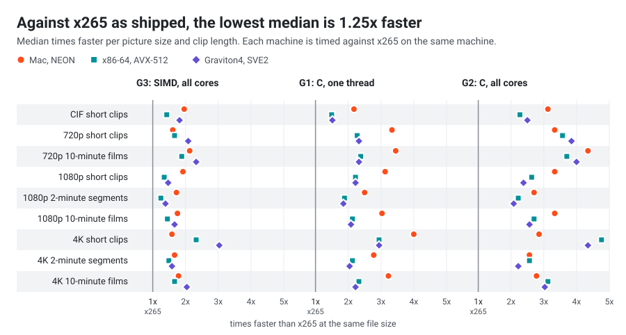
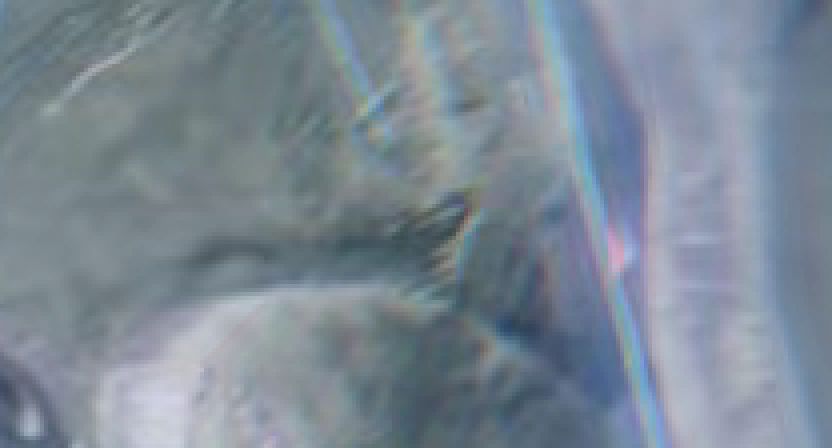
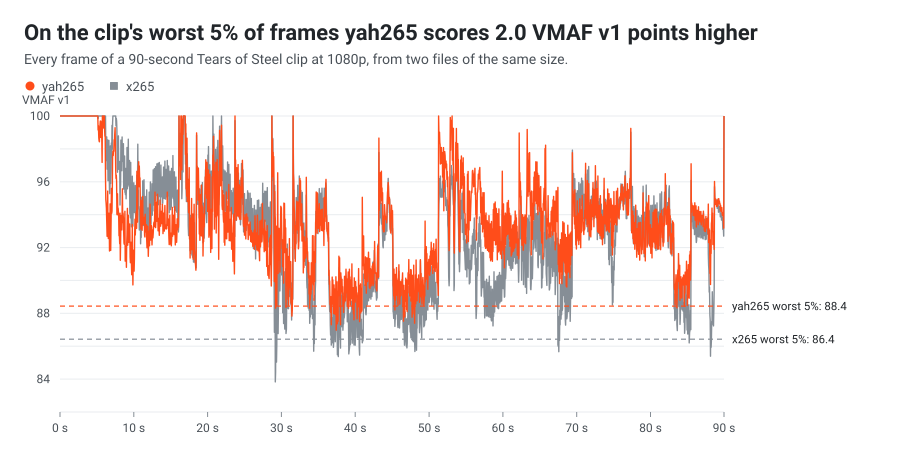
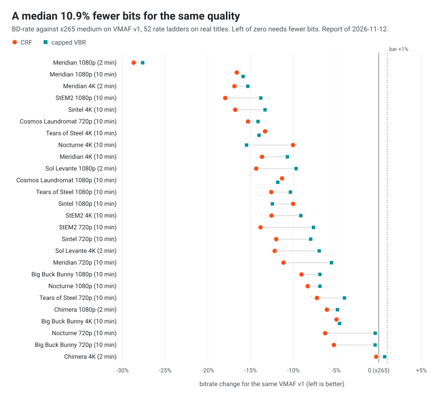
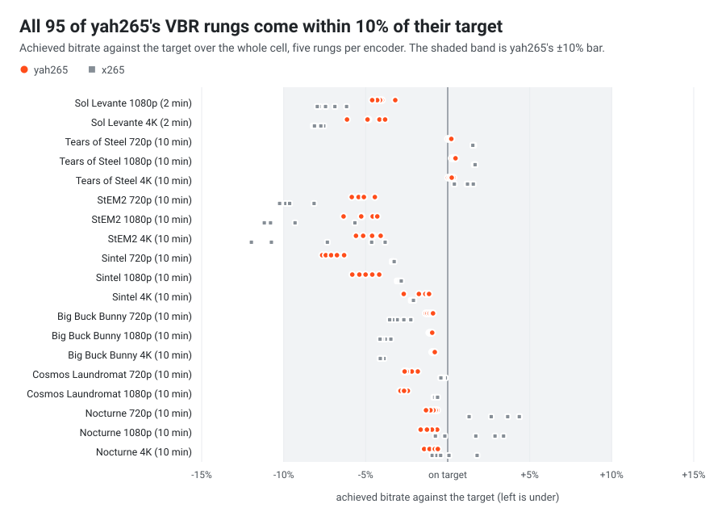
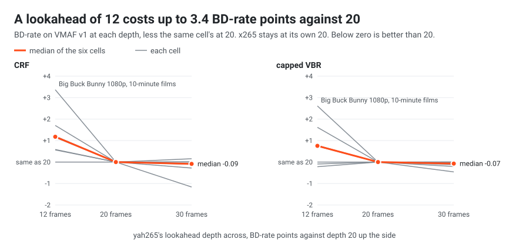
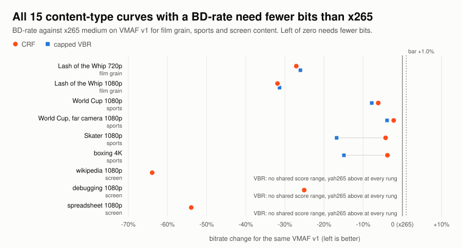

# Results

The results on this page compare yah265 with x265 4.3 when both run at `--preset medium`.

The first two rows are the main result. They cover the Mac's CRF encodes where the two files match in size within 1%.

<!--gen:verdict-->
| what was measured | result |
|---|--:|
| median speed on the Mac at the same file size, 30 CRF cells | 1.8x faster |
| median VMAF v1 lead at the same file size, the same 30 cells | +1.23 points |
| median bits saved at equal VMAF v1, 38 rate ladders | 10.2% |
| speed passes, per picture size and clip length, three goals on three machines | 81 of 81 |
| rate ladders inside the +1.0% BD-rate limit | 38 of 38 |
| capped VBR cells faster than x265 at the same target bitrate, on three machines | 57 of 57 |
| VBR rungs within ±10% of their target | 95 of 95 |
| content-type clips passing on quality | 9 of 9 |
<!--/gen:verdict-->

To see the two encodes in motion, [watch them side by side](compare.md).

The quality limit is that yah265 may need at most 1.0% more bits than x265 for the same VMAF v1. [The methodology](methodology.md) sets out each limit and the rules that make a number valid. See [How x265 was run](x265-run.md) for its build and the command for each goal, and [Check it yourself](check-it-yourself.md) to take the same measurements on your own machine.

## What the numbers mean

A cell is one clip at one picture size. A tier is a clip length: S is short clips, M is 2-minute segments, L is 10-minute films.

Speed is written as times faster. It's x265's encode time divided by yah265's when both write a file of the same size. On the speed charts right is faster.

Speed cells read median / slowest clip.

I read speed three ways and call each one a goal. G3 times both encoders as shipped. It's the speed a user sees.

<!--gen:goal-defs-->
| goal | yah265 | x265 | threads |
|---|---|---|---|
| G3 | as shipped, with SIMD | as shipped, with its assembly | each encoder's default |
| G1 | plain C (`N265_ASM_OFF=all`) | plain C (`--no-asm`) | one. x265 gets it from `--pools none --frame-threads 1` |
| G2 | plain C | plain C | each encoder's default |
<!--/gen:goal-defs-->

Plain C is each encoder's own binary with its hand-written SIMD switched off. G1 and G2 compare the algorithms alone.

Three machines were timed:

- **Mac**: an Apple M5 Max with 18 cores and NEON.
- **x86-64**: an Intel Xeon Platinum 8488C with AVX-512, rented in the cloud.
- **Graviton4**: an AWS arm64 machine with SVE2.

On the two cloud machines both encoders were held to 16 vCPUs. A cloud time is only ever compared with x265 on the same machine.

## The test set

The size columns count the cells in each tier at that picture size.

<!--gen:test-set-->
| tier | CIF | 720p | 1080p | 4K | what's in it | how it's cut |
|---|--:|--:|--:|--:|---|---|
| S, short clips | 3 | 4 | 3 | 1 | Big Buck Bunny, bus, Ducks take off, foreman, fourpeople, Park joy, pedestrian, riverbed, shields, stefan, sunflower | each clip whole |
| M, 2-minute segments |  |  | 1 | 1 | Sol Levante | from the first non-black frame |
| L, 10-minute films |  | 6 | 6 | 5 | Big Buck Bunny, Cosmos Laundromat, Nocturne, Sintel, StEM2, Tears of Steel | 600 seconds past the opening card, stopped before the end credits |
| C, content types |  | 1 | 7 | 1 | 2 film grain, 4 sports, 3 screen | seven short clips and one ten-minute film scan at two sizes |
<!--/gen:test-set-->

Tiers S, M and L decide the speed verdict. Tier C adds film grain, sports and screen recordings. Only its quality counts toward the verdict, although its speed is shown too.

Quality is VMAF v1, scored at display size. A picture smaller than 1080p is scaled up to fit 1920x1080 before it's scored, CIF included. [The methodology](methodology.md#scoring-quality) names the libvmaf build and the models.

## Speed

<!--gen:fig-speed-->
<figure class="chart"></figure>
<!--/gen:fig-speed-->

The table has the same numbers as median / slowest clip, in times faster.

<!--gen:speed-mac-->
| picture size | clip length | G3 | G1 | G2 |
|---|---|--:|--:|--:|
| CIF | short clips | 1.96x / 1.75x | 2.17x / 2.08x | 3.12x / 2.86x |
| 720p | short clips | 1.61x / 1.54x | 3.33x / 2.33x | 3.33x / 3.03x |
| 720p | 10-minute films | 2.13x / 1.79x | 3.45x / 3.12x | 4.35x / 3.57x |
| 1080p | short clips | 1.92x / 1.79x | 3.12x / 2.70x | 3.33x / 2.94x |
| 1080p | 2-minute segments | 1.72x / 1.72x | 2.50x / 2.50x | 2.70x / 2.70x |
| 1080p | 10-minute films | 1.75x / 1.69x | 3.03x / 2.78x | 3.33x / 3.23x |
| 4K | short clips | 1.59x / 1.59x | 4.00x / 4.00x | 2.86x / 2.86x |
| 4K | 2-minute segments | 1.67x / 1.67x | 2.78x / 2.78x | 2.56x / 2.56x |
| 4K | 10-minute films | 1.79x / 1.52x | 3.23x / 3.12x | 2.78x / 2.63x |
<!--/gen:speed-mac-->

G3 is the closest of the three goals. On these clips x265's assembly gains more over its plain C than yah265's SIMD gains over its own.

On the longer clips, G1 and G2 are timed on 30-second samples.

## Each ten-minute film

<figure class="chart"></figure>

Each film runs from its start frame to its last story frame. The table has the Mac's speed for each film at each goal, in times faster.

Each film at each goal

<!--gen:films-->
| film | last story frame | G3 | G1 | G2 |
|---|--:|--:|--:|
| Tears of Steel 720p | 12671 | 2.13x | 3.57x | 4.35x |
| Tears of Steel 1080p | 12671 | 1.72x | 3.03x | 3.33x |
| Tears of Steel 4K | 12671 | 1.82x | 3.33x | 2.94x |
| StEM2 720p | 12939 | 2.22x | 3.57x | 4.55x |
| StEM2 1080p | 12939 | 1.79x | 3.12x | 3.45x |
| StEM2 4K | 12939 | 1.79x | 3.12x | 2.78x |
| Sintel 720p | 13177 | 2.13x | 3.45x | 4.17x |
| Sintel 1080p | 13177 | 1.72x | 3.23x | 3.23x |
| Sintel 4K | 13177 | 1.52x | 3.12x | 2.63x |
| Big Buck Bunny 720p | 13928 | 1.79x | 3.45x | 3.57x |
| Big Buck Bunny 1080p | 13928 | 1.69x | 3.03x | 3.23x |
| Big Buck Bunny 4K | 13928 | 1.67x | 3.23x | 2.70x |
| Cosmos Laundromat 720p | 13723 | 2.08x | 3.12x | 4.55x |
| Cosmos Laundromat 1080p | 13723 | 1.82x | 2.78x | 3.33x |
| Nocturne 720p | 34319 | 1.79x | 4.35x | 3.70x |
| Nocturne 1080p | 34319 | 1.79x | 3.57x | 3.45x |
| Nocturne 4K | 34319 | 2.08x | 3.57x | 3.45x |
<!--/gen:films-->

## By machine

<!--gen:fig-machines-->
<figure class="chart"></figure>
<!--/gen:fig-machines-->

The same medians from each machine's slowest to its fastest:

<!--gen:goal-table-->
| goal | Apple M5 Max (NEON) | Xeon 8488C (AVX-512) | Graviton4 (SVE2) |
|---|--:|--:|--:|
| G3: as shipped, SIMD on all cores | 1.59x to 2.13x | 1.25x to 2.33x | 1.39x to 3.03x |
| G1: algorithm only, plain C on one thread | 2.17x to 4.00x | 1.49x to 2.94x | 1.52x to 2.94x |
| G2: algorithm only, plain C on all cores | 2.56x to 4.35x | 2.22x to 4.76x | 2.08x to 4.35x |
<!--/gen:goal-table-->

The next three tables give median / slowest clip for each goal.

G3, SIMD on all cores:

<!--gen:machines-g3-->
| picture size | clip length | Mac | x86-64 | x86-64 against x265 at `--asm avx512` | Graviton4 |
|---|---|--:|--:|--:|--:|
| CIF | short clips | 1.96x / 1.75x | 1.43x / 1.22x | 1.43x / 1.19x | 1.82x / 1.52x |
| 720p | short clips | 1.61x / 1.54x | 1.67x / 1.33x | 1.61x / 1.30x | 2.08x / 1.75x |
| 720p | 10-minute films | 2.13x / 1.79x | 1.89x / 1.79x | 1.82x / 1.75x | 2.33x / 2.17x |
| 1080p | short clips | 1.92x / 1.79x | 1.35x / 1.25x | 1.30x / 1.20x | 1.47x / 1.41x |
| 1080p | 2-minute segments | 1.72x / 1.72x | 1.25x / 1.25x | 1.22x / 1.22x | 1.39x / 1.39x |
| 1080p | 10-minute films | 1.75x / 1.69x | 1.45x / 1.41x | 1.43x / 1.37x | 1.67x / 1.56x |
| 4K | short clips | 1.59x / 1.59x | 2.33x / 2.33x | 2.27x / 2.27x | 3.03x / 3.03x |
| 4K | 2-minute segments | 1.67x / 1.67x | 1.49x / 1.49x | 1.45x / 1.45x | 1.59x / 1.59x |
| 4K | 10-minute films | 1.79x / 1.52x | 1.67x / 1.61x | 1.64x / 1.59x | 2.04x / 1.85x |
<!--/gen:machines-g3-->

On the Xeon x265 reports AVX2 as the highest instruction set it uses by default. The fifth column times it again at `--asm avx512`.

G1 and G2 on each machine

G1, plain C on one thread:

<!--gen:machines-g1-->
| picture size | clip length | Mac | x86-64 | Graviton4 |
|---|---|--:|--:|--:|
| CIF | short clips | 2.17x / 2.08x | 1.49x / 1.49x | 1.52x / 1.47x |
| 720p | short clips | 3.33x / 2.33x | 2.27x / 1.64x | 2.33x / 1.69x |
| 720p | 10-minute films | 3.45x / 3.12x | 2.38x / 2.33x | 2.33x / 2.22x |
| 1080p | short clips | 3.12x / 2.70x | 2.22x / 1.89x | 2.22x / 1.82x |
| 1080p | 2-minute segments | 2.50x / 2.50x | 1.89x / 1.89x | 1.85x / 1.85x |
| 1080p | 10-minute films | 3.03x / 2.78x | 2.13x / 2.04x | 2.08x / 1.96x |
| 4K | short clips | 4.00x / 4.00x | 2.94x / 2.94x | 2.94x / 2.94x |
| 4K | 2-minute segments | 2.78x / 2.78x | 2.13x / 2.13x | 2.04x / 2.04x |
| 4K | 10-minute films | 3.23x / 3.12x | 2.33x / 2.22x | 2.22x / 2.13x |
<!--/gen:machines-g1-->

G2, plain C on all cores:

<!--gen:machines-g2-->
| picture size | clip length | Mac | x86-64 | Graviton4 |
|---|---|--:|--:|--:|
| CIF | short clips | 3.12x / 2.86x | 2.27x / 2.04x | 2.50x / 2.22x |
| 720p | short clips | 3.33x / 3.03x | 3.57x / 2.63x | 3.85x / 2.94x |
| 720p | 10-minute films | 4.35x / 3.57x | 3.70x / 3.45x | 4.00x / 3.57x |
| 1080p | short clips | 3.33x / 2.94x | 2.63x / 2.33x | 2.38x / 2.17x |
| 1080p | 2-minute segments | 2.70x / 2.70x | 2.22x / 2.22x | 2.08x / 2.08x |
| 1080p | 10-minute films | 3.33x / 3.23x | 2.70x / 2.56x | 2.56x / 2.44x |
| 4K | short clips | 2.86x / 2.86x | 4.76x / 4.76x | 4.35x / 4.35x |
| 4K | 2-minute segments | 2.56x / 2.56x | 2.56x / 2.56x | 2.22x / 2.22x |
| 4K | 10-minute films | 2.78x / 2.63x | 3.12x / 3.03x | 3.03x / 2.78x |
<!--/gen:machines-g2-->

A Graviton3 with 256-bit SVE ran the short clips at G3. Its CIF row has two clips because the third came out more than 1% off the target size.

Graviton3, short clips at G3

<!--gen:graviton3-->
| picture size | Graviton3 | clips |
|---|--:|--:|
| CIF | 1.89x / 1.67x | 2 |
| 720p | 2.27x / 1.85x | 4 |
| 1080p | 1.61x / 1.52x | 3 |
| 4K | 2.94x / 2.94x | 1 |
<!--/gen:graviton3-->

The Xeon also ran the short clips at G3 with both encoders capped to one older instruction set, to stand in for a CPU that has no AVX-512.

<!--gen:capped-->
| picture size | both at SSE4.2 | both at AVX2 | clips |
|---|--:|--:|--:|--:|
| CIF | 1.56x / 1.33x | 1.35x / 1.14x | 3 |
| 720p | 2.00x / 1.54x | 1.56x / 1.25x | 4 |
| 1080p | 1.45x / 1.30x | 1.18x / 1.09x | 3 |
| 4K | 2.22x / 2.22x | 2.00x / 2.00x | 1 |
<!--/gen:capped-->

AVX2 against AVX2 is the closest pairing on the page. Because capping the instruction set doesn't change the output, quality is the same as in the next section. [Architectures](architectures.md) explains the instruction sets and how each is checked. The per-machine detail is in <!--gen:report-x86-->[the x86-64 report](docs/parity/PARITY-REPORT-yah265-x86-2026-11-13.md)<!--/gen:report-x86--> and <!--gen:report-g4-->[the Graviton report](docs/parity/PARITY-REPORT-yah265-graviton-2026-11-13.md)<!--/gen:report-g4-->.

## Quality at the same size

<!--gen:fig-quality-->
<figure class="chart"></figure>
<!--/gen:fig-quality-->

The chart and table show yah265's VMAF v1 score minus x265's at the matched file size.

<!--gen:quality-->
| picture size | clip length | median | smallest lead | on |
|---|---|--:|--:|---|
| CIF | short clips | +2.33 | +0.56 | stefan CIF |
| 720p | short clips | +2.39 | +0.86 | shields 720p |
| 720p | 10-minute films | +1.54 | +0.61 | Big Buck Bunny 720p |
| 1080p | short clips | +0.61 | -0.05 | sunflower 1080p |
| 1080p | 2-minute segments | +1.96 | +1.96 | Sol Levante 1080p |
| 1080p | 10-minute films | +1.08 | +0.70 | Big Buck Bunny 1080p |
| 4K | short clips | +1.22 | +1.22 | Big Buck Bunny 4K |
| 4K | 2-minute segments | +1.72 | +1.72 | Sol Levante 4K |
| 4K | 10-minute films | +1.18 | +0.44 | Big Buck Bunny 4K |
<!--/gen:quality-->

The scores were measured on the Mac. Graviton4 writes the same streams as the Mac apart from one Nocturne 4K encode, so its quality is the same. Because the Xeon's streams differ a little, I ran three ladders again there.

Ladders run again on the Xeon

<!--gen:quality-xeon-->
| ladder run again on the Xeon | mode | BD-rate points from the Mac's curve |
|---|---|--:|
| Sol Levante 1080p, 2-minute segments | CRF | -0.03 |
| Cosmos Laundromat 1080p, 10-minute films | CRF | -0.03 |
| Cosmos Laundromat 1080p, 10-minute films | VBR | +0.01 |
<!--/gen:quality-xeon-->

## Side by side at the same size

Scores aside, you can just look at the two encodes. The clip is 90 seconds of Tears of Steel at 1080p, from the middle of the story. Both encoders wrote files of the same size at `medium`. Switch between the reference and the two encodes.

<!--gen:fig-frames-->
<figure class="compare">

0:29 into the clipVMAF v1 on this frame: yah265 88.3, x265 84.4. The crop is shown at 4x.

<i style="left:80.00%;top:5.59%;width:10.83%;height:13.05%"></i>

Reference · 4x zoom

<b>yah265</b> · VMAF v1 88.3 on this frame · 15.95 MB file · 4x zoom

<b>x265</b> · VMAF v1 84.4 on this frame · 15.88 MB file · 4x zoom

0:48 into the clipVMAF v1 on this frame: yah265 87.4, x265 86.3. The crop is shown at 4x.

<i style="left:3.33%;top:0.00%;width:10.83%;height:13.05%"></i>

Reference · 4x zoom

<b>yah265</b> · VMAF v1 87.4 on this frame · 15.95 MB file · 4x zoom

<b>x265</b> · VMAF v1 86.3 on this frame · 15.88 MB file · 4x zoom

<figcaption>Two hard moments of the clip. yah265 keeps more of the texture in the first. The second is close. Tears of Steel: (CC) Blender Foundation, <a href="https://mango.blender.org">mango.blender.org</a>, CC-BY 3.0.</figcaption>
</figure>
<!--/gen:fig-frames-->

The [comparison players](https://terranvigil.github.io/yah265-compare/) play both encodes in motion: 30 seconds of Nocturne in 4K, 30 seconds of Sparks at 1080p and a scrolling Wikipedia page. Each lets you switch encodes and jump to the frames where they differ most.

A script picked the frames and crops by a [fixed rule](methodology.md#the-frames-shown-side-by-side): low-scoring frames, cropped where the two encodes differ most.

## The worst frames

Because an average can hide a bad stretch, this section looks at the low end of the same Tears of Steel clip. The chart follows it frame by frame.

<!--trust:fig-trace-->
<figure class="chart"></figure>
<!--/trust:fig-trace-->

<!--trust:tears-table-->
| VMAF v1 over | yah265 | x265 | yah265's lead |
|---|--:|--:|--:|
| all 2160 frames | 93.57 | 92.91 | +0.66 |
| worst 5% of frames (108 frames) | 88.44 | 86.43 | +2.02 |
| lowest frame | 86.97 | 83.83 | +3.14 |
| file size | 15.95 MB | 15.88 MB | +0.4% |
<!--/trust:tears-table-->

Both files came from ffmpeg at `medium`, with <!--trust:tears-crfs-->`-crf 25` for yah265 and `-crf 25.3` for x265<!--/trust:tears-crfs-->. All frames were scored. yah265's lead on the worst 5% of the frames is wider than its lead on the average.

The next table compares each clip's lowest frame with its average.

<!--trust:low-table-->
| size | cells | median lead, all frames | median lead, lowest frame | cells ahead on their lowest frame |
|---|--:|--:|--:|--:|
| CIF | 3 | +2.33 | -1.53 | 1 of 3 |
| 720p | 4 | +2.39 | +2.17 | 4 of 4 |
| 1080p | 4 | +1.28 | +2.24 | 3 of 4 |
| 4K | 2 | +1.47 | +3.14 | 2 of 2 |
| **all** | **13** | **+1.96** | **+2.10** | 10 of 13 |
<!--/trust:low-table-->

At CIF yah265's lowest frame is behind x265's on two of the three clips, although its mean is ahead on all three.

## Quality across the rate range

One matched point says little about the rest of the curve. So each 2-minute and 10-minute cell also runs a ladder. A ladder is the same clip coded at five quality settings on both encoders.

<!--gen:fig-curves-->
<figure class="chart"></figure>
<!--/gen:fig-curves-->

BD-rate turns each pair of curves into one number: how much more or less bitrate yah265 needs for the same VMAF v1 score. Negative means fewer bits. The quality limit is +1.0% on any curve.

<figure class="chart"></figure>

<!--gen:bd-summary-->
| over the ladders | value |
|---|--:|
| median BD-rate, CRF | -12.0% |
| median BD-rate, capped VBR | -9.1% |
| median BD-rate, both | -10.2% |
| ladders where yah265 needs fewer bits | 38 of 38 |
| closest to the quality limit: Nocturne 720p, 10-minute films, VBR | -0.4% |
<!--/gen:bd-summary-->

Each ladder is set up the same way:

- CRF rungs: 20, 23, 26, 29 and 32 on both sides.
- VBR rungs: the bitrate x265 reached at each of those CRFs. The maxrate is 1.5 times the target. The buffer is twice the target.
- Both encoders run at 6 threads with a 20-frame lookahead.

BD-rate of each ladder

<!--gen:bd-->
| cell | clip length | CRF BD-rate | VBR BD-rate |
|---|---|--:|--:|
| Sol Levante 1080p | 2-minute segments | -14.3% | -9.7% |
| Sol Levante 4K | 2-minute segments | -12.2% | -7.0% |
| Tears of Steel 720p | 10-minute films | -7.2% | -4.0% |
| Tears of Steel 1080p | 10-minute films | -12.6% | -10.3% |
| Tears of Steel 4K | 10-minute films | -13.3% | -14.0% |
| StEM2 720p | 10-minute films | -13.8% | -7.6% |
| StEM2 1080p | 10-minute films | -18.0% | -13.8% |
| StEM2 4K | 10-minute films | -12.5% | -9.1% |
| Sintel 720p | 10-minute films | -12.0% | -8.0% |
| Sintel 1080p | 10-minute films | -10.0% | -12.4% |
| Sintel 4K | 10-minute films | -16.8% | -13.3% |
| Big Buck Bunny 720p | 10-minute films | -5.3% | -0.4% |
| Big Buck Bunny 1080p | 10-minute films | -9.0% | -6.9% |
| Big Buck Bunny 4K | 10-minute films | -4.9% | -4.6% |
| Cosmos Laundromat 720p | 10-minute films | -15.3% | -14.1% |
| Cosmos Laundromat 1080p | 10-minute films | -11.3% | -11.8% |
| Nocturne 720p | 10-minute films | -6.3% | -0.4% |
| Nocturne 1080p | 10-minute films | -8.3% | -6.9% |
| Nocturne 4K | 10-minute films | -10.0% | -15.5% |
<!--/gen:bd-->

## VBR

VBR has to hit its bitrate as well as look good. Each of yah265's rungs has to come within ±10% of its target over the whole cell. The chart draws x265's rungs for comparison.

<!--gen:fig-tracking-->
<figure class="chart"></figure>
<!--/gen:fig-tracking-->

VBR rate against target, per cell

<!--gen:vbr-track-->
| cell | clip length | yah265, five rungs | x265, five rungs |
|---|---|--:|--:|
| Sol Levante 1080p | 2-minute segments | -4.6% to -3.2% | -7.9% to -6.2% |
| Sol Levante 4K | 2-minute segments | -6.1% to -3.8% | -8.2% to -7.6% |
| Tears of Steel 720p | 10-minute films | +0.0% to +0.2% | +1.5% to +1.6% |
| Tears of Steel 1080p | 10-minute films | +0.2% to +0.5% | +1.6% to +1.7% |
| Tears of Steel 4K | 10-minute films | +0.0% to +0.4% | +0.4% to +1.6% |
| StEM2 720p | 10-minute films | -5.8% to -4.4% | -10.3% to -8.1% |
| StEM2 1080p | 10-minute films | -6.4% to -4.3% | -11.2% to -5.7% |
| StEM2 4K | 10-minute films | -5.6% to -4.1% | -12.0% to -3.8% |
| Sintel 720p | 10-minute films | -7.7% to -6.3% | -3.4% to -3.3% |
| Sintel 1080p | 10-minute films | -5.8% to -4.2% | -3.1% to -2.8% |
| Sintel 4K | 10-minute films | -2.7% to -1.1% | -2.2% to -2.1% |
| Big Buck Bunny 720p | 10-minute films | -1.3% to -0.9% | -3.5% to -2.2% |
| Big Buck Bunny 1080p | 10-minute films | -1.1% to -0.9% | -4.1% to -3.5% |
| Big Buck Bunny 4K | 10-minute films | -0.9% to -0.8% | -4.1% to -3.9% |
| Cosmos Laundromat 720p | 10-minute films | -2.7% to -1.8% | -0.4% to -0.1% |
| Cosmos Laundromat 1080p | 10-minute films | -2.9% to -2.4% | -0.8% to -0.6% |
| Nocturne 720p | 10-minute films | -1.3% to -0.6% | +1.3% to +4.4% |
| Nocturne 1080p | 10-minute films | -1.6% to -0.6% | -0.8% to +3.4% |
| Nocturne 4K | 10-minute films | -1.4% to -0.6% | -0.9% to +1.8% |
<!--/gen:vbr-track-->

### VBR encode time

Both encoders ran as shipped at the same target bitrate. I didn't include these timings in the main result. The second table shows how close each encoder came to the target.

<!--gen:vbr-machines-->
| picture size | clip length | Mac | x86-64 | Graviton4 | cells |
|---|---|--:|--:|--:|--:|
| 720p | 10-minute films | 2.38x / 1.85x | 2.00x / 1.72x | 2.50x / 2.00x | 6 |
| 1080p | 2-minute segments | 1.69x / 1.69x | 1.23x / 1.23x | 1.39x / 1.39x | 1 |
| 1080p | 10-minute films | 1.64x / 1.37x | 1.30x / 1.19x | 1.43x / 1.28x | 6 |
| 4K | 2-minute segments | 1.52x / 1.52x | 1.33x / 1.33x | 1.41x / 1.41x | 1 |
| 4K | 10-minute films | 1.56x / 1.33x | 1.49x / 1.37x | 1.75x / 1.52x | 5 |
<!--/gen:vbr-machines-->

VBR encode time on the Mac, per cell

<!--gen:vbr-wall-->
| cell | clip length | target kbit/s | speed | yah265 against target | x265 against target |
|---|---|--:|--:|--:|--:|
| Sol Levante 1080p | 2-minute segments | 7863 | 1.69x | -3.8% | -7.1% |
| Sol Levante 4K | 2-minute segments | 20733 | 1.52x | -4.0% | -8.2% |
| Tears of Steel 720p | 10-minute films | 628 | 2.63x | +0.1% | +1.6% |
| Tears of Steel 1080p | 10-minute films | 1279 | 1.64x | +0.4% | +1.6% |
| Tears of Steel 4K | 10-minute films | 3389 | 1.56x | +0.2% | +1.4% |
| StEM2 720p | 10-minute films | 567 | 2.38x | -5.1% | -10.3% |
| StEM2 1080p | 10-minute films | 1145 | 1.69x | -5.8% | -11.2% |
| StEM2 4K | 10-minute films | 2964 | 1.64x | -5.2% | -9.9% |
| Sintel 720p | 10-minute films | 523 | 2.38x | -7.3% | -3.4% |
| Sintel 1080p | 10-minute films | 1113 | 1.56x | -5.3% | -3.0% |
| Sintel 4K | 10-minute films | 4329 | 1.33x | -1.6% | -2.1% |
| Big Buck Bunny 720p | 10-minute films | 620 | 1.85x | -1.2% | -2.8% |
| Big Buck Bunny 1080p | 10-minute films | 1365 | 1.37x | -1.1% | -3.9% |
| Big Buck Bunny 4K | 10-minute films | 3453 | 1.47x | -0.9% | -4.1% |
| Cosmos Laundromat 720p | 10-minute films | 734 | 2.56x | -2.3% | -0.4% |
| Cosmos Laundromat 1080p | 10-minute films | 1407 | 1.64x | -2.8% | -0.8% |
| Nocturne 720p | 10-minute films | 1022 | 2.13x | -0.8% | +4.2% |
| Nocturne 1080p | 10-minute films | 2198 | 1.72x | -1.1% | +2.6% |
| Nocturne 4K | 10-minute films | 9142 | 2.04x | -1.4% | -0.6% |
<!--/gen:vbr-wall-->

## Lookahead depth

I swept yah265's lookahead on a few cells instead of inheriting x265's depth. yah265 ran at 12, 20 and 30 frames.

<!--gen:fig-lookahead-->
<figure class="chart"></figure>
<!--/gen:fig-lookahead-->

The lookahead sweep, per cell

<!--gen:lookahead-->
| cell | mode | yah265 at 12 | yah265 at 20 | yah265 at 30 |
|---|---|--:|--:|--:|
| Sol Levante 1080p, 2-minute segments | CRF | -13.8% | -14.3% | -14.4% |
| Tears of Steel 1080p, 10-minute films | CRF | -11.4% | -12.6% | -12.9% |
| Sintel 4K, 10-minute films | CRF | -15.6% | -16.8% | -16.9% |
| Big Buck Bunny 1080p, 10-minute films | CRF | -5.7% | -9.0% | -10.2% |
| Sol Levante 1080p, 2-minute segments | VBR | -8.9% | -9.7% | -9.7% |
| Tears of Steel 1080p, 10-minute films | VBR | -9.6% | -10.3% | -10.5% |
| Sintel 4K, 10-minute films | VBR | -13.5% | -13.3% | -13.4% |
| Big Buck Bunny 1080p, 10-minute films | VBR | -4.3% | -6.9% | -7.3% |
<!--/gen:lookahead-->

`medium` uses 20 from 720p up. An earlier sweep on the development clips, from 8 to 40 frames, also found that a window deeper than 20 costs more time than it gains.

## Content types

Tier C is the content that codecs tend to handle unevenly: a scan of a 1924 film with heavy grain, four sports clips and three screen recordings. The tier ran on the Mac, where x265 ran its `medium` defaults on all the clips with no `--tune`. yah265's `medium` detects screen content and handheld footage by itself. Those two detectors were built on clips in this tier.

<!--gen:fig-tierc-->
<figure class="chart"></figure>
<!--/gen:fig-tierc-->

The VMAF v1 lead in the table is read at the same file size.

<!--gen:tier-c-->
| clip | content | VMAF v1 lead | CRF BD-rate | VBR BD-rate | yah265 VBR rate against target | G3 speed |
|---|---|--:|--:|--:|--:|--:|
| Lash of the Whip 720p | film grain | +2.55 | -27.1% | -26.0% | -0.7% to -0.3% | 2.13x |
| Lash of the Whip 1080p | film grain | +2.92 | -31.9% | -31.4% | -0.6% to -0.3% | 1.85x |
| World Cup 1080p | sports | +0.52 | -6.2% | -7.8% | -1.2% to -0.9% | 1.92x |
| World Cup, far camera 1080p | sports | +0.14 | -2.2% | -3.9% | -1.5% to +0.6% | 1.89x \* |
| Skater 1080p | sports | +0.60 | -4.3% | -16.8% | +0.4% to +1.0% | 2.00x |
| boxing 4K | sports | -0.24 | -3.8% | -14.9% | +3.3% to +5.0% | 3.57x |
| wikipedia 1080p | screen | +3.57 | -63.9% | no shared range | -23.0% to -13.4% | 1.89x \* |
| debugging 1080p | screen | +2.53 | -25.1% | no shared range | -11.2% to +0.3% | 1.96x \* |
| spreadsheet 1080p | screen | +3.15 | -53.9% | no shared range | -26.8% to -22.7% | 1.89x \* |
<!--/gen:tier-c-->

All nine clips pass on quality. On the three screen recordings yah265's lowest VBR rung scores above x265's highest at a lower bitrate. No BD-rate can be computed there because the two curves share no score range.

Both encoders undershoot their VBR targets on the screen recordings, where the still frames between changes cost almost nothing.

The four speeds with an asterisk were timed before yah265's `medium` gained its screen and handheld detectors.

## HDR

HDR quality is read on its own metric, HDR-VMAF. See the [HDR page](hdr.md) for those tables.

## The full record

The runs behind this page are in <!--gen:report-all-->[the all-architecture report](docs/parity/PARITY-REPORT-yah265-all-isa-2026-11-14.md)<!--/gen:report-all-->.
