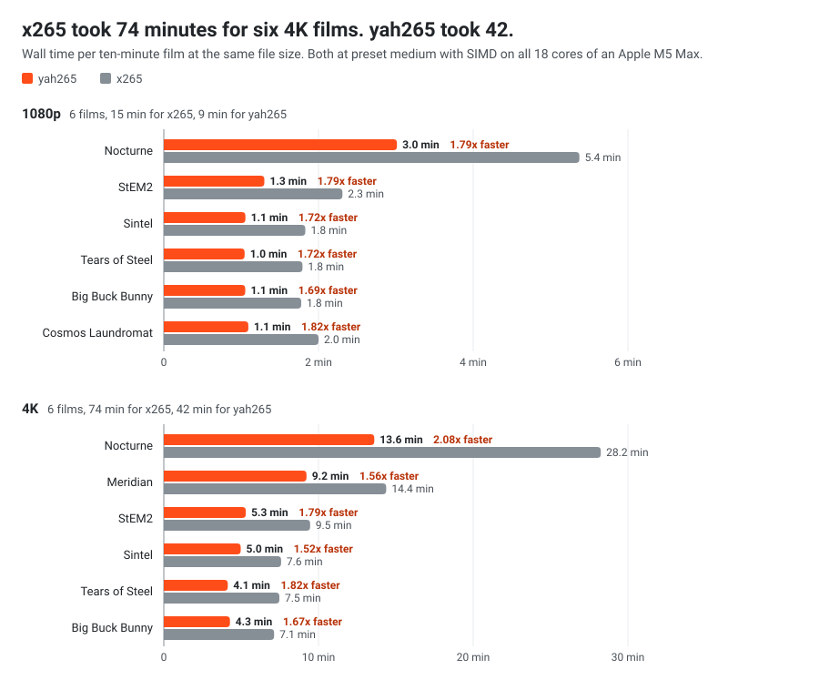

# Shell test

This page is off the nav and out of the search index. It shows each piece of the shell once. Links look like [the results page](results.md), and inline code looks like `--preset medium`.

## Diagram classes

<figure class="diagram">
<svg viewBox="0 0 720 300" role="img" aria-labelledby="st-t st-d">
<title id="st-t">The diagram classes</title>
<desc id="st-d">One sample of each class a diagram may use: four kinds of box, four kinds of line and three kinds of text.</desc>
<rect class="d-box" x="20" y="24" width="150" height="64" rx="6"/>
<text class="d-label" x="95" y="61" text-anchor="middle">d-box</text>
<rect class="d-fill" x="195" y="24" width="150" height="64" rx="6"/>
<text class="d-label" x="270" y="61" text-anchor="middle">d-fill</text>
<rect class="d-accent" x="370" y="24" width="150" height="64" rx="6"/>
<text class="d-label" x="445" y="61" text-anchor="middle">d-accent</text>
<rect class="d-muted" x="545" y="24" width="150" height="64" rx="6"/>
<text class="d-label d-muted" x="620" y="61" text-anchor="middle">d-muted</text>
<line class="d-line" x1="20" y1="130" x2="170" y2="130"/>
<text class="d-label" x="20" y="152">d-line</text>
<line class="d-dash" x1="195" y1="130" x2="345" y2="130"/>
<text class="d-label" x="195" y="152">d-dash</text>
<line class="d-arrow" x1="370" y1="130" x2="520" y2="130"/>
<text class="d-label" x="370" y="152">d-arrow</text>
<line class="d-arrow d-accent" x1="545" y1="130" x2="695" y2="130"/>
<text class="d-label" x="545" y="152">d-arrow d-accent</text>
<line class="d-line d-accent" x1="20" y1="190" x2="170" y2="190"/>
<text class="d-label" x="20" y="212">d-line d-accent</text>
<line class="d-dash d-muted" x1="195" y1="190" x2="345" y2="190"/>
<text class="d-label" x="195" y="212">d-dash d-muted</text>
<line class="d-arrow d-muted" x1="370" y1="190" x2="520" y2="190"/>
<text class="d-label" x="370" y="212">d-arrow d-muted</text>
<text class="d-text" x="20" y="264">d-text is the prose face</text>
<text class="d-label" x="270" y="264">d-label is small sans</text>
<text class="d-mono" x="445" y="264">d-mono --threads 1</text>
<text class="d-text d-accent" x="620" y="264">d-accent</text>
</svg>
<figcaption>Every class from the diagram contract, drawn once.</figcaption>
</figure>

## Code blocks

A shell block tints the prompt and the comment. The copy button leaves the prompt out.

```sh
# build the release binary
$ make build-rel
$ ffmpeg -i in.mov -f yuv4mpegpipe - | build-rel/y265 --input - --crf 26 --preset medium --output out.265
```

A block with no language stays plain.

```
encoded 240 frames
```

## Tables

| class | frames | wall, yah265 | wall, x265 | a long column that makes this table wider than a phone | another wide column of filler words |
|---|--:|--:|--:|---|---|
| CIF | 300 | 0.00 | 0.00 | sample text, with no measured value in it | sample text |
| 720p | 600 | 0.00 | 0.00 | sample text, with no measured value in it | sample text |
| 1080p | 600 | 0.00 | 0.00 | sample text, with no measured value in it | sample text |

## A chart figure

<figure class="chart"><figcaption>A chart is an image. It carries its own light and dark colors.</figcaption></figure>

### A third-level heading

> A quoted block.

<div class="aside"><p class="aside-title">A boxed note</p><p>Text in a boxed note.</p></div>
