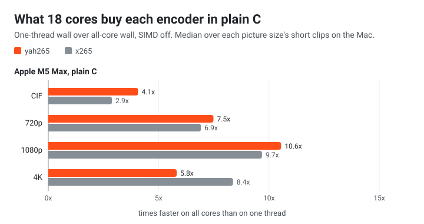

# Threading

yah265 uses every core by default. This page explains how the work is divided, what limits it and which outputs repeat from run to run. [Design](design.md#the-pipeline) has the pipeline this page takes apart.

## Rows are the unit of work

One shared pool of worker threads runs the whole encode. `--threads` sets its size. The default is one worker per CPU.

The unit of work is a row of coding tree units. A frame becomes three tasks per row: encode the row, deblock it, then run SAO and publish the finished row for other frames to predict from. One more task per frame does the entropy coding. It writes the bits from the decisions the rows recorded.

Keeping the entropy coder out of the rows keeps the stream simple. HEVC has optional tools that make a stream easier to code in parallel, at a cost in bitrate. yah265 writes one slice per picture with none of them. Because the entropy passes of different frames don't depend on each other, they run in parallel as ordinary pool work.

Inside a frame, a block needs its left, upper and upper-right neighbors to be finished. Each row therefore trails the row above it by two coding tree units.

<figure class="diagram">
<svg class="d-wide" viewBox="0 0 720 226" role="img" aria-labelledby="thr-wave-w-t thr-wave-w-d">
<title id="thr-wave-w-t">Rows of one frame coded at the same time, each two units behind the row above</title>
<desc id="thr-wave-w-d">One frame drawn as a grid of coding tree units, five rows deep. Every row is partly coded and has one unit being coded now. Each row's unit is two columns to the left of the one in the row above. The coded area is a staircase. For the unit being coded in the third row, three finished units are marked with a dashed outline: the one to its left, the one above it and the one above and to its right.</desc>
<rect class="d-fill" x="20" y="24" width="32" height="32" rx="0"/>
<rect class="d-fill" x="52" y="24" width="32" height="32" rx="0"/>
<rect class="d-fill" x="84" y="24" width="32" height="32" rx="0"/>
<rect class="d-fill" x="116" y="24" width="32" height="32" rx="0"/>
<rect class="d-fill" x="148" y="24" width="32" height="32" rx="0"/>
<rect class="d-fill" x="180" y="24" width="32" height="32" rx="0"/>
<rect class="d-fill" x="212" y="24" width="32" height="32" rx="0"/>
<rect class="d-fill" x="244" y="24" width="32" height="32" rx="0"/>
<rect class="d-fill" x="276" y="24" width="32" height="32" rx="0"/>
<rect class="d-fill" x="308" y="24" width="32" height="32" rx="0"/>
<rect class="d-muted" x="340" y="24" width="32" height="32" rx="0"/>
<rect class="d-muted" x="372" y="24" width="32" height="32" rx="0"/>
<rect class="d-muted" x="404" y="24" width="32" height="32" rx="0"/>
<rect class="d-fill" x="20" y="56" width="32" height="32" rx="0"/>
<rect class="d-fill" x="52" y="56" width="32" height="32" rx="0"/>
<rect class="d-fill" x="84" y="56" width="32" height="32" rx="0"/>
<rect class="d-fill" x="116" y="56" width="32" height="32" rx="0"/>
<rect class="d-fill" x="148" y="56" width="32" height="32" rx="0"/>
<rect class="d-fill" x="180" y="56" width="32" height="32" rx="0"/>
<rect class="d-fill" x="212" y="56" width="32" height="32" rx="0"/>
<rect class="d-fill" x="244" y="56" width="32" height="32" rx="0"/>
<rect class="d-muted" x="276" y="56" width="32" height="32" rx="0"/>
<rect class="d-muted" x="308" y="56" width="32" height="32" rx="0"/>
<rect class="d-muted" x="340" y="56" width="32" height="32" rx="0"/>
<rect class="d-muted" x="372" y="56" width="32" height="32" rx="0"/>
<rect class="d-muted" x="404" y="56" width="32" height="32" rx="0"/>
<rect class="d-fill" x="20" y="88" width="32" height="32" rx="0"/>
<rect class="d-fill" x="52" y="88" width="32" height="32" rx="0"/>
<rect class="d-fill" x="84" y="88" width="32" height="32" rx="0"/>
<rect class="d-fill" x="116" y="88" width="32" height="32" rx="0"/>
<rect class="d-fill" x="148" y="88" width="32" height="32" rx="0"/>
<rect class="d-fill" x="180" y="88" width="32" height="32" rx="0"/>
<rect class="d-muted" x="212" y="88" width="32" height="32" rx="0"/>
<rect class="d-muted" x="244" y="88" width="32" height="32" rx="0"/>
<rect class="d-muted" x="276" y="88" width="32" height="32" rx="0"/>
<rect class="d-muted" x="308" y="88" width="32" height="32" rx="0"/>
<rect class="d-muted" x="340" y="88" width="32" height="32" rx="0"/>
<rect class="d-muted" x="372" y="88" width="32" height="32" rx="0"/>
<rect class="d-muted" x="404" y="88" width="32" height="32" rx="0"/>
<rect class="d-fill" x="20" y="120" width="32" height="32" rx="0"/>
<rect class="d-fill" x="52" y="120" width="32" height="32" rx="0"/>
<rect class="d-fill" x="84" y="120" width="32" height="32" rx="0"/>
<rect class="d-fill" x="116" y="120" width="32" height="32" rx="0"/>
<rect class="d-muted" x="148" y="120" width="32" height="32" rx="0"/>
<rect class="d-muted" x="180" y="120" width="32" height="32" rx="0"/>
<rect class="d-muted" x="212" y="120" width="32" height="32" rx="0"/>
<rect class="d-muted" x="244" y="120" width="32" height="32" rx="0"/>
<rect class="d-muted" x="276" y="120" width="32" height="32" rx="0"/>
<rect class="d-muted" x="308" y="120" width="32" height="32" rx="0"/>
<rect class="d-muted" x="340" y="120" width="32" height="32" rx="0"/>
<rect class="d-muted" x="372" y="120" width="32" height="32" rx="0"/>
<rect class="d-muted" x="404" y="120" width="32" height="32" rx="0"/>
<rect class="d-fill" x="20" y="152" width="32" height="32" rx="0"/>
<rect class="d-fill" x="52" y="152" width="32" height="32" rx="0"/>
<rect class="d-muted" x="84" y="152" width="32" height="32" rx="0"/>
<rect class="d-muted" x="116" y="152" width="32" height="32" rx="0"/>
<rect class="d-muted" x="148" y="152" width="32" height="32" rx="0"/>
<rect class="d-muted" x="180" y="152" width="32" height="32" rx="0"/>
<rect class="d-muted" x="212" y="152" width="32" height="32" rx="0"/>
<rect class="d-muted" x="244" y="152" width="32" height="32" rx="0"/>
<rect class="d-muted" x="276" y="152" width="32" height="32" rx="0"/>
<rect class="d-muted" x="308" y="152" width="32" height="32" rx="0"/>
<rect class="d-muted" x="340" y="152" width="32" height="32" rx="0"/>
<rect class="d-muted" x="372" y="152" width="32" height="32" rx="0"/>
<rect class="d-muted" x="404" y="152" width="32" height="32" rx="0"/>
<rect class="d-accent" x="340" y="24" width="32" height="32" rx="0"/>
<rect class="d-accent" x="276" y="56" width="32" height="32" rx="0"/>
<rect class="d-accent" x="212" y="88" width="32" height="32" rx="0"/>
<rect class="d-accent" x="148" y="120" width="32" height="32" rx="0"/>
<rect class="d-accent" x="84" y="152" width="32" height="32" rx="0"/>
<rect class="d-dash d-accent" x="184" y="92" width="24" height="24" rx="0"/>
<rect class="d-dash d-accent" x="216" y="60" width="24" height="24" rx="0"/>
<rect class="d-dash d-accent" x="248" y="60" width="24" height="24" rx="0"/>
<rect class="d-fill" x="468" y="34" width="18" height="18" rx="0"/>
<text class="d-label" x="496" y="48">finished</text>
<rect class="d-accent" x="468" y="68" width="18" height="18" rx="0"/>
<text class="d-label" x="496" y="82">being coded, one in each row</text>
<rect class="d-dash d-accent" x="468" y="102" width="18" height="18" rx="0"/>
<text class="d-label" x="496" y="116">what the third row's block</text>
<text class="d-label" x="496" y="134">needs: left, upper, upper-right</text>
<rect class="d-muted" x="468" y="154" width="18" height="18" rx="0"/>
<text class="d-label" x="496" y="168">waiting</text>
<text class="d-label" x="228" y="212" text-anchor="middle">each row runs two coding tree units behind the row above</text>
</svg>
<svg class="d-narrow" viewBox="0 0 360 330" role="img" aria-labelledby="thr-wave-n-t thr-wave-n-d">
<title id="thr-wave-n-t">Rows of one frame coded at the same time, each two units behind the row above</title>
<desc id="thr-wave-n-d">One frame drawn as a grid of coding tree units, five rows deep. Every row is partly coded and has one unit being coded now. Each row's unit is two columns to the left of the one in the row above. The coded area is a staircase. For the unit being coded in the third row, three finished units are marked with a dashed outline: the one to its left, the one above it and the one above and to its right.</desc>
<rect class="d-fill" x="10" y="10" width="34" height="34" rx="0"/>
<rect class="d-fill" x="44" y="10" width="34" height="34" rx="0"/>
<rect class="d-fill" x="78" y="10" width="34" height="34" rx="0"/>
<rect class="d-fill" x="112" y="10" width="34" height="34" rx="0"/>
<rect class="d-fill" x="146" y="10" width="34" height="34" rx="0"/>
<rect class="d-fill" x="180" y="10" width="34" height="34" rx="0"/>
<rect class="d-fill" x="214" y="10" width="34" height="34" rx="0"/>
<rect class="d-fill" x="248" y="10" width="34" height="34" rx="0"/>
<rect class="d-muted" x="282" y="10" width="34" height="34" rx="0"/>
<rect class="d-muted" x="316" y="10" width="34" height="34" rx="0"/>
<rect class="d-fill" x="10" y="44" width="34" height="34" rx="0"/>
<rect class="d-fill" x="44" y="44" width="34" height="34" rx="0"/>
<rect class="d-fill" x="78" y="44" width="34" height="34" rx="0"/>
<rect class="d-fill" x="112" y="44" width="34" height="34" rx="0"/>
<rect class="d-fill" x="146" y="44" width="34" height="34" rx="0"/>
<rect class="d-fill" x="180" y="44" width="34" height="34" rx="0"/>
<rect class="d-muted" x="214" y="44" width="34" height="34" rx="0"/>
<rect class="d-muted" x="248" y="44" width="34" height="34" rx="0"/>
<rect class="d-muted" x="282" y="44" width="34" height="34" rx="0"/>
<rect class="d-muted" x="316" y="44" width="34" height="34" rx="0"/>
<rect class="d-fill" x="10" y="78" width="34" height="34" rx="0"/>
<rect class="d-fill" x="44" y="78" width="34" height="34" rx="0"/>
<rect class="d-fill" x="78" y="78" width="34" height="34" rx="0"/>
<rect class="d-fill" x="112" y="78" width="34" height="34" rx="0"/>
<rect class="d-muted" x="146" y="78" width="34" height="34" rx="0"/>
<rect class="d-muted" x="180" y="78" width="34" height="34" rx="0"/>
<rect class="d-muted" x="214" y="78" width="34" height="34" rx="0"/>
<rect class="d-muted" x="248" y="78" width="34" height="34" rx="0"/>
<rect class="d-muted" x="282" y="78" width="34" height="34" rx="0"/>
<rect class="d-muted" x="316" y="78" width="34" height="34" rx="0"/>
<rect class="d-fill" x="10" y="112" width="34" height="34" rx="0"/>
<rect class="d-fill" x="44" y="112" width="34" height="34" rx="0"/>
<rect class="d-muted" x="78" y="112" width="34" height="34" rx="0"/>
<rect class="d-muted" x="112" y="112" width="34" height="34" rx="0"/>
<rect class="d-muted" x="146" y="112" width="34" height="34" rx="0"/>
<rect class="d-muted" x="180" y="112" width="34" height="34" rx="0"/>
<rect class="d-muted" x="214" y="112" width="34" height="34" rx="0"/>
<rect class="d-muted" x="248" y="112" width="34" height="34" rx="0"/>
<rect class="d-muted" x="282" y="112" width="34" height="34" rx="0"/>
<rect class="d-muted" x="316" y="112" width="34" height="34" rx="0"/>
<rect class="d-muted" x="10" y="146" width="34" height="34" rx="0"/>
<rect class="d-muted" x="44" y="146" width="34" height="34" rx="0"/>
<rect class="d-muted" x="78" y="146" width="34" height="34" rx="0"/>
<rect class="d-muted" x="112" y="146" width="34" height="34" rx="0"/>
<rect class="d-muted" x="146" y="146" width="34" height="34" rx="0"/>
<rect class="d-muted" x="180" y="146" width="34" height="34" rx="0"/>
<rect class="d-muted" x="214" y="146" width="34" height="34" rx="0"/>
<rect class="d-muted" x="248" y="146" width="34" height="34" rx="0"/>
<rect class="d-muted" x="282" y="146" width="34" height="34" rx="0"/>
<rect class="d-muted" x="316" y="146" width="34" height="34" rx="0"/>
<rect class="d-accent" x="282" y="10" width="34" height="34" rx="0"/>
<rect class="d-accent" x="214" y="44" width="34" height="34" rx="0"/>
<rect class="d-accent" x="146" y="78" width="34" height="34" rx="0"/>
<rect class="d-accent" x="78" y="112" width="34" height="34" rx="0"/>
<rect class="d-accent" x="10" y="146" width="34" height="34" rx="0"/>
<rect class="d-dash d-accent" x="116" y="82" width="26" height="26" rx="0"/>
<rect class="d-dash d-accent" x="150" y="48" width="26" height="26" rx="0"/>
<rect class="d-dash d-accent" x="184" y="48" width="26" height="26" rx="0"/>
<text class="d-label" x="180" y="204" text-anchor="middle">each row runs two coding tree units</text>
<text class="d-label" x="180" y="222" text-anchor="middle">behind the row above</text>
<rect class="d-fill" x="10" y="244" width="16" height="16" rx="0"/>
<text class="d-label" x="34" y="257">finished</text>
<rect class="d-muted" x="180" y="244" width="16" height="16" rx="0"/>
<text class="d-label" x="204" y="257">waiting</text>
<rect class="d-accent" x="10" y="272" width="16" height="16" rx="0"/>
<text class="d-label" x="34" y="285">being coded, one in each row</text>
<rect class="d-dash d-accent" x="10" y="300" width="16" height="16" rx="0"/>
<text class="d-label" x="34" y="313">what the third row's block needs</text>
</svg>
<figcaption>Because a block reads the finished blocks to its left, above it and above to its right, the rows advance as a staircase.</figcaption>
</figure>

## What a row waits for

A row in a P or B frame predicts from other frames. It can start as soon as each reference frame has finished the rows its motion search can reach. That reach is fixed by geometry: the search range, the fractional-sample step and the length of the interpolation filter.

<figure class="diagram">
<svg class="d-wide" viewBox="0 0 720 274" role="img" aria-label="Rows of three frames in flight, and what a row waits for">
<title>Rows of three frames in flight, and what a row waits for</title>
<desc>Three frames side by side, each drawn as six rows with a bar for how far each row has been coded. The first frame is a reference and is nearly done. The second predicts from the first and has four rows under way, each trailing the row above. The third predicts from both and has just started. The block being coded in the second frame is joined to an outlined band of three rows in the first frame, the rows its motion search can reach. A block in the third frame is joined to a band of two rows in the second.</desc>
<text class="d-label" x="120" y="46" text-anchor="middle">frame 1, a reference</text>
<rect class="d-muted" x="20" y="60" width="200" height="25" rx="0"/>
<rect class="d-fill" x="20" y="60" width="200" height="25" rx="0"/>
<rect class="d-muted" x="20" y="85" width="200" height="25" rx="0"/>
<rect class="d-fill" x="20" y="85" width="200" height="25" rx="0"/>
<rect class="d-muted" x="20" y="110" width="200" height="25" rx="0"/>
<rect class="d-fill" x="20" y="110" width="200" height="25" rx="0"/>
<rect class="d-muted" x="20" y="135" width="200" height="25" rx="0"/>
<rect class="d-fill" x="20" y="135" width="200" height="25" rx="0"/>
<rect class="d-muted" x="20" y="160" width="200" height="25" rx="0"/>
<rect class="d-fill" x="20" y="160" width="200" height="25" rx="0"/>
<rect class="d-muted" x="20" y="185" width="200" height="25" rx="0"/>
<rect class="d-fill" x="20" y="185" width="120" height="25" rx="0"/>
<text class="d-label" x="360" y="46" text-anchor="middle">frame 2 predicts from 1</text>
<rect class="d-muted" x="260" y="60" width="200" height="25" rx="0"/>
<rect class="d-fill" x="260" y="60" width="200" height="25" rx="0"/>
<rect class="d-muted" x="260" y="85" width="200" height="25" rx="0"/>
<rect class="d-fill" x="260" y="85" width="200" height="25" rx="0"/>
<rect class="d-muted" x="260" y="110" width="200" height="25" rx="0"/>
<rect class="d-fill" x="260" y="110" width="150" height="25" rx="0"/>
<rect class="d-muted" x="260" y="135" width="200" height="25" rx="0"/>
<rect class="d-fill" x="260" y="135" width="100" height="25" rx="0"/>
<rect class="d-muted" x="260" y="160" width="200" height="25" rx="0"/>
<rect class="d-muted" x="260" y="185" width="200" height="25" rx="0"/>
<text class="d-label" x="600" y="46" text-anchor="middle">frame 3 predicts from 1 and 2</text>
<rect class="d-muted" x="500" y="60" width="200" height="25" rx="0"/>
<rect class="d-fill" x="500" y="60" width="60" height="25" rx="0"/>
<rect class="d-muted" x="500" y="85" width="200" height="25" rx="0"/>
<rect class="d-muted" x="500" y="110" width="200" height="25" rx="0"/>
<rect class="d-muted" x="500" y="135" width="200" height="25" rx="0"/>
<rect class="d-muted" x="500" y="160" width="200" height="25" rx="0"/>
<rect class="d-muted" x="500" y="185" width="200" height="25" rx="0"/>
<rect class="d-line d-accent" x="20" y="110" width="200" height="75" rx="0"/>
<line class="d-line d-accent" x1="360" y1="135" x2="220" y2="110"/>
<line class="d-line d-accent" x1="360" y1="160" x2="220" y2="185"/>
<rect class="d-accent" x="360" y="135" width="20" height="25" rx="0"/>
<rect class="d-line d-accent" x="260" y="60" width="200" height="50" rx="0"/>
<line class="d-line d-accent" x1="560" y1="60" x2="460" y2="60"/>
<line class="d-line d-accent" x1="560" y1="85" x2="460" y2="110"/>
<rect class="d-accent" x="560" y="60" width="20" height="25" rx="0"/>
<text class="d-label" x="120" y="234" text-anchor="middle">rows 1 to 5 done</text>
<text class="d-label" x="360" y="234" text-anchor="middle">each row trails the one above</text>
<text class="d-label" x="600" y="234" text-anchor="middle">started before frame 2 is done</text>
<text class="d-label" x="360" y="264" text-anchor="middle">outlined rows: what the highlighted block's motion search can reach in its reference</text>
</svg>
<svg class="d-narrow" viewBox="0 0 360 490" role="img" aria-labelledby="thr-rows-n-t thr-rows-n-d">
<title id="thr-rows-n-t">Rows of three frames in flight, and what a row waits for</title>
<desc id="thr-rows-n-d">Three frames, each drawn as six rows with a bar for how far each row has been coded. The first frame is a reference and is nearly done. The second predicts from the first and has four rows under way, each trailing the row above. The third predicts from both and has just started. The block being coded in the second frame is joined to an outlined band of three rows in the first frame, the rows its motion search can reach. A block in the third frame is joined to a band of two rows in the second.</desc>
<rect class="d-muted" x="8" y="12" width="180" height="20" rx="0"/>
<rect class="d-fill" x="8" y="12" width="180" height="20" rx="0"/>
<rect class="d-muted" x="8" y="32" width="180" height="20" rx="0"/>
<rect class="d-fill" x="8" y="32" width="180" height="20" rx="0"/>
<rect class="d-muted" x="8" y="52" width="180" height="20" rx="0"/>
<rect class="d-fill" x="8" y="52" width="180" height="20" rx="0"/>
<rect class="d-muted" x="8" y="72" width="180" height="20" rx="0"/>
<rect class="d-fill" x="8" y="72" width="180" height="20" rx="0"/>
<rect class="d-muted" x="8" y="92" width="180" height="20" rx="0"/>
<rect class="d-fill" x="8" y="92" width="180" height="20" rx="0"/>
<rect class="d-muted" x="8" y="112" width="180" height="20" rx="0"/>
<rect class="d-fill" x="8" y="112" width="108" height="20" rx="0"/>
<rect class="d-muted" x="8" y="162" width="180" height="20" rx="0"/>
<rect class="d-fill" x="8" y="162" width="180" height="20" rx="0"/>
<rect class="d-muted" x="8" y="182" width="180" height="20" rx="0"/>
<rect class="d-fill" x="8" y="182" width="180" height="20" rx="0"/>
<rect class="d-muted" x="8" y="202" width="180" height="20" rx="0"/>
<rect class="d-fill" x="8" y="202" width="135" height="20" rx="0"/>
<rect class="d-muted" x="8" y="222" width="180" height="20" rx="0"/>
<rect class="d-fill" x="8" y="222" width="90" height="20" rx="0"/>
<rect class="d-muted" x="8" y="242" width="180" height="20" rx="0"/>
<rect class="d-muted" x="8" y="262" width="180" height="20" rx="0"/>
<rect class="d-muted" x="8" y="312" width="180" height="20" rx="0"/>
<rect class="d-fill" x="8" y="312" width="54" height="20" rx="0"/>
<rect class="d-muted" x="8" y="332" width="180" height="20" rx="0"/>
<rect class="d-muted" x="8" y="352" width="180" height="20" rx="0"/>
<rect class="d-muted" x="8" y="372" width="180" height="20" rx="0"/>
<rect class="d-muted" x="8" y="392" width="180" height="20" rx="0"/>
<rect class="d-muted" x="8" y="412" width="180" height="20" rx="0"/>
<text class="d-label" x="200" y="30" text-anchor="start">frame 1, a reference</text>
<text class="d-label" x="200" y="48" text-anchor="start">rows 1 to 5 done</text>
<text class="d-label" x="200" y="180" text-anchor="start">frame 2 predicts</text>
<text class="d-label" x="200" y="198" text-anchor="start">from 1</text>
<text class="d-label" x="200" y="222" text-anchor="start">each row trails</text>
<text class="d-label" x="200" y="240" text-anchor="start">the one above</text>
<text class="d-label" x="200" y="330" text-anchor="start">frame 3 predicts</text>
<text class="d-label" x="200" y="348" text-anchor="start">from 1 and 2</text>
<text class="d-label" x="200" y="372" text-anchor="start">started before</text>
<text class="d-label" x="200" y="390" text-anchor="start">frame 2 is done</text>
<rect class="d-line d-accent" x="8" y="52" width="180" height="60" rx="0"/>
<line class="d-line d-accent" x1="98" y1="222" x2="8" y2="112"/>
<line class="d-line d-accent" x1="116" y1="222" x2="188" y2="112"/>
<rect class="d-accent" x="98" y="222" width="18" height="20" rx="0"/>
<rect class="d-line d-accent" x="8" y="162" width="180" height="40" rx="0"/>
<line class="d-line d-accent" x1="62" y1="312" x2="8" y2="202"/>
<line class="d-line d-accent" x1="80" y1="312" x2="188" y2="202"/>
<rect class="d-accent" x="62" y="312" width="18" height="20" rx="0"/>
<text class="d-label" x="180" y="462" text-anchor="middle">outlined rows: what the highlighted block's</text>
<text class="d-label" x="180" y="480" text-anchor="middle">motion search can reach in its reference</text>
</svg>
<figcaption>A row can run as soon as the outlined rows are finished in every reference. It doesn't wait for the whole reference frame.</figcaption>
</figure>

The start rule is only a good guess. Whenever a block is about to touch a reference picture, the encoder checks that the rows it will read are published. If they aren't, the block waits while its worker picks up work from an older frame. Waits always point at older frames. Because the oldest frame never waits on another, the pool can't lock up.

Forbidding motion vectors that point too far down the reference is another way to make frames overlap. Because that narrows what the encoder can choose, I chose waiting instead. A vector may point anywhere the standard allows.

## Frames in flight

One frame can't keep a large pool busy, because only so many of its rows can run at once. The encoder therefore keeps several frames in flight. The count follows the picture.

| picture | frames in flight |
|---|--:|
| too small to fill the pool with two frames, such as CIF | 8 |
| 720p | 8 |
| 1080p and 4K on the 64x64 tree | 12 |
| anything else | 6 |

<figure class="diagram">
<svg class="d-wide" viewBox="0 0 720 350" role="img" aria-label="Twelve frames in flight, reference frames first">
<title>Twelve frames in flight, reference frames first</title>
<desc>A timeline with one bar per frame in coding order. The bars overlap, and at the marked moment all twelve are being coded at once. Frames that other frames predict from start first. The four B frames that nothing predicts from start last.</desc>
<text class="d-mono" x="96" y="55" text-anchor="end">P8</text>
<rect class="d-accent" x="110" y="44" width="301.6" height="14" rx="3"/>
<text class="d-mono" x="96" y="75" text-anchor="end">B4</text>
<rect class="d-accent" x="168" y="64" width="301.6" height="14" rx="3"/>
<text class="d-mono" x="96" y="95" text-anchor="end">P16</text>
<rect class="d-accent" x="197" y="84" width="301.6" height="14" rx="3"/>
<text class="d-mono" x="96" y="115" text-anchor="end">B2</text>
<rect class="d-accent" x="226" y="104" width="301.6" height="14" rx="3"/>
<text class="d-mono" x="96" y="135" text-anchor="end">B6</text>
<rect class="d-accent" x="226" y="124" width="301.6" height="14" rx="3"/>
<text class="d-mono" x="96" y="155" text-anchor="end">B12</text>
<rect class="d-accent" x="255" y="144" width="301.6" height="14" rx="3"/>
<text class="d-mono" x="96" y="175" text-anchor="end">B10</text>
<rect class="d-accent" x="284" y="164" width="301.6" height="14" rx="3"/>
<text class="d-mono" x="96" y="195" text-anchor="end">B14</text>
<rect class="d-accent" x="284" y="184" width="301.6" height="14" rx="3"/>
<text class="d-mono" x="96" y="215" text-anchor="end">B1</text>
<rect class="d-fill" x="318.8" y="204" width="301.6" height="14" rx="3"/>
<text class="d-mono" x="96" y="235" text-anchor="end">B3</text>
<rect class="d-fill" x="330.4" y="224" width="301.6" height="14" rx="3"/>
<text class="d-mono" x="96" y="255" text-anchor="end">B5</text>
<rect class="d-fill" x="342" y="244" width="301.6" height="14" rx="3"/>
<text class="d-mono" x="96" y="275" text-anchor="end">B7</text>
<rect class="d-fill" x="353.6" y="264" width="301.6" height="14" rx="3"/>
<line class="d-dash" x1="382.6" y1="30" x2="382.6" y2="288"/>
<text class="d-label" x="382.6" y="22" text-anchor="middle">twelve frames in flight at this moment</text>
<line class="d-arrow d-muted" x1="110" y1="300" x2="690" y2="300"/>
<text class="d-label" x="690" y="318" text-anchor="end">time</text>
<rect class="d-accent" x="110" y="322" width="12" height="12" rx="2"/>
<text class="d-label" x="130" y="333" text-anchor="start">frames that other frames predict from</text>
<rect class="d-fill" x="410" y="322" width="12" height="12" rx="2"/>
<text class="d-label" x="430" y="333" text-anchor="start">frames nothing predicts from</text>
</svg>
<svg class="d-narrow" viewBox="0 0 360 370" role="img" aria-labelledby="thr-flight-n-t thr-flight-n-d">
<title id="thr-flight-n-t">Twelve frames in flight, reference frames first</title>
<desc id="thr-flight-n-d">A timeline with one bar per frame in coding order. The bars overlap, and at the marked moment all twelve are being coded at once. Frames that other frames predict from start first. The four B frames that nothing predicts from start last.</desc>
<text class="d-mono" x="40" y="55" text-anchor="end">P8</text>
<rect class="d-accent" x="48.0" y="44" width="168.3" height="14" rx="3"/>
<text class="d-mono" x="40" y="75" text-anchor="end">B4</text>
<rect class="d-accent" x="80.4" y="64" width="168.3" height="14" rx="3"/>
<text class="d-mono" x="40" y="95" text-anchor="end">P16</text>
<rect class="d-accent" x="96.5" y="84" width="168.3" height="14" rx="3"/>
<text class="d-mono" x="40" y="115" text-anchor="end">B2</text>
<rect class="d-accent" x="112.7" y="104" width="168.3" height="14" rx="3"/>
<text class="d-mono" x="40" y="135" text-anchor="end">B6</text>
<rect class="d-accent" x="112.7" y="124" width="168.3" height="14" rx="3"/>
<text class="d-mono" x="40" y="155" text-anchor="end">B12</text>
<rect class="d-accent" x="128.9" y="144" width="168.3" height="14" rx="3"/>
<text class="d-mono" x="40" y="175" text-anchor="end">B10</text>
<rect class="d-accent" x="145.1" y="164" width="168.3" height="14" rx="3"/>
<text class="d-mono" x="40" y="195" text-anchor="end">B14</text>
<rect class="d-accent" x="145.1" y="184" width="168.3" height="14" rx="3"/>
<text class="d-mono" x="40" y="215" text-anchor="end">B1</text>
<rect class="d-fill" x="164.5" y="204" width="168.3" height="14" rx="3"/>
<text class="d-mono" x="40" y="235" text-anchor="end">B3</text>
<rect class="d-fill" x="171.0" y="224" width="168.3" height="14" rx="3"/>
<text class="d-mono" x="40" y="255" text-anchor="end">B5</text>
<rect class="d-fill" x="177.5" y="244" width="168.3" height="14" rx="3"/>
<text class="d-mono" x="40" y="275" text-anchor="end">B7</text>
<rect class="d-fill" x="183.9" y="264" width="168.3" height="14" rx="3"/>
<line class="d-dash" x1="200.1" y1="30" x2="200.1" y2="288"/>
<text class="d-label" x="200.1" y="22" text-anchor="middle">twelve frames in flight at this moment</text>
<line class="d-arrow d-muted" x1="48" y1="300" x2="350" y2="300"/>
<text class="d-label" x="350" y="318" text-anchor="end">time</text>
<rect class="d-accent" x="8" y="326" width="12" height="12" rx="2"/>
<text class="d-label" x="28" y="337" text-anchor="start">frames that other frames predict from</text>
<rect class="d-fill" x="8" y="348" width="12" height="12" rx="2"/>
<text class="d-label" x="28" y="359" text-anchor="start">frames nothing predicts from</text>
</svg>
<figcaption>A sketch of the schedule on a 64x64 tree, drawn to show the order. The bar lengths aren't measured.</figcaption>
</figure>

Two rules keep a deep queue moving. Frames that others predict from get workers first, since later frames are waiting on their rows. On wide pictures a row gives up its worker when it finds the row above too close.

More frames in flight need more memory, because each one holds its own pictures.

## The lookahead and the driver

One thread, the driver, prepares each frame before the pool can start on it. It feeds the lookahead, classifies flat and dark areas, builds the adaptive quantization field, analyzes weighted prediction and runs the propagation step that decides where later frames will look.

All of that scales with the picture. At 4K a driver that did all of it alone would be slower than the pool. Workers would sit idle while they waited for the next frame. Above one thread the driver therefore cuts each of those steps into items that any free worker can take.

<figure class="diagram">
<svg class="d-wide" viewBox="0 0 720 272" role="img" aria-label="The driver's per-frame analysis, alone and split over the pool">
<title>The driver's per-frame analysis, alone and split over the pool</title>
<desc>Two timelines of the work the driver does before it can dispatch a frame: the lookahead push, the flat census, the AQ field, the dark map, the weighted prediction analysis and the cu-tree. On one thread the six steps run end to end. With many threads each step is cut into items that free workers run beside the driver, so each step is shorter and the frame is dispatched sooner.</desc>
<text class="d-label" x="20" y="34" text-anchor="start">one thread: the driver does each step alone</text>
<rect class="d-box" x="20" y="44" width="134" height="34" rx="6"/>
<text class="d-label" x="87" y="65.5" text-anchor="middle">push</text>
<rect class="d-box" x="160" y="44" width="84" height="34" rx="6"/>
<text class="d-label" x="202" y="65.5" text-anchor="middle">flat census</text>
<rect class="d-box" x="250" y="44" width="74" height="34" rx="6"/>
<text class="d-label" x="287" y="65.5" text-anchor="middle">AQ field</text>
<rect class="d-box" x="330" y="44" width="74" height="34" rx="6"/>
<text class="d-label" x="367" y="65.5" text-anchor="middle">dark map</text>
<rect class="d-box" x="410" y="44" width="84" height="34" rx="6"/>
<text class="d-label" x="452" y="65.5" text-anchor="middle">weights</text>
<rect class="d-box" x="500" y="44" width="134" height="34" rx="6"/>
<text class="d-label" x="567" y="65.5" text-anchor="middle">cu-tree</text>
<rect class="d-accent" x="640" y="44" width="60" height="34" rx="6"/>
<text class="d-label" x="670" y="65.5" text-anchor="middle">dispatch</text>
<text class="d-label" x="20" y="124" text-anchor="start">many threads: free workers take pieces of each step</text>
<rect class="d-fill" x="20" y="176" width="78" height="16" rx="3"/>
<rect class="d-fill" x="20" y="196" width="78" height="16" rx="3"/>
<rect class="d-fill" x="20" y="216" width="78" height="16" rx="3"/>
<rect class="d-box" x="20" y="136" width="78" height="34" rx="6"/>
<text class="d-label" x="59" y="157.5" text-anchor="middle">push</text>
<rect class="d-fill" x="104" y="176" width="60" height="16" rx="3"/>
<rect class="d-fill" x="104" y="196" width="60" height="16" rx="3"/>
<rect class="d-fill" x="104" y="216" width="60" height="16" rx="3"/>
<rect class="d-box" x="104" y="136" width="60" height="34" rx="6"/>
<text class="d-label" x="134" y="157.5" text-anchor="middle">census</text>
<rect class="d-fill" x="170" y="176" width="44" height="16" rx="3"/>
<rect class="d-fill" x="170" y="196" width="44" height="16" rx="3"/>
<rect class="d-fill" x="170" y="216" width="44" height="16" rx="3"/>
<rect class="d-box" x="170" y="136" width="44" height="34" rx="6"/>
<text class="d-label" x="192" y="157.5" text-anchor="middle">AQ</text>
<rect class="d-fill" x="220" y="176" width="48" height="16" rx="3"/>
<rect class="d-fill" x="220" y="196" width="48" height="16" rx="3"/>
<rect class="d-fill" x="220" y="216" width="48" height="16" rx="3"/>
<rect class="d-box" x="220" y="136" width="48" height="34" rx="6"/>
<text class="d-label" x="244" y="157.5" text-anchor="middle">dark</text>
<rect class="d-fill" x="274" y="176" width="68" height="16" rx="3"/>
<rect class="d-fill" x="274" y="196" width="68" height="16" rx="3"/>
<rect class="d-fill" x="274" y="216" width="68" height="16" rx="3"/>
<rect class="d-box" x="274" y="136" width="68" height="34" rx="6"/>
<text class="d-label" x="308" y="157.5" text-anchor="middle">weights</text>
<rect class="d-fill" x="348" y="176" width="74" height="16" rx="3"/>
<rect class="d-fill" x="348" y="196" width="74" height="16" rx="3"/>
<rect class="d-fill" x="348" y="216" width="74" height="16" rx="3"/>
<rect class="d-box" x="348" y="136" width="74" height="34" rx="6"/>
<text class="d-label" x="385" y="157.5" text-anchor="middle">cu-tree</text>
<rect class="d-accent" x="428" y="136" width="60" height="34" rx="6"/>
<text class="d-label" x="458" y="157.5" text-anchor="middle">dispatch</text>
<text class="d-label" x="504" y="158" text-anchor="start">dispatched sooner</text>
<text class="d-label" x="20" y="256" text-anchor="start">shaded bars: the same step's items, run by workers that had nothing else to do</text>
<line class="d-line d-muted" x1="18" y1="136" x2="18" y2="232"/>
</svg>
<svg class="d-narrow" viewBox="0 0 360 500" role="img" aria-labelledby="thr-split-n-t thr-split-n-d">
<title id="thr-split-n-t">The driver's per-frame analysis, alone and split over the pool</title>
<desc id="thr-split-n-d">Two timelines of the work the driver does before it can dispatch a frame: the lookahead push, the flat census, the AQ field, the dark map, the weighted prediction analysis and the cu-tree. On one thread the six steps run end to end. With many threads each step is cut into items that free workers run beside the driver, so each step is shorter and the frame is dispatched sooner.</desc>
<text class="d-label" x="8" y="20" text-anchor="start">one thread: the driver</text>
<text class="d-label" x="8" y="36" text-anchor="start">does each step alone</text>
<text class="d-label" x="166" y="20" text-anchor="start">many threads: free</text>
<text class="d-label" x="166" y="36" text-anchor="start">workers take pieces</text>
<text class="d-label" x="166" y="52" text-anchor="start">of each step</text>
<rect class="d-box" x="8" y="66" width="142" height="74" rx="6"/>
<text class="d-label" x="79" y="107.5" text-anchor="middle">push</text>
<rect class="d-box" x="8" y="144" width="142" height="46" rx="6"/>
<text class="d-label" x="79" y="171.5" text-anchor="middle">flat census</text>
<rect class="d-box" x="8" y="194" width="142" height="41" rx="6"/>
<text class="d-label" x="79" y="219" text-anchor="middle">AQ field</text>
<rect class="d-box" x="8" y="239" width="142" height="41" rx="6"/>
<text class="d-label" x="79" y="264" text-anchor="middle">dark map</text>
<rect class="d-box" x="8" y="284" width="142" height="46" rx="6"/>
<text class="d-label" x="79" y="311.5" text-anchor="middle">weights</text>
<rect class="d-box" x="8" y="334" width="142" height="74" rx="6"/>
<text class="d-label" x="79" y="375.5" text-anchor="middle">cu-tree</text>
<rect class="d-accent" x="8" y="412" width="142" height="33" rx="6"/>
<text class="d-label" x="79" y="433" text-anchor="middle">dispatch</text>
<rect class="d-fill" x="258" y="66" width="18" height="43" rx="3"/>
<rect class="d-fill" x="282" y="66" width="18" height="43" rx="3"/>
<rect class="d-fill" x="306" y="66" width="18" height="43" rx="3"/>
<rect class="d-box" x="166" y="66" width="84" height="43" rx="6"/>
<text class="d-label" x="208" y="92" text-anchor="middle">push</text>
<rect class="d-fill" x="258" y="113" width="18" height="33" rx="3"/>
<rect class="d-fill" x="282" y="113" width="18" height="33" rx="3"/>
<rect class="d-fill" x="306" y="113" width="18" height="33" rx="3"/>
<rect class="d-box" x="166" y="113" width="84" height="33" rx="6"/>
<text class="d-label" x="208" y="134" text-anchor="middle">census</text>
<rect class="d-fill" x="258" y="150" width="18" height="24" rx="3"/>
<rect class="d-fill" x="282" y="150" width="18" height="24" rx="3"/>
<rect class="d-fill" x="306" y="150" width="18" height="24" rx="3"/>
<rect class="d-box" x="166" y="150" width="84" height="24" rx="6"/>
<text class="d-label" x="208" y="166.5" text-anchor="middle">AQ</text>
<rect class="d-fill" x="258" y="178" width="18" height="26" rx="3"/>
<rect class="d-fill" x="282" y="178" width="18" height="26" rx="3"/>
<rect class="d-fill" x="306" y="178" width="18" height="26" rx="3"/>
<rect class="d-box" x="166" y="178" width="84" height="26" rx="6"/>
<text class="d-label" x="208" y="195.5" text-anchor="middle">dark</text>
<rect class="d-fill" x="258" y="208" width="18" height="37" rx="3"/>
<rect class="d-fill" x="282" y="208" width="18" height="37" rx="3"/>
<rect class="d-fill" x="306" y="208" width="18" height="37" rx="3"/>
<rect class="d-box" x="166" y="208" width="84" height="37" rx="6"/>
<text class="d-label" x="208" y="231" text-anchor="middle">weights</text>
<rect class="d-fill" x="258" y="249" width="18" height="41" rx="3"/>
<rect class="d-fill" x="282" y="249" width="18" height="41" rx="3"/>
<rect class="d-fill" x="306" y="249" width="18" height="41" rx="3"/>
<rect class="d-box" x="166" y="249" width="84" height="41" rx="6"/>
<text class="d-label" x="208" y="274" text-anchor="middle">cu-tree</text>
<rect class="d-accent" x="166" y="294" width="84" height="33" rx="6"/>
<text class="d-label" x="208" y="315" text-anchor="middle">dispatch</text>
<text class="d-label" x="166" y="347" text-anchor="start">dispatched sooner</text>
<text class="d-label" x="180" y="470" text-anchor="middle">shaded bars: the same step's items, run by</text>
<text class="d-label" x="180" y="488" text-anchor="middle">workers that had nothing else to do</text>
</svg>
<figcaption>The split changes when the analysis finishes. Because every sum is still added up in its old order, the results are the same numbers.</figcaption>
</figure>

The split isn't always a win. Because the hand-off costs more than it saves on small pictures, each step keeps a running time for both forms so that it can use the faster one.

## Input

Reading the source is work too. Above one thread a separate thread reads frames ahead into a small buffer so that a slow disk or a slow decoder upstream doesn't add its time to every frame. At `--threads 1` the read stays inline.

## What stays identical

At `--threads 1`, two runs of the same command are promised to write the same bytes. Every change has to pass a check of it before it merges.

Above one thread, identical output is checked and reported. The design aims for it. A task reads only values that are fixed by the input and the settings. The schedule decides when a task runs, never what it reads. Every round of checks compares streams across thread counts and across repeated runs. A mismatch is recorded as a warning with its cause.

Capped VBR is different by design. Above one thread its stream differs from the one-thread stream, for the reason in the next section.

## Rate control with frames in flight

Rate decisions are made in coding order on the driver, one frame at a time, before a frame enters the pool. The per-block offsets are fixed at that point too.

Because fixed QP and CRF need nothing from earlier frames, their frames overlap freely. A mode that targets a bitrate wants to know how many bits the earlier frames really took. Plain ABR waits for them. Because its frames run one after another, only the rows inside a frame run in parallel.

Capped VBR doesn't wait. Above one thread it plans each frame from the actual sizes of frames up to eight back and from the planned sizes of the ones still in flight. Its speed is kept that way, at the price of a stream that differs from the one-thread stream. A buffer shorter than 1.2 seconds of maxrate is the exception. Because frames in flight would overdraw a buffer that shallow, the encoder waits there at every thread count and writes the one-thread stream.

## Segment-parallel encoding

`--gop-parallel <n>` is a different way to use cores. It cuts a long input at key frame periods. Several encoder instances share the threads to code the segments at once. The segments are joined at IDR pictures into one stream.

It's off by default. The joined stream differs from the serial one and has no buffer timing messages. The option can't be combined with two-pass, zones or a QP file, among others that `--help` lists.

## Setting it yourself

| setting | what it does |
|---|---|
| `--threads <n>` | size of the worker pool. 0, the default, is one per CPU |
| `--threads 1` | one worker, inline reads, byte-identical run to run |
| `--gop-parallel <n>` | code segments on `n` encoder instances at once |
| `N265_READAHEAD_MB=0` | turn off the reader thread |
| `N265_DRV_PAR=0` | keep the driver's analysis on the driver |

The two environment settings move no bit of the output. They exist for timing one schedule against the other. The [encoding guide](guide.md#long-inputs-and-many-cores) has the advice on which to use.

## Scaling with cores

The chart shows how much each encoder gains from the Mac's cores. It compares the same short clips in plain C on one thread and on all cores.

<figure class="chart">

<figcaption>Short clips on the Mac with SIMD off and <code>medium</code> on each side. Because the Mac's cores aren't all the same speed, the ceiling is below its core count.</figcaption>
</figure>

<!--gen:threads-table-->
| class | yah265 | x265 | clips |
|---|--:|--:|--:|
| CIF | 4.1x | 2.9x | 3 |
| 720p | 7.5x | 6.9x | 4 |
| 1080p | 10.6x | 9.7x | 3 |
| 4K | 5.8x | 8.4x | 1 |
<!--/gen:threads-table-->

Up to 1080p yah265 gains more from the cores than x265 does. At 4K it gains less. On a machine with many cores the driver sets the pace of a 4K encode, because part of its work is a chain in which each frame's analysis reads the previous frame's result. These rows were timed before the driver's analysis was split over the pool.

[Results](results.md#speed) has the wall-time comparisons with x265 at one thread and on all cores.
